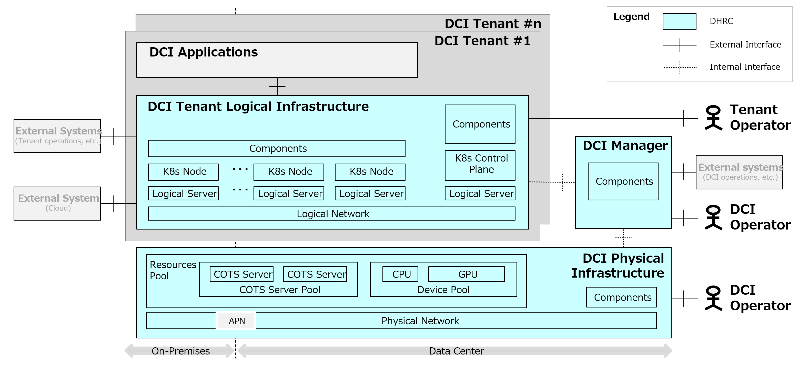

[Japanese](./README_ja.md) / [English](./README.md)

# DHRC: Dynamic Hardware Resource Control

DHRC is open-source software designed to flexibly and efficiently manage and control distributed computing resources. It is designed as a core component of DCI (Data-Centric Infrastructure), a next-generation architecture that delivers the low power consumption, low latency, and high flexibility required in the IOWN era.

# DCI: Data-Centric Infrastructure

DCI aims to address the following challenges:
* Increasing power consumption: Reduce the power load caused by large-scale data processing, such as AI
* Declining cost-effectiveness: Reducing capital and operational costs through optimized hardware configurations
* Lack of flexibility: Supporting rapid configuration changes and service development tailored to customer needs

For more detailed information on DCI, please refer to the following resources.

Reference Link: [Data-centric Infrastructure for Enabling Practical Use of IOWN](https://ntt-review.jp/archive/ntttechnical.php?contents=ntr202507fa4.html)

# Targeted Value Propositions

We aim to deliver the following four values:
1. Effective use of accelerators: Efficiently utilize GPUs and dedicated hardware to meet performance requirements
2. Optimization of hardware configurations: Leverage CDI (Composable Disaggregated Infrastructure) technology to flexibly adjust configurations based on needs
3. Optimization of application deployment: Achieve optimal resource allocation through scheduling
4. Simplified Application Development: Standardize Kubernetes-based application execution environments to support rapid service development and operations

# Key Features
|Feature|Description|
|:--|:--|
|Resource Pool Management|Flexibly configures servers with appropriate accelerators from the hardware resource pool based on requests from the cluster management function​|
|Cluster Management|Builds clusters where multiple tenants can run applications independently, and dynamically adjusts cluster configurations based on scale​|
|Scheduler Function|Controls the deployment and deletion of applications, as well as the allocation of hardware resources to applications|
|Communication Management Function|Provides information necessary for inter-application communication and manages CPU-independent data transfer between applications via RDMA|

# DHRC Architecture
DHRC consists of three components: the DCI Manager, the DCI Physical Infrastructure, and the DCI Tenant Logical Infrastructure.

|Element|Description|Main Functions|
|:--|:--|:--|
|DCI Manager|Core component for integrated management of DCI physical infrastructure and DCI tenant logical infrastructure| <ul><li> DCI tenant logical infrastructure deployment </li> <li> Resource management (Logical servers, physical servers, cards, network devices, and image management for controllers and applications) </li> <li> System-wide metrics/log collection, fault detection, notification, and incident response </li> <li> System-wide backup, recovery management, and maintenance </li></ul> |
|DCI Physical Infrastructure|Physical infrastructure consisting of resource pools (COTS servers, CDI devices, physical network) and management controllers|  <ul> <li> Physical resource management, resource provisioning, and return </li> <li>  Physical infrastructure metrics/log collection </li> <li> Physical infrastructure backup, recovery management, and maintenance </li> </ul> |
|DCI Tenant Logical Infrastructure|Provides the execution environment for DCI applications and logical management functions shared across tenants| <ul> <li> Provisioning of DCI application execution environments (Pod management, connectivity, and monitoring) </li> <li> Tenant management (User Management, Policy Management) </li> <li> Metrics/Log Collection, Monitoring Infrastructure, Fault Detection, Notification, and Troubleshooting for Tenants and Applications </li> <li> Tenant Resource Scaling </li> <li> Tenant Backup, Recovery Management, and Maintenance </li> </ul> |
|DCI Applications|Applications built and operated by tenant administrators (outside DHRC)||

# Repositories

|Repository|Description|
|:--|:--|
|dci_common  (This repository)|This is the main DHRC repository. It references the sub-repositories for each component that makes up DHRC, and stores manuals, scripts, and stub code serving as examples of interface implementations necessary for building and operating DHRC.|
|dci_manager|Stores code for the DCI Manager. For example, it contains custom provider functions for ClusterAPI, resource pool management functions, a configuration management database, deployment scripts for components, and files for external OSS. |
|dci_physical_infrastructure|Stores code for the DCI physical infrastructure. For example, it contains MAAS management functions, CDI management functions, network device management functions, and files for external OSS. |
|dci_tenant_infrastructure|Stores code for the DCI tenant logical infrastructure. Examples include connectivity features between DCI applications, monitoring infrastructure, resource scaling features, and files for external OSS. |

# License

Apache License 2.0
