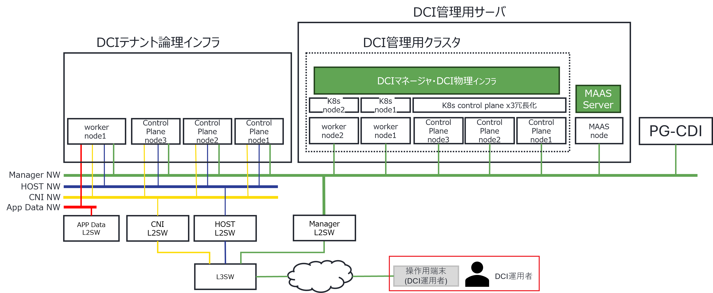
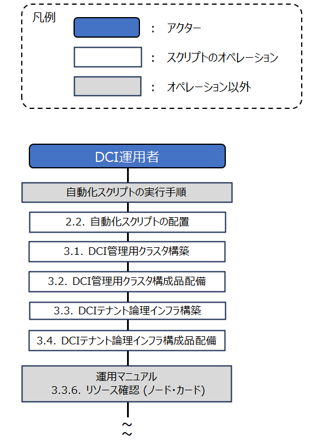
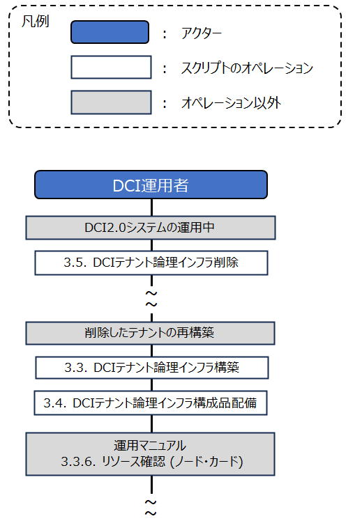
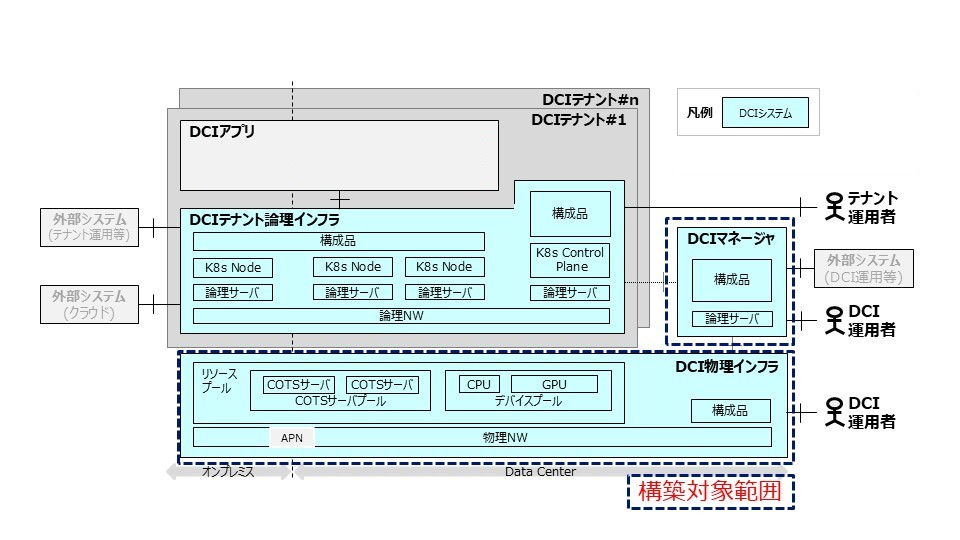
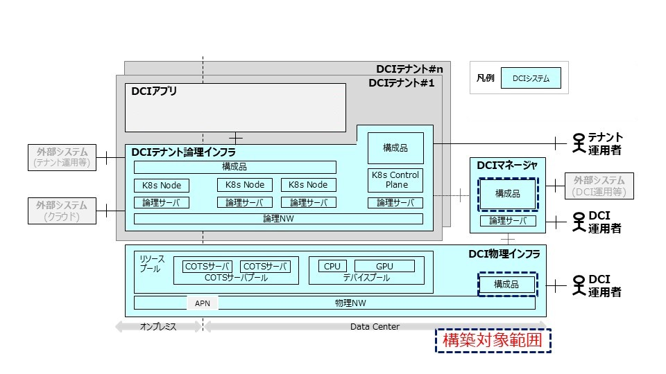
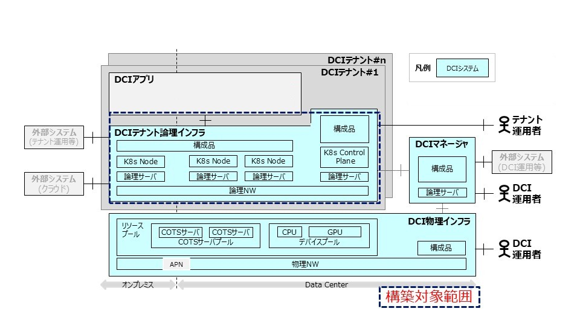
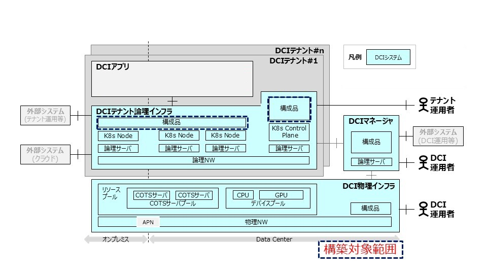

= 自動化スクリプトマニュアル
:toc: macro
:toclevels: 4
:sectnums:
:sectnumlevels: 4
:xrefstyle: short
:workdir: (2.2.で作成した作業ディレクトリ)

第1.0版

2026/11/05

NTT株式会社

[width="100%",cols="9%,13%,13%,13%,38%,19%",]
|===
|版数 |改版日 |担当 |承認 |変更内容 |変更箇所
|1.0 |2026/11/05 |1Finity)中村(亘)、重留、北田 |1Finity)田村 |初版作成 |
|===

toc::[]

== はじめに

本自動化スクリプトは、「DCI-2.0 構築マニュアル」「DCI-2.0 運用マニュアル」の一部の手順を自動化することで、
システム構築時間の大幅削減、オペレーションミスの低減が可能となるもので、本書は自動化スクリプトの配備手順、
スクリプトの構成、設定方法、実行手順、および実行結果の確認手順について説明するものです。

各マニュアルの自動化スクリプトの対象は以下となります。

* DCI-2.0 構築マニュアル
** 3.3 DCI管理用クラスタの構築
** 3.4 DCIマネージャおよびDCI物理インフラ配備の事前準備
** 3.5 DCIマネージャ配備
** 3.6 DCI物理インフラの配備
** 3.7 DCI管理用クラスタへの構成品配備
* DCI-2.0 運用マニュアル
** 3.3.2 DCIテナント論理インフラ構築
** 3.3.4 構築後セットアップ
// TODO: 構築マニュアルがFixされたら章番号を確認・更新すること
// （2026/06/24時点の章番号。参照元ブランチ: feature/issue862_update_manuals_for_RV_at_the_end_of_May の最新）

なお、本書を読むにあたっては、Linuxおよび Kubernetesに関する基本的な知識が必要となりますので、ご了承ください。

=== 前提条件
自動化スクリプトは、DCI運用者が操作端末上で実行することを前提としています。以下の図に示す（図中の赤枠）。

==== 操作端末の要件

本スクリプトを実行する操作端末は、以下の要件を満たす必要があります。

. Ansible 2.14.18以上がインストール済みであること
+
[source,console]
----
# インストールコマンド
python3 -m pip install --upgrade pip
python3 -m pip install ansible-core==2.14.18

# インストール確認
ansible --version
----
. 構築対象のDCI管理用サーバに対しSSH接続が可能であること
+
[source,console]
----
# 例: ユーザー名が admin、接続先IPアドレスが 192.168.1.1 の場合
ssh admin@192.168.1.1
----
. SSH鍵認証が設定済みであること
+
[source,console]
----
# 例: SSH鍵ペアを未作成の場合は以下で生成する
ssh-keygen -t ed25519 -f ~/.ssh/id_ed25519

# 例: 生成した公開鍵を接続先ノードへ登録する（192.168.1.1 の場合）
ssh-copy-id admin@192.168.1.1
----
. sudoをパスワードなしで実行できる権限が設定済みであること
+
[source,console]
----
sudo visudo
# 以下の行のコメント（#）を外す
%wheel        ALL=(ALL)       NOPASSWD: ALL
----

. Gitがインストールされていること
+
[source,console]
----
# Gitのインストール確認
git --version

# インストールされていない場合（RHEL/CentOSの例）
sudo yum install -y git
----

==== DCI管理用サーバの要件

. 構築マニュアルに記載されたOSがインストール済みであること
+
// TODO: 構築マニュアルがFixされたら章番号を確認・更新すること
// （2026/06/24時点の章番号。参照元ブランチ: feature/issue862_update_manuals_for_RV_at_the_end_of_May の最新）
「DCI-2.0 構築マニュアル」の「3.2.1. OSインストールと初期設定」に記載のOSがインストールされていることを確認する。
+
[source,console]
----
$ cat /etc/redhat-release
Red Hat Enterprise Linux release 9.6 (Plow)
----
. RHELのサブスクリプションが登録済みであること
+
[source,console]
----
$ rhc status
Connection status for mgr-cp-1:

● Connected to Red Hat Subscription Management
● Not connected to Red Hat Insights
● The Remote Host Configuration daemon is active

Manage your connected systems: https://red.ht/connector
----
. sudoをパスワードなしで実行できる権限が設定済みであること
+
[source,console]
----
sudo visudo
# 以下の行のコメント（#）を外す
%wheel        ALL=(ALL)       NOPASSWD: ALL
----

IMPORTANT: すべての要件が満たされていない場合、スクリプト実行時にエラーが発生します。

=== 注意事項、制限事項

本スクリプト使用時の注意事項について説明します。

WARNING: 各スクリプトは管理者権限を必要とします。テスト環境以外での使用においては、関係者と合意の上実行してください。

IMPORTANT: 各スクリプトは決められた実行順序で実行してください。順序を間違えた場合、エラーや動作不良の原因となることがあります。

== 自動化スクリプト使用方法

本章では、各自動化スクリプトの配備手順、スクリプトの構成について説明します。

=== 自動化スクリプト実行の流れ

自動化スクリプトで実施する作業の全体の流れを示します。
作業の目的に応じて「システム初期構築の流れ」または「DCIテナント論理インフラ削除の流れ」を参照してください。

==== システム初期構築の流れ

システムの初期構築に使用するスクリプトは以下の4種類があり、主に2つの場合に利用されます。

. DCI管理用クラスタ初期構築
* DCI管理用クラスタの構築スクリプト
* DCI管理用クラスタへの構成品配備スクリプト
. テナント初期構築
* DCIテナント論理インフラ構築スクリプト
* DCIテナント論理インフラへの構成品配備スクリプト

自動化スクリプトの作業全体の流れを以下の図に示します。
これらの作業を上から順に実施することで、DCI-2.0システムの環境を段階的に構築できます。
図中の数字が各章番号を示し、各章で具体的なスクリプトの作業手順を説明します。

==== DCIテナント論理インフラ削除の流れ

構築済みのDCIテナント論理インフラを削除する場合は以下のスクリプトを使用します。

* DCIテナント論理インフラ削除スクリプト

テナントの削除作業の流れを以下の図に示します。
図中の数字が章番号を示し、詳細手順は対応する章を参照してください。

=== 自動化スクリプトの配置

. 操作端末上で作業用の空のディレクトリを作成
+
[source,console,subs="attributes+"]
----
mkdir /pass/to/work
----
+
NOTE: 上記はディレクトリ作成の例です。 +
 `/pass/to/work` の部分は任意のパスを指定することが可能です。（例: `mkdir /tmp/dci_work`）。

. 作成したディレクトリに移動
+
[source,console,subs="attributes+"]
----
cd /pass/to/work
----

. GitHubリポジトリからスクリプトをクローン（developブランチ）
+
[source,console]
----
git clone -b develop https://github.com/openkasugai/dci_common.git
----

. クローンされたディレクトリを確認
+
[source,console]
----
cd dci_common/script
ls -l
----
+
以下のディレクトリが配置されていることを確認：
+
* manager_cluster_setup/
* manager_software_deploy/
* tenant_provisioning/
* tenant_deploy/
* tenant_delete/
* support_tools/

NOTE: スクリプトは任意のディレクトリに配置可能です。以降の手順では、配置したディレクトリを作業ディレクトリとして実行してください。

=== スクリプト構成

<<_自動化スクリプトの配備,2.2 自動化スクリプトの配備>>により作業ディレクトリに以下の5つの自動化スクリプトと、
サポートツール群が配置配備されます。以下に各スクリプトの機能概要を示します。

[cols="^5,22,72",options="header,striped"]
|===
|# |スクリプト |説明

|1
|manager_cluster_setup/
|管理用K8sクラスタの構築。Kubernetes、CRI-O、Calicoなどのインストール・設定を自動化

|2
|manager_software_deploy/
|DCI管理用クラスタへの構成品配備。Harbor、CNPG、Cluster API、監視スタックなどをインストール

|3
|tenant_provisioning/
|DCIテナント論理インフラの構築。Cluster APIを使用して自動プロビジョニング

|4
|tenant_deploy/
|DCIテナント論理インフラへの構成品配備とアクセス設定。テナント運用者用kubeconfigを生成

|5
|tenant_delete/
|DCIテナント論理インフラの解体と解体後作業。K8sリソース・Harbor証明書・CoreDNS・Harbor Replicationを削除

|6
|support_tools/
|事前準備ツール（pre_setup_tools）、診断ツール（diagnosis）、MinIOバケット管理ツール（minio_bucket_management）を含む
|===

==== manager_cluster_setup

DCI管理用クラスタ構築用スクリプト群

[source]
----
manager_cluster_setup/
├── manager_cluster_setup.sh
└── ansible/
    └── inventory/
        ├── hosts
        ├── group_vars/
        └── host_vars/
----

manager_cluster_setup.sh::
DCI管理用クラスタを自動構築するメインスクリプト

ansible/inventory/::
Ansible インベントリ設定ディレクトリ
+
hosts:::
ノード一覧を定義するインベントリファイル
+
group_vars/:::
グループ変数を格納するディレクトリ
+
host_vars/:::
ホスト固有の変数を格納するディレクトリ

==== manager_software_deploy

DCI管理用クラスタへの構成品配備用スクリプト群

[source]
----
manager_software_deploy/
├── manager_software_deploy.sh
└── ansible/
    └── inventory/
        ├── hosts
        └── group_vars/
----

manager_software_deploy.sh::
DCI管理用クラスタへ構成品を配備するメインスクリプト

ansible/inventory/::
Ansible インベントリ設定ディレクトリ
+
hosts:::
ノード一覧を定義するインベントリファイル
+
group_vars/:::
グループ変数を格納するディレクトリ

==== tenant_provisioning

DCIテナント論理インフラ構築用スクリプト群

[source]
----
tenant_provisioning/
├── tenant_provisioning.sh
└── ansible/
    └── inventory/
        ├── hosts
        └── group_vars/
----

tenant_provisioning.sh::
DCIテナント論理インフラを構築するメインスクリプト

ansible/inventory/::
Ansible インベントリ設定ディレクトリ
+
hosts:::
ノード一覧を定義するインベントリファイル
+
group_vars/:::
グループ変数を格納するディレクトリ

==== tenant_deploy

DCIテナント論理インフラへの構成品配備用スクリプト群

[source]
----
tenant_deploy/
├── tenant_deploy.sh
└── ansible/
    └── inventory/
        ├── hosts
        └── group_vars/
----

tenant_deploy.sh::
DCIテナント論理インフラへ構成品を配備するメインスクリプト

ansible/inventory/::
Ansible インベントリ設定ディレクトリ
+
hosts:::
ノード一覧を定義するインベントリファイル
+
group_vars/:::
グループ変数を格納するディレクトリ

==== tenant_delete

DCIテナント論理インフラ解体用スクリプト群

[source]
----
tenant_delete/
├── tenant_delete.sh
└── ansible/
    └── inventory/
        ├── hosts
        └── group_vars/
----

tenant_delete.sh::
DCIテナント論理インフラ解体処理を自動実行するメインスクリプト

ansible/inventory/::
Ansible インベントリ設定ディレクトリ
+
hosts:::
ノード一覧を定義するインベントリファイル（冗長構成時は全台記述）
+
group_vars/:::
グループ変数を格納するディレクトリ

==== support_tools

サポートツール群

===== pre_setup_tools

事前準備用ツール群

[source]
----
pre_setup_tools/
├── data_collect_tools/
│   ├── nodes.csv
│   ├── switch.csv
│   ├── cdi.csv
│   └── make_all.sh
├── configuration_management_database/
│   ├── config.yaml
│   └── main_tmp.go
└── dci_tenant_infra_chart/
    └── values.yaml
----

data_collect_tools/::
インフラ情報自動収集ツール。MAASおよびCDI機器からハードウェア情報を収集し、構成管理DB登録ツール（`configuration_management_database`）のインプットとなる `config.yaml` を自動生成する +
本ツールは **MAASサーバ上** で実行する。
+
nodes.csv:::
MAASに登録するノード情報（ホスト名・MAC・IPMI情報等）を記述する設定ファイル
+
switch.csv:::
ネットワークスイッチ情報（名前・拠点・IP・ポート範囲・タイプ）を記述する設定ファイル
+
cdi.csv:::
CDI機器の接続情報を記述する設定ファイル
+
make_all.sh:::
3つのCSVファイルを読み込み、MAASコミッション・ハードウェア情報収集・CDI情報取得を順に実行して `config.yaml` を生成するメインスクリプト

configuration_management_database/::
構成管理DB登録用スクリプト生成ツール
+
config.yaml:::
構成管理DB登録用スクリプト設定ファイル（`data_collect_tools` で自動生成、または手動で編集）
+
main_tmp.go:::
構成管理DB登録用スクリプト生成ツール本体

dci_tenant_infra_chart/::
DCIテナント論理インフラ構築用yaml生成ツール
+
values.yaml:::
DCIテナント論理インフラ構築用yaml生成ツール設定ファイル

===== minio_bucket_management

MinIOバケット管理ツール群 +
Loki/VeleroバケットをAnsible SSH経由で作成・削除するツールです。

[source]
----
minio_bucket_management/
├── minio_bucket_management.sh
├── inventory.ini
├── vars.yaml
├── minio_bucket_create.yaml
└── minio_bucket_delete.yaml
----

minio_bucket_management.sh::
バケット作成・削除を実行するメインスクリプト（引数: `create` / `delete`）

inventory.ini::
MinIOサーバのインベントリファイル

vars.yaml::
MinIO接続設定、MinIO認証情報と作成・削除対象バケット名リスト

minio_bucket_create.yaml::
バケット作成Playbook

minio_bucket_delete.yaml::
バケット削除Playbook

===== nfs_pv_cleanup

NFS PVクリーンアップツール群 +
削除したテナントのPVで使用されていたNFSサーバ上のデータをAnsible SSH経由で削除するツールです。 +
`tenant_delete.sh` 実行前のステップ0として実行してください。

[source]
----
nfs_pv_cleanup/
├── nfs_pv_cleanup.sh
├── inventory.ini
├── vars.yaml
└── nfs_pv_cleanup.yaml
----

nfs_pv_cleanup.sh::
NFSサーバ上のテナントPVデータ削除を実行するメインスクリプト

inventory.ini::
NFSサーバのインベントリファイル

vars.yaml::
削除対象テナントのnamespaceとNFSサーバエクスポートパスを定義する設定ファイル

nfs_pv_cleanup.yaml::
各テナントのNFSエクスポートパス配下のデータを削除するPlaybook

===== diagnosis

診断ツール群

[source]
----
diagnosis/
├── diagnosis.sh
└── overall_diagnosis.sh
----

diagnosis.sh::
診断スクリプト

overall_diagnosis.sh::
一括診断実行スクリプト

<<<

<<<

== 自動化スクリプトの実行

=== DCI管理用クラスタ構築

本節ではDCI管理用クラスタの初期構築を自動化します。
Kubernetes、CRI-O、Calicoのインストールから、
Control Plane/Workerノードの参加（kubeadm join）までをカバーします。

// TODO: 構築マニュアルがFixされたら以下の章番号を確認・更新すること
// （2026/06/24時点の章番号。参照元ブランチ: feature/issue862_update_manuals_for_RV_at_the_end_of_May の最新）
本スクリプトがカバーする「DCI-2.0 構築マニュアル」の手順は以下のとおりです。

* 3.3. DCI管理用クラスタの構築
** 3.3.1. K8sのインストール
** 3.3.2. CRI-Oのインストール
** 3.3.3. CRI-O設定
** 3.3.4. K8sクラスタ構築事前準備
** 3.3.5. K8sクラスタ構築
** 3.3.6. K8sクラスタ構築確認

==== 構築範囲

==== スクリプト設定ファイルの作成

`manager_cluster_setup/ansible/inventory` 配下の設定ファイルを、実環境に合わせて編集する手順を示します。  
設定は次の順序で実施してください。

. 対象ディレクトリへ移動
+
[source,console,subs="attributes+"]
----
cd {workdir}/dci_common/script/manager_cluster_setup
----

. 編集対象ファイルを確認
+
[source,console]
----
ls -l ansible/inventory
find ansible/inventory/host_vars -maxdepth 2 -name vars.yaml
----

編集対象は以下です。

* `ansible/inventory/hosts`
* `ansible/inventory/group_vars/all/vars.yaml`
* `ansible/inventory/group_vars/dci_mgmt_k8s_control_plane/vars.yaml`
* `ansible/inventory/host_vars/<ホスト名>/vars.yaml`

[discrete]
====== 1. hosts の設定（ノード定義）

`ansible/inventory/hosts` で、Control Plane ノード群と Worker ノード群を定義します。  
構文は「`<inventory名> ansible_host=<接続先IP> ansible_user=<SSHユーザー>`」です。

[source,ini]
----
[dci_mgmt_k8s_control_plane]
# DCI管理用クラスタのK8s Control Plane
mgr-cp-1 ansible_host=192.168.1.1 ansible_user=admin
mgr-cp-2 ansible_host=192.168.1.2 ansible_user=admin
mgr-cp-3 ansible_host=192.168.1.3 ansible_user=admin

[dci_mgmt_k8s_node]
# DCI管理用クラスタのK8s node
mgr-wk-1 ansible_host=192.168.1.4 ansible_user=admin
mgr-wk-2 ansible_host=192.168.1.5 ansible_user=admin
----

設定時の注意点：

* `mgr-cp-1`（Control Plane グループ先頭）はクラスタ初期化対象として使用されます。
* `mgr-cp-2` 以降は追加 Control Plane 参加対象として使用されます。
* `dci_mgmt_k8s_node` は Worker 参加対象です。
* `ansible_user` は各ノードでSSHログイン可能かつ sudo 実行可能なユーザーを指定してください。
* ホスト名（`mgr-cp-1` など）は、後述の `host_vars/<ホスト名>/vars.yaml` のディレクトリ名と一致させてください。

NOTE: Control Plane 1台構成でも動作しますが、HA構成とする場合は3台以上を推奨します。

[discrete]
====== 2. group_vars/all/vars.yaml の設定（バージョン・ネットワーク）

`ansible/inventory/group_vars/all/vars.yaml` で導入バージョンおよびネットワーク設定を行います。

[source,yaml]
----
# Kubernetes
k8s_version_major: 1.34
k8s_version_minor: 2

# CRI-O
crio_version_major: 1.34
crio_version_minor: 2

# Calico
calico_version_major: 3.29
calico_version_minor: 2

# kube-vipアドレス設定
kube_vip_address: 172.28.161.30   # kube-vipのIPアドレス

# k8sクラスタネットワーク設定
pod_subnet: 172.17.10.0/24        # PodネットワークのCIDR
service_subnet: 172.17.20.0/24    # ServiceネットワークのCIDR

# プロキシ設定（外部通信にプロキシが必要な場合のみ設定）
proxy_setup_enabled: false
proxy_url: "http://192.168.1.1:8080/"   # プロキシURL（例: "http://192.168.1.1:8080/"）
----

設定時の注意点：

* `k8s_version_major` と `crio_version_major` は同一系列に合わせてください。
* `*_minor` は実在する配布バージョンを指定してください。
* `kube_vip_address` は同一L2セグメント内で未使用のIPを指定してください。
* `pod_subnet` と `service_subnet` は、既存ネットワークや他クラスタと重複しないCIDRを指定してください。
* 外部通信にプロキシが不要な場合は `proxy_setup_enabled: false` のままにしてください。プロキシが必要な場合のみ `proxy_setup_enabled: true` にして `proxy_url` を実環境の値に変更してください。
* 同ファイル内の `ansible_work_dir`、リポジトリURL、パッケージ名は内部参照されるため、要件がない限り変更しないでください。

[discrete]
====== 3. group_vars/dci_mgmt_k8s_control_plane/vars.yaml の設定（NIC・CRI設定）

`ansible/inventory/group_vars/dci_mgmt_k8s_control_plane/vars.yaml` で、CalicoのNIC検出方法およびkube-vipのインターフェース・ CIDRを設定します。

[source,yaml]
----
# CalicoのNIC自動検出方法
calico_autodetect_method: "kubernetes-internal-ip"

# kube-vip
kube_vip_interface: eth1
kube_vip_cidr: 24

# k8sクラスタ設定
cri_socket: unix:///var/run/crio/crio.sock
----

設定時の注意点：

* `kube_vip_interface` は Control Plane 全ノードで共通に存在するNIC名を指定してください。
* `kube_vip_cidr` は `kube_vip_address`（`all/vars.yaml`設定）のネットワークに合わせて指定してください。
* 複数NIC環境で内部IP選択が期待通りにならない場合は、`calico_autodetect_method: interface=<CNI用NIC名>` の形式で明示指定してください。

[discrete]
====== 4. host_vars/<ホスト名>/vars.yaml の設定（ホスト固有）

各ノードの `ansible/inventory/host_vars/<ホスト名>/vars.yaml` で `cni_address` を設定します。

[source,yaml]
----
# 例: ansible/inventory/host_vars/mgr-cp-1/vars.yaml
cni_address: 198.51.100.1
----

設定時の注意点：

* すべての対象ノード（Control Plane/Worker）で `cni_address` を設定してください。
* `cni_address` はノードごとに一意である必要があります。
* `cni_address` は、セクション3 で `calico_autodetect_method: interface=<CNI用NIC名>` として指定した CNI 用NIC と同じサブネットに属するIPアドレスを指定してください。
+
（例: CNI 用NICが `198.51.100.0/26` に所属する場合、`cni_address` は `198.51.100.x` の範囲で指定）
* `host_vars` のディレクトリ名は `hosts` の inventory 名と一致させてください。

[discrete]
====== 5. 設定反映前チェック

以下の観点を実行前に確認してください。

* `hosts` に定義した全ノードへ SSH鍵認証で接続可能であること
+
[source,console]
----
（コマンド例）
$ ansible -i ansible/inventory/hosts all -m ping
mgr-cp-1 | SUCCESS => { "ping": "pong" }
mgr-cp-2 | SUCCESS => { "ping": "pong" }
...
----
NOTE: `pong` が返らないノードがある場合は、Playbook実行前にSSH設定・sudo設定・ファイアウォール設定を見直してください。

* `ansible_user` で `sudo` がパスワード不要で実行できること
+
[source,console]
----
（コマンド例）
$ ansible -i ansible/inventory/hosts all -b -m command -a "whoami"
mgr-cp-1 | CHANGED | rc=0 >>
root
mgr-cp-2 | CHANGED | rc=0 >>
root
...
----
* `kube_vip_address`、`pod_subnet`、`service_subnet`、`cni_address` に重複がないこと
+
[source,console]
----
（コマンド例）
$ grep -r "kube_vip_address\|pod_subnet\|service_subnet\|cni_address" ansible/inventory/group_vars/ ansible/inventory/host_vars/
----

==== スクリプト実行手順

. スクリプト実行
+
[source,console,subs="attributes+"]
----
cd {workdir}/dci_common/script/manager_cluster_setup
bash manager_cluster_setup.sh
----
+
[source,console]
----
（コマンド例）
$ bash manager_cluster_setup.sh
+ set -e
++ dirname manager_cluster_setup.sh
+ CURRENT_DIR=.
+ INVENTORY=./ansible/inventory/hosts
...
(中略)
...
+ echo '[SUCCESS] 全Playbook実行が完了しました'
[SUCCESS] 全Playbook実行が完了しました
----

. 実行ログの確認
+
[source,console,subs="attributes+"]
----
cd {workdir}/dci_common/script/manager_cluster_setup

# 最新の実行ログディレクトリを確認
ls -1dt ansible/logs/*_manager_cluster_setup | head -1
# → 出力されたディレクトリ名を以降の YYYYMMDD_HHMMSS 部分に置き換えて使用してください
tail -f ansible/logs/YYYYMMDD_HHMMSS_manager_cluster_setup/01-pre_setup_proxy.log

# 例: クラスタ初期化ログを確認（完了後に確認する場合）
view ansible/logs/YYYYMMDD_HHMMSS_manager_cluster_setup/07-k8s_cluster_init.log
----

. スクリプト実行後の手動確認
+
NOTE: 以下のコマンドは、自動化スクリプトを実行した操作端末上ではなく、*構築ターゲットであるDCI管理用クラスタのK8s Control Plane* 上にSSHでログインした後に実行してください。 +
（例: `ssh <ユーザー名>@<K8s Control PlaneのIPアドレス>`）
+
[source,console]
----
kubectl get nodes
kubectl get pods -A
kubectl cluster-info
----
+
[source,console]
----
（コマンド例）
$ kubectl get nodes
NAME         STATUS   ROLES           AGE   VERSION
mgr-cp-1     Ready    control-plane   10m   v1.32.2
mgr-cp-2     Ready    control-plane   8m    v1.32.2
mgr-wk-1     Ready    <none>          5m    v1.32.2

$ kubectl get pods -A
NAMESPACE                           NAME                                                              READY   STATUS    RESTARTS       AGE
NAMESPACE     NAME                                       READY   STATUS    RESTARTS   AGE
kube-system   calico-kube-controllers-xxxxx-xxxxx        1/1     Running   0          3m6s
kube-system   calico-node-xxxxx                          1/1     Running   0          2m20s
kube-system   calico-node-xxxxx                          1/1     Running   0          3m6s
kube-system   calico-node-xxxxx                          1/1     Running   0          2m27s
...
(中略)
...
kube-system   kube-vip-mgr-cp-2                          1/1     Running   0          2m30s
kube-system   kube-vip-mgr-cp-3                          1/1     Running   0          2m26s

$ kubectl cluster-info
Kubernetes control plane is running at https://192.168.2.30:6443
CoreDNS is running at https://192.168.2.30:6443/api/v1/namespaces/kube-system/services/kube-dns:dns/proxy

To further debug and diagnose cluster problems, use 'kubectl cluster-info dump'.
----

NOTE: 実行途中で失敗した場合は設定を修正後、`manager_cluster_setup.sh` を再実行してください。

==== スクリプト実行結果の確認

`support_tools/diagnosis` を使用して、manager_cluster_setup の実行結果を診断します。

. 診断ツールを実行
+
[source,console,subs="attributes+"]
----
cd {workdir}/dci_common/script/support_tools/diagnosis
./diagnosis.sh manager_cluster_setup --script-root {workdir}/dci_common/script
----
+
[source,console,subs="attributes+"]
----
（コマンド例）
$ ./diagnosis.sh manager_cluster_setup --script-root {workdir}/dci_common/script
==============================================
DCI診断ツール
==============================================
スクリプト名        : manager_cluster_setup
ログディレクトリ    : {workdir}/dci_common/script/manager_cluster_setup/ansible/logs/manager_cluster_setup_logdirectory
インベントリパス    : {workdir}/dci_common/script/manager_cluster_setup/ansible/inventory/hosts
出力ディレクトリ    : {workdir}/dci_common/script/support_tools/diagnosis/common/../diagnosis_reports/diagnosis_reports_logdirectory
ログレベル          : INFO
タイムアウト        : 900秒
==============================================

2026-05-20 10:46:39,035 - __main__ - INFO - Initializing diagnosis engine...
2026-05-20 10:46:39,035 - __main__ - INFO - Validating prerequisites...
...
(中略)
...
[SUCCESS] 終了コード0: 診断が正常に完了しました

==============================================
✅ 診断が正常に完了しました - リソース状態の問題は見つかりませんでした
==============================================
結果:
  - サマリーレポート : {workdir}/dci_common/script/support_tools/diagnosis/common/../diagnosis_reports/diagnosis_reports_logdirectory/summary.md
  - コンソールログ    : {workdir}/dci_common/script/support_tools/diagnosis/common/../diagnosis_reports/diagnosis_reports_logdirectory/diagnosis_console.log
==============================================
----

. 特定ログを指定して診断する場合
+
[source,console,subs="attributes+"]
----
./diagnosis.sh manager_cluster_setup \
  --script-root {workdir}/dci_common/script \
  --log-dir-name YYYYMMDD_HHMMSS
----

. 診断結果の確認
+
[source,console]
----
cat diagnosis_reports/*_manager_cluster_setup/summary.md
cat diagnosis_reports/*_manager_cluster_setup/diagnosis_console.log
----

終了コードの目安：

* `0`: 問題なし
* `1`: 診断ツールエラー
* `2`: 重大な問題を検出
* `3`: 警告を検出

<<<

<<<

=== DCI管理用クラスタへの構成品配備

本節では、DCI管理用クラスタに必要なコンポーネントを配備します。
Harbor、CNPG PostgreSQL、Cluster API、監視スタック、物理インフラ管理など、
多岐に渡る構成品の自動インストール・設定を実行します。

// TODO: 構築マニュアルがFixされたら以下の章番号を確認・更新すること
// （2026/06/24時点の章番号。参照元ブランチ: feature/issue862_update_manuals_for_RV_at_the_end_of_May の最新）
本スクリプトがカバーする「DCI-2.0 構築マニュアル」の手順は以下のとおりです。

* 3.4. DCIマネージャおよびDCI物理インフラ配備の事前準備
** 3.4.2. プロキシの設定（外部通信にプロキシが必要な場合のみ）@control plane※, @k8s node
** 3.4.3. helmのインストール @control plane※
** 3.4.4. velero CLIのインストール @control plane※
** 3.4.5. git、buildah、go、yqのインストール @control plane※, @k8s node
** 3.4.6. NTPサーバの設定 @control plane※, @k8s node
* 3.5. DCIマネージャ配備
* 3.6. DCI物理インフラの配備 @control plane
* 3.7. 管理用クラスタへの構成品配備
* 3.8. DCI管理用クラスタのシステム正常動作確認 @control plane
* 4.2. 構成管理DBへのリソース情報の登録 @control plane
** 4.2.1. 構成管理DBへの登録

==== 構築範囲

==== インフラ情報の自動収集

本節では、`pre_setup_tools/data_collect_tools` ツールを使用して、MAASサーバおよびCDI機器からインフラのハードウェア情報を自動収集し、
構成管理DB登録ツールのインプットとなる `config.yaml` を生成します。

ツールを実行すると、`pre_setup_tools/data_collect_tools/config.yaml` が生成されます。
このファイルを `pre_setup_tools/configuration_management_database/config.yaml` にコピーして使用します。

NOTE: 手動で `config.yaml` を作成する場合は、本節をスキップして次節「構成管理DB登録用スクリプトの作成」に進み、`config.yaml` を直接編集してください。

IMPORTANT: 本ツールは **MAASサーバ上** で実行してください。操作端末からは実行できません。

[discrete]
===== 前提条件

* MAASサーバに `maas`・`jq`・`sshpass` コマンドがインストールされていること
* 各対象ノードに `lldpd`（`lldpctl`）・`lspci`・`ethtool` がインストールされていること
* MAASサーバの SSH 公開鍵が MAAS GUI に登録されていること

[discrete]
===== 手順

. MAASサーバ上でスクリプトを配置したディレクトリへ移動
+
[source,console,subs="attributes+"]
----
cd {workdir}/dci_common/script/support_tools/pre_setup_tools/data_collect_tools
----

. `nodes.csv` を環境に合わせて編集
+
[source]
----
HOSTNAME,MAC,IPMI_ADDR,IPMI_USER,IPMI_PASS,SERVER_TYPE,SERVER_ROLE,DEPLOYMENT_TYPE
d1-m01-cots-worker01,aa:bb:cc:dd:ee:ff,172.28.160.59,testuser,xxxx,COTS,1,1
d1-m01-cots-compute01,aa:bb:cc:dd:ee:ff,172.28.160.202,testuser,xxxx,COMPUTE,,
----
+
[cols="2,5",options="header"]
|===
|フィールド |説明
|`HOSTNAME` |サーバのホスト名
|`MAC` |マネージャ用NICのMACアドレス
|`IPMI_ADDR` |BMC（IPMI）のIPアドレス
|`IPMI_USER` |BMC（IPMI）のユーザ名
|`IPMI_PASS` |BMC（IPMI）のパスワード
|`SERVER_TYPE` |サーバの種別。`COTS` または `COMPUTE`
|`SERVER_ROLE` |`COTS` の場合に指定。`0`：K8S ControlPlane、`1`：K8S Node
|`DEPLOYMENT_TYPE` |`COTS` の場合に指定。`0`：VMホスト、`1`：ベアメタル
|===

. `switch.csv` を環境に合わせて編集
+
[source]
----
NW_SWITCH_NAME,LOCATION,NW_IP_ADDR,NW_USER,VENDOR,PRODUCT_NAME,OS,PORT_START,PORT_END,TYPE
d1-m01-l2-switch-host01,loc1.location,192.168.2.10,sw-user,edgecore networks,DCS208/AS5812-54X,Edgecore SONiC,Ethernet0,Ethernet32,host
d1-m01-l3-l2-switch-cni01,loc1.location,192.168.2.11,sw-user,edgecore networks,DCS208/AS5812-54X,Edgecore SONiC,Ethernet0,Ethernet32,cni
d1-m01-l2-switch-app01,loc2.location,192.168.2.12,sw-user,edgecore networks,DCS208/AS5812-54X,Edgecore SONiC,Ethernet0,Ethernet32,app
----
+
[cols="2,5",options="header"]
|===
|フィールド |説明
|`NW_SWITCH_NAME` |スイッチの識別名
|`LOCATION` |拠点識別子。`loc1.location`、`loc2.location` 等 `locX.location` 形式で指定
|`NW_IP_ADDR` |スイッチのIPアドレス
|`NW_USER` |スイッチへのアクセスユーザ名
|`VENDOR` |スイッチのベンダー名
|`PRODUCT_NAME` |スイッチの製品名
|`OS` |スイッチのNOS（ネットワークOS）名
|`PORT_START` |このTYPEに該当するポート範囲の開始ポート名（例: `Ethernet0`）
|`PORT_END` |このTYPEに該当するポート範囲の終了ポート名（例: `Ethernet32`）
|`TYPE` |ネットワーク役割。`host`・`cni`・`app` のいずれかを指定
|===

. `cdi.csv` を環境に合わせて編集（CDI機器を使用しない場合は空のままで可）
+
[source]
----
HOST,USER,PASS,LOCATION,CDI_VERSION,GROUP_NAME,CDI_GUEST,CDI_USER,CDI_PASSWORD,CDIMGR_GUEST_USER,CDIMGR_GUEST_PASSWORD,CDIMGR_HOST,CDIMGR_HOST_USER,CDIMGR_HOST_PASSWORD,DIRECTOR_PASSWORD,PCIE_BOX_IP
172.28.161.199,ubuntu,xxxx,dc1,2.0,group0,172.20.30.150,dhrcsystem,yyyy,fujitsu,aaaa,1.1.1.1,fujitsu,bbbb,cccc,172.20.30.160
----
+
各フィールドの詳細仕様については、`support_tools/pre_setup_tools/data_collect_tools/README.md` を参照してください。

. `make_all.sh` を実行
+
[source,console]
----
./make_all.sh
----
+
MAASコミッションをノードごとに並列で2回実行するため、完了まで **10分程度** かかります。

. `config.yaml` が生成されたことを確認
+
[source,console]
----
ls config.yaml
----

. 生成された `config.yaml` を `configuration_management_database/` にコピー
+
[source,console,subs="attributes+"]
----
cp config.yaml {workdir}/dci_common/script/support_tools/pre_setup_tools/configuration_management_database/config.yaml
----

NOTE: `config.yaml` の内容を確認し、誤った値が含まれていないかを事前にチェックしてください。

==== 構成管理DB初期登録用ファイルの作成
構成管理DB（PostgreSQL）へのリソースプール情報初期登録に使用する
Goコード（`main.go`）を `pre_setup_tools/configuration_management_database` ツールを使用して生成します。

ツールを実行すると、`pre_setup_tools/configuration_management_database` 配下に `main.go` が生成されます。このファイルを `manager_software_deploy/ansible/inventory/group_vars/all/vars.yaml` 内の変数 `db_init_file` に指定することで、自動化スクリプトの`manager_software_deploy` を実行する時にDB登録コードとして参照されます。

[discrete]
===== 手順

. 対象ディレクトリへ移動
+
[source,console,subs="attributes+"]
----
cd {workdir}/dci_common/script/support_tools/pre_setup_tools/configuration_management_database
----

. 依存関係のインストール（初回のみ）
+
[source,console]
----
go mod tidy
----

. `config.yaml` を確認・必要に応じて編集
+
前節「インフラ情報の自動収集」でコピーした `config.yaml` を使用する場合はそのまま進めてください。手動で作成する場合は、各フィールドの詳細仕様を `support_tools/pre_setup_tools/configuration_management_database/README.md` を参照して編集してください。

. `main.go` を生成
+
[source,console]
----
go run main_tmp.go > main.go
----
+
正常に終了すると、カレントディレクトリに `main.go` が生成されます。

NOTE: `config.yaml` を変更した場合は、`go run main_tmp.go > main.go` を再実行して `main.go` を再生成してください。

==== スクリプト設定ファイルの作成

`manager_software_deploy/ansible/inventory` 配下の設定ファイルを、実環境に合わせて編集する手順を示します。  
機密情報を含む `vault.yaml` は Ansible Vault で管理します。

. 対象ディレクトリへ移動
+
[source,console,subs="attributes+"]
----
cd {workdir}/dci_common/script/manager_software_deploy
----

. 編集対象ファイルを確認
+
[source,console]
----
ls -l ansible/inventory
find ansible/inventory/group_vars -maxdepth 3 -type f
----

主な編集対象：

* `ansible/inventory/hosts`
* `ansible/inventory/group_vars/all/vars.yaml`
* `ansible/inventory/group_vars/dci_mgmt_k8s_control_plane/vars.yaml`
* `ansible/inventory/group_vars/all/vault.yaml`
* `ansible/inventory/group_vars/dci_mgmt_k8s_control_plane/vault.yaml`
* `ansible/utility/db_init_main.go`

[discrete]
====== 1. hosts の設定（DCI管理用サーバ定義）

`ansible/inventory/hosts` は manager_cluster_setup と同一構成を使用します。  
コントロールプレーン先頭ホスト（`dci_mgmt_k8s_control_plane` の1台目）が多くの Playbook の実行対象になります。

[source,ini]
----
[dci_mgmt_k8s_control_plane]
mgr-cp-1 ansible_host=192.168.1.1 ansible_user=admin
mgr-cp-2 ansible_host=192.168.1.2 ansible_user=admin
mgr-cp-3 ansible_host=192.168.1.3 ansible_user=admin

[dci_mgmt_k8s_node]
mgr-wk-1 ansible_host=192.168.1.4 ansible_user=admin
mgr-wk-2 ansible_host=192.168.1.5 ansible_user=admin
----

設定時の注意点：

* すべてのノードで `ansible_user` の SSH鍵認証と sudo 権限が必要です。
* `mgr-cp-1` は Harbor/CNPG/監視など主要構成品配備の実行ノードとして使われます。

[discrete]
====== 2. group_vars/all/vars.yaml の設定（バージョン・環境）

`ansible/inventory/group_vars/all/vars.yaml` で、以下を実環境に合わせて設定します。

* OSSバージョン群（Helm/Go/cert-manager/Harbor/CNPG/Cluster API/Prometheus 等）
* DHRCバージョン群（`dci_common_version` など）
* イメージ再ビルドフラグ（`*_rebuild`）
* 環境固有パラメータ（拠点、MAAS、DNS、NFS、バックアップ、firewalld 等）

代表例：

[source,yaml]
----
db_init_file: "{{ playbook_dir }}/../support_tools/pre_setup_tools/configuration_managemento_database/main.go"

locations:
  - dc1

maas_server_ip: "172.28.161.22"

nameservers:
  - 8.8.8.8
  - 1.1.1.1

nfs_server_ip: "203.0.113.1"
nfs_server_export_path: "/export/nfs"

tenant_nfs_server_ip: "172.28.197.102"
tenant_nfs_server_export_path: "/mnt/tenant_nfs_share"
----

設定時の注意点：

* `db_init_file` には、前節「構成管理DB登録用スクリプトの作成」で生成した `main.go` のパスを指定してください。
* `dci_*_version` は存在するブランチ/タグを指定してください。
* `*_rebuild` を `true` にすると毎回ビルドされるため、作業時間とレジストリ状態を考慮してください。
* NFS/バックアップストレージのIP・パス・バケット名は環境ごとに必ず確認してください。

[discrete]
====== 3. group_vars/dci_mgmt_k8s_control_plane/vars.yaml の設定（DCI管理用クラスタのControlPlane固有）

`ansible/inventory/group_vars/dci_mgmt_k8s_control_plane/vars.yaml` で、Harbor接続・監視通知等を設定します。

[source,yaml]
----
harbor_manager_url: "{{ kube_vip_address }}"
harbor_manager_port: 30003

postgrest_db_api_hostname: db-api.local
postgrest_db_api_port: 8443

monitoring_alert_email: "alert@example.com"
grafana_smtp_enable: false
grafana_smtp_host: "smtp.example.com"
grafana_smtp_port: "25"

ipmi_exporter_enabled: false
----

設定時の注意点：

* `harbor_manager_url` は kube-vip アドレスと同値を参照します（`kube_vip_address` 変数を使用）。
* `postgrest_db_api_hostname` および `postgrest_db_api_port` は postgrestDB API の接続先を指定してください。
* メール通知を使う場合、SMTP設定と `monitoring_alert_email` を実運用値に変更してください。
* `ipmi_exporter_enabled` はIPMI Exporterの有効/無効を制御します。必要な場合は `true` に設定してください。

[discrete]
====== 4. Vault ファイル編集手順（必須）

Git clone 直後の Vault 対象ファイルは平文ですが、パスワード等の機密値はダミー値（`*****` 等）で登録されています。  
初回利用時はダミー値を実値に編集してから暗号化し、再編集時は「安全な編集方法（推奨）」を使用してください。

. Vault 対象ファイル

* `ansible/inventory/group_vars/all/vault.yaml`
* `ansible/inventory/group_vars/dci_mgmt_k8s_control_plane/vault.yaml`

. 利用開始時の手順（初回のみ）

.. 平文のダミー値（`*****` 等）を各環境の実値に編集
+
[source,console]
----
vi ansible/inventory/group_vars/all/vault.yaml
vi ansible/inventory/group_vars/dci_mgmt_k8s_control_plane/vault.yaml
----

.. Vault パスワードファイルを作成
+
[source,console]
----
echo "YOUR_VAULT_PASSWORD" > ansible/.vault_pass
chmod 600 ansible/.vault_pass
----
+
NOTE: `YOUR_VAULT_PASSWORD` は任意の文字列に置き換えてください。このパスワードは Vault ファイルの暗号化・復号に使用します。忘れると復号できなくなるため、取り扱いに注意してください。

.. 暗号化
+
[source,console]
----
ansible-vault encrypt \
  ansible/inventory/group_vars/all/vault.yaml \
  ansible/inventory/group_vars/dci_mgmt_k8s_control_plane/vault.yaml \
  --vault-password-file ansible/.vault_pass
----

. 安全な編集方法（推奨）：暗号化済みファイルを再編集する場合
+
[source,console]
----
ansible-vault edit ansible/inventory/group_vars/all/vault.yaml \
  --vault-password-file ansible/.vault_pass

ansible-vault edit ansible/inventory/group_vars/dci_mgmt_k8s_control_plane/vault.yaml \
  --vault-password-file ansible/.vault_pass
----

`all/vault.yaml` には GitHub トークン、MAAS APIキー、RHELサブスクリプション情報、MinIOパスワード等を設定します。  
`dci_mgmt_k8s_control_plane/vault.yaml` には Harbor 認証情報、物理インフラ接続情報、IPMI監視認証情報等を設定します。

[discrete]
====== 5. 設定反映前チェック

実行前に以下を確認してください。

* `pre_setup_tools/configuration_management_database/main.go` が配置済みであること
+
[source,console]
----
（コマンド例）
$ ls ../support_tools/pre_setup_tools/configuration_management_database/main.go
../support_tools/pre_setup_tools/configuration_management_database/main.go
----
* Vault ファイルが暗号化状態であること（先頭が `$ANSIBLE_VAULT;`）
+
[source,console]
----
（コマンド例）
$ head -1 ansible/inventory/group_vars/all/vault.yaml
$ANSIBLE_VAULT;1.1;AES256
----
* `ansible/.vault_pass` が存在しパーミッションが 600 であること
+
[source,console]
----
（コマンド例）
$ ls -l ansible/.vault_pass
-rw------- 1 admin admin 24 Jun  4 10:00 ansible/.vault_pass
----
* 全ノードに疎通できること
+
[source,console]
----
（コマンド例）
$ cd ansible
$ ansible -i inventory/hosts all -m ping --vault-password-file .vault_pass
mgr-cp-1 | SUCCESS => { "ping": "pong" }
mgr-cp-2 | SUCCESS => { "ping": "pong" }
...
----
NOTE: `pong` が返らないノードがある場合は、Playbook実行前にSSH設定・sudo設定・ファイアウォール設定を見直してください。

==== スクリプト実行手順

. スクリプト実行
+
[source,console,subs="attributes+"]
----
cd {workdir}/dci_common/script/manager_software_deploy
bash manager_software_deploy.sh
----
+
[source,console]
----
（コマンド例）
$ bash manager_software_deploy.sh
+ set -e
++ dirname manager_software_deploy.sh
+ CURRENT_DIR=.
+ INVENTORY=./ansible/inventory/hosts
...
(中略)
...
+ echo '[SUCCESS] 全Playbook実行が完了しました'
[SUCCESS] 全Playbook実行が完了しました
----

. 実行ログの確認
+
[source,console,subs="attributes+"]
----
cd {workdir}/dci_common/script/manager_software_deploy

# 最新の実行ログディレクトリを確認
ls -1dt ansible/logs/*_manager_software_deploy | head -1
# → 出力されたディレクトリ名を以降の YYYYMMDD_HHMMSS 部分に置き換えて使用してください
tail -f ansible/logs/YYYYMMDD_HHMMSS_manager_software_deploy/14-harbor_install.log

# 例: 監視スタック配備ログを確認（完了後に確認する場合）
view ansible/logs/YYYYMMDD_HHMMSS_manager_software_deploy/17-monitoring_stack_apply.log
----

. スクリプト実行後の手動確認
+
NOTE: 以下のコマンドは、自動化スクリプトを実行した操作端末上ではなく、*構築ターゲットであるDCI管理用クラスタのK8s Control Plane* 上にSSHでログインした後に実行してください。 +
（例: `ssh <ユーザー名>@<K8s Control PlaneのIPアドレス>`）
+
[source,console]
----
kubectl get pods -A
kubectl get pvc -A
kubectl get httproute -A
----
+
[source,console]
----
（コマンド例）
$ kubectl get pods -A
NAMESPACE                           NAME                                                              READY   STATUS    RESTARTS      AGE
caaph-system                        caaph-controller-manager-xxxxx-xxxxx                              1/1     Running   0             19m
capdci-system                       cluster-api-provider-dci-controller-manager-xxxxx-xxxxx           1/1     Running   0             21m
capi-kubeadm-bootstrap-system       capi-kubeadm-bootstrap-controller-manager-xxxxx-xxxxx             1/1     Running   0             19m
...
(中略)
...
velero                              node-agent-xbncd                                                  1/1     Running   0             18m
velero                              velero-5f65b56fcd-9mrjq                                           1/1     Running   0             18m

$ kubectl get pvc -A
NAMESPACE    NAME                                                                                                     STATUS   VOLUME                                     CAPACITY   ACCESS MODES   STORAGECLASS   VOLUMEATTRIBUTESCLASS   AGE
database     database-cluster-1                                                                                       Bound    pvc-xxxxx-xxxxx-xxxxx-xxxxx-xxxxx          8Gi        RWO            nfs-client     <unset>                 24m
database     database-cluster-2                                                                                       Bound    pvc-xxxxx-xxxxx-xxxxx-xxxxx-xxxxx          8Gi        RWO            nfs-client     <unset>                 23m
database     database-cluster-3                                                                                       Bound    pvc-xxxxx-xxxxx-xxxxx-xxxxx-xxxxx          8Gi        RWO            nfs-client     <unset>                 22m
...
(中略)
...
prometheus   prometheus-grafana-b                                                                                     Bound    pvc-xxxxx-xxxxx-xxxxx-xxxxx-xxxxx          10Gi       RWO            nfs-client     <unset>                 24m
prometheus   prometheus-prometheus-kube-prometheus-prometheus-db-prometheus-prometheus-kube-prometheus-prometheus-0   Bound    pvc-xxxxx-xxxxx-xxxxx-xxxxx-xxxxx          10Gi       RWO            nfs-client     <unset>                 24m

$ kubectl get httproute -A
NAMESPACE   NAME              HOSTNAMES          AGE
loki        loki-route        ["loki.local"]     8d
postgrest   postgrest-route   ["db-api.local"]   8d
----

NOTE: `ansible/.vault_pass` が不正または未配置の場合、Vault復号で失敗します。まず Vault 設定を見直してください。

==== スクリプト実行結果の確認

`support_tools/diagnosis` を使用して、manager_software_deploy の実行結果を診断します。

. 診断ツールを実行
+
[source,console,subs="attributes+"]
----
cd {workdir}/dci_common/script/support_tools/diagnosis
./diagnosis.sh manager_software_deploy --script-root {workdir}/dci_common/script
----
+
[source,console,subs="attributes+"]
----
（コマンド例）
$ ./diagnosis.sh manager_software_deploy --script-root {workdir}/dci_common/script
==============================================
DCI診断ツール
==============================================
スクリプト名        : manager_software_deploy
ログディレクトリ    : {workdir}/dci_common/script/manager_software_deploy/ansible/logs/manager_software_deploy_logdirectory
インベントリパス    : {workdir}/dci_common/script/manager_software_deploy/ansible/inventory/hosts
出力ディレクトリ    : {workdir}/dci_common/script/support_tools/diagnosis/common/../diagnosis_reports/diagnosis_reports_logdirectory
ログレベル          : INFO
タイムアウト        : 900秒
==============================================

2026-05-20 10:46:39,035 - __main__ - INFO - Initializing diagnosis engine...
2026-05-20 10:46:39,035 - __main__ - INFO - Validating prerequisites...
...
(中略)
...
[SUCCESS] 終了コード0: 診断が正常に完了しました

==============================================
✅ 診断が正常に完了しました - リソース状態の問題は見つかりませんでした
==============================================
結果:
  - サマリーレポート : {workdir}/dci_common/script/support_tools/diagnosis/common/../diagnosis_reports/diagnosis_reports_logdirectory/summary.md
  - コンソールログ    : {workdir}/dci_common/script/support_tools/diagnosis/common/../diagnosis_reports/diagnosis_reports_logdirectory/diagnosis_console.log
==============================================
----

. 診断結果の確認
+
[source,console]
----
cat diagnosis_reports/*_manager_software_deploy/summary.md
cat diagnosis_reports/*_manager_software_deploy/diagnosis_console.log
----

. 異常が検出された場合の確認
+
[source,console]
----
# 診断で収集された詳細情報（生成されている場合）
find diagnosis_reports/*_manager_software_deploy/resources -type f
----

NOTE: 重大エラー（終了コード `2`）の場合は、該当 Playbook ログと `summary.md` の両方を突合して復旧方針を決定してください。

<<<

<<<

=== DCIテナント論理インフラ構築
本節では、DCIテナント論理インフラのK8sクラスタを自動プロビジョニングします。
テナントのネットワーク構成、ノード定義、Harbor証明書など、
テナント固有の設定を適用してK8sクラスタを立ち上げます。

// TODO: 構築マニュアルがFixされたら以下の章番号を確認・更新すること
// （2026/06/24時点の章番号。参照元ブランチ: feature/issue862_update_manuals_for_RV_at_the_end_of_May の最新）
本スクリプトがカバーする「DCI-2.0 構築マニュアル」の手順は以下のとおりです。

* 3.3. テナント契約・初期構築業務
** 3.3.1. 構築前セットアップ
** 3.3.2. テナント論理インフラ構築

==== 構築範囲

==== テナント構築用yamlファイルの作成

DCIテナント論理インフラ（Cluster API + DCI リソース）を構築するための
Kubernetes マニフェスト（YAML）を `pre_setup_tools/dci_tenant_infra_chart` ツールを使用して生成します。

ツールを実行すると、 `pre_setup_tools/dci_tenant_infra_chart` 配下に `<テナント名>.yaml` が生成されます。
このファイルを `tenant_provisioning/ansible/inventry/group_vars/all/vars.yaml` 内の変数 `tenant_yaml_path` に指定することで、
自動化スクリプトの `tenant_provisioning` を実行する時にテナント構築用マニフェストとして参照されます。

[discrete]
===== 手順

. 対象ディレクトリへ移動
+
[source,console,subs="attributes+"]
----
cd {workdir}/dci_common/script/support_tools/pre_setup_tools/dci_tenant_infra_chart
----

. `values.yaml` を環境に合わせて編集
+

各フィールドの詳細仕様については、`support_tools/pre_setup_tools/dci_tenant_infra_chart/README.md` を参照してください。

. Kubernetes マニフェストを生成
+
[source,console]
----
helm template <テナント名> . -f values.yaml | sed '/^# Source: /d' > <テナント名>.yaml
----
+
[source,console]
----
# 例: テナント名が tenant-1 の場合
helm template tenant-1 . -f values.yaml | sed '/^# Source: /d' > tenant-1.yaml
----
+
正常に終了すると、カレントディレクトリに `<テナント名>.yaml` が生成されます。
生成される Kubernetes リソースは以下のとおりです。
+
[cols="2,5",options="header,striped"]
|===
|リソース種別 |説明

|`Cluster` |Cluster API のクラスタリソース
|`DCICluster` |DCI 固有のクラスタインフラリソース（ネットワーク設定含む）
|`KubeadmControlPlane` |コントロールプレーン設定（kubeadm・kube-vip・auditd 等）
|`MachineDeployment` |ワーカーノードのデプロイ設定
|`DCIMachineTemplate` |DCI 固有のマシンテンプレート（GPU・NIC 仕様）
|`KubeadmConfigTemplate` |ワーカーノード用 kubeadm 設定テンプレート
|===

NOTE: `values.yaml` を変更した場合は、`helm template` コマンドを再実行して YAML を再生成してください。

==== スクリプト設定ファイルの作成

`tenant_provisioning/ansible/inventory` の設定手順を示します。  
本スクリプトは Vault ファイルを使用しません（機密値は原則含まない想定）。

. 対象ディレクトリへ移動
+
[source,console,subs="attributes+"]
----
cd {workdir}/dci_common/script/tenant_provisioning
----

. 編集対象ファイルを確認
+
[source,console]
----
ls -l ansible/inventory
find ansible/inventory/group_vars -maxdepth 3 -type f
----

主な編集対象：

* `ansible/inventory/hosts`
* `ansible/inventory/group_vars/all/vars.yaml`
* `ansible/inventory/group_vars/all/vault.yaml`
* `ansible/utility/<tenant名>.yaml`

[discrete]
====== 1. hosts の設定（DCI管理用クラスタ接続先）

`ansible/inventory/hosts` には、実行先となるDCI管理用クラスタのK8s Control Planeを1台定義します。

[source,ini]
----
[dci_mgmt_k8s_control_plane]
mgr-cp-1 ansible_host=192.168.1.1 ansible_user=admin
----

設定時の注意点：

* Playbook は `dci_mgmt_k8s_control_plane[0]` に対して実行されます。
* 冗長構成でも、この inventory には実行対象1台のみを記載します。

[discrete]
====== 2. group_vars/all/vars.yaml の設定（テナント・NW・予備ノード）

`ansible/inventory/group_vars/all/vars.yaml` で、以下を設定します。

1. `tenants[]` のテナント定義
2. `manager_nw` / `cni_nw` / `host_nw` のネットワーク定義
3. `spare_nodes[]` の予備ノード定義

テナント定義例：

[source,yaml]
----
tenants:
  - tenant_name: tenant-1
    tenant_namespace: tenant-1
    tenant_yaml_file: tenant-1.yaml
    tenant_yaml_path: "{{ playbook_dir }}/../support_tools/pre_setup_tools/dci_tenant_infra_chart/tenant-1.yaml"
    harbor_private_key_file: tenant-1.key
    harbor_ca_file: tenant-1.crt
    harbor_ca_name: tenant-1
    harbor_ca_expiration: 3650
----

ネットワーク定義例：

[source,yaml]
----
manager_nw:
  cidr: 172.28.193.0/24
  ip_range:
    start: 172.28.193.70
    end: 172.28.193.78
  vid: 1193

cni_nw:
  cidr: 172.28.166.0/24
  ip_range:
    start: 172.28.166.10
    end: 172.28.166.200
  vid: 1166

host_nw:
  cidr: 172.28.163.0/24
  ip_range:
    start: 172.28.163.10
    end: 172.28.163.200
  vid: 1163
----

予備ノード定義例：

[source,yaml]
----
spare_nodes:
  - node_name: spare-node01
    node_yaml_file: spare-node01.yaml
    location: dc1
    server_type: COTSServer
    os:
      distribution: rhel
      version: 9.6-custom
    gpu:
      model: NVIDIA-BLACKWELL
      num: 1
    nic:
      model: NVIDIA-CONNECTX-6-DX
      num: 1
----

設定時の注意点：

* `tenant_yaml_path` には、前節「Kubernetes マニフェストを生成」の手順で作成した YAML ファイルのパスを指定してください。
* `cni_nw` と `host_nw` はテナント構築YAML内のネットワーク定義と一致させてください。
* `spare_nodes` を使わない場合は、該当エントリを削除してください。

[discrete]
====== 4. Vault ファイル編集手順（必須）

Git clone 直後の Vault 対象ファイルは平文ですが、パスワード等の機密値はダミー値（`*****` 等）で登録されています。  
初回利用時はダミー値を実値に編集してから暗号化し、再編集時は「安全な編集方法（推奨）」を使用してください。

. Vault 対象ファイル

* `ansible/inventory/group_vars/all/vault.yaml`

. 利用開始時の手順（初回のみ）

.. 平文のダミー値（`*****` 等）を各環境の実値に編集
+
[source,console]
----
vi ansible/inventory/group_vars/all/vault.yaml
----

.. Vault パスワードファイルを作成
+
[source,console]
----
echo "YOUR_VAULT_PASSWORD" > ansible/.vault_pass
chmod 600 ansible/.vault_pass
----
+
NOTE: `YOUR_VAULT_PASSWORD` は任意の文字列に置き換えてください。このパスワードは Vault ファイルの暗号化・復号に使用します。忘れると復号できなくなるため、取り扱いに注意してください。

.. 暗号化
+
[source,console]
----
ansible-vault encrypt ansible/inventory/group_vars/all/vault.yaml \
  --vault-password-file ansible/.vault_pass
----

. 安全な編集方法（推奨）：暗号化済みファイルを再編集する場合
+
[source,console]
----
ansible-vault edit ansible/inventory/group_vars/all/vault.yaml \
  --vault-password-file ansible/.vault_pass
----

`all/vault.yaml` には テナント機密情報を設定します。  

[discrete]
====== 5. 設定反映前チェック

実行前に以下を確認してください。

* `tenants[]` の各 `tenant_name` / `tenant_namespace` が一意であること
+
[source,console]
----
（コマンド例）
$ grep -E "tenant_name:|tenant_namespace:" ansible/inventory/group_vars/all/vars.yaml
    tenant_name: tenant-1
    tenant_namespace: tenant-1
----
* `manager_nw` / `cni_nw` / `host_nw` が互いに重複しないこと
+
[source,console]
----
（コマンド例）
$ grep -A1 "manager_nw:\|cni_nw:\|host_nw:" ansible/inventory/group_vars/all/vars.yaml | grep "cidr:"
  cidr: 192.168.193.0/24
  cidr: 192.168.166.0/24
  cidr: 192.168.163.0/24
----
* Vault ファイルが暗号化状態であること（先頭が `$ANSIBLE_VAULT;`）
+
[source,console]
----
（コマンド例）
$ head -1 ansible/inventory/group_vars/all/vault.yaml
$ANSIBLE_VAULT;1.1;AES256
----
* `ansible/.vault_pass` が存在しパーミッションが 600 であること
+
[source,console]
----
（コマンド例）
$ ls -l ansible/.vault_pass
-rw------- 1 admin admin 24 Jun  4 10:00 ansible/.vault_pass
----
* DCI管理用クラスタのK8s Control Planeへの疎通があること
+
[source,console]
----
（コマンド例）
$ cd ansible
$ ansible -i inventory/hosts dci_mgmt_k8s_control_plane -m ping --vault-password-file .vault_pass
mgr-cp-1 | SUCCESS => { "ping": "pong" }
mgr-cp-2 | SUCCESS => { "ping": "pong" }
...
----
NOTE: `pong` が返らないノードがある場合は、Playbook実行前にSSH設定・sudo設定・ファイアウォール設定を見直してください。

==== スクリプト実行手順

. スクリプト実行
+
[source,console,subs="attributes+"]
----
cd {workdir}/dci_common/script/tenant_provisioning
bash tenant_provisioning.sh
----
+
[source,console]
----
（コマンド例）
$ bash tenant_provisioning.sh
+ set -e
++ dirname tenant_provisioning.sh
+ CURRENT_DIR=.
+ INVENTORY=./ansible/inventory/hosts
...
(中略)
...
+ echo '[SUCCESS] 全Playbook実行が完了しました'
[SUCCESS] 全Playbook実行が完了しました
----

. 実行ログの確認
+
[source,console,subs="attributes+"]
----
cd {workdir}/dci_common/script/tenant_provisioning

# 最新の実行ログディレクトリを確認
ls -1dt ansible/logs/*_tenant_provisioning | head -1
# → 出力されたディレクトリ名を以降の YYYYMMDD_HHMMSS 部分に置き換えて使用してください
tail -f ansible/logs/YYYYMMDD_HHMMSS_tenant_provisioning/01-tenant_logical_infra_components_prepare.log

# 例: プロビジョニングログを確認（完了後に確認する場合）
view ansible/logs/YYYYMMDD_HHMMSS_tenant_provisioning/02-tenant_logical_infra_provisioning.log
----

. スクリプト実行後の手動確認
+
NOTE: 以下のコマンドは、自動化スクリプトを実行した操作端末上ではなく、*構築ターゲットであるDCI管理用クラスタのK8s Control Plane* 上にSSHでログインした後に実行してください。 +
（例: `ssh <ユーザー名>@<K8s Control PlaneのIPアドレス>`）
+
[source,console]
----
kubectl get cluster -A
kubectl get kubeadmcontrolplane -A
kubectl get machinedeployment -A
----
+
[source,console]
----
（コマンド例）
$ kubectl get cluster -A
NAMESPACE   NAME       CLUSTERCLASS   AVAILABLE   CP DESIRED   CP AVAILABLE   CP UP-TO-DATE   W DESIRED   W AVAILABLE   W UP-TO-DATE   PHASE         AGE     VERSION
tenant-1    tenant-1                  True        1            1              1               1           1             1              Provisioned   5h18m   

$ kubectl get kubeadmcontrolplane -A
NAMESPACE   NAME           CLUSTER    AVAILABLE   DESIRED   CURRENT   READY   AVAILABLE   UP-TO-DATE   INITIALIZED   AGE     VERSION
tenant-1    controlplane   tenant-1   True        1         1         1       1           1            true          5h18m   v1.34.2

$ kubectl get machinedeployment -A
NAMESPACE   NAME          CLUSTER    AVAILABLE   DESIRED   CURRENT   READY   AVAILABLE   UP-TO-DATE   PHASE     AGE     VERSION
tenant-1    md-worker-1   tenant-1   True        1         1         1       1           1            Running   5h18m   v1.34.2
----

NOTE: DCIテナント論理インフラの起動完了には時間を要するため、`kubectl get cluster -A` の `Ready` 状態を継続確認してください。

==== スクリプト実行結果の確認

`support_tools/diagnosis` を使用して、tenant_provisioning の実行結果を診断します。

. 診断ツールを実行
+
[source,console,subs="attributes+"]
----
cd {workdir}/dci_common/script/support_tools/diagnosis
./diagnosis.sh tenant_provisioning --script-root {workdir}/dci_common/script
----
+
[source,console,subs="attributes+"]
----
（コマンド例）
$ ./diagnosis.sh tenant_provisioning --script-root {workdir}/dci_common/script
==============================================
DCI診断ツール
==============================================
スクリプト名        : tenant_provisioning
ログディレクトリ    : {workdir}/dci_common/script/tenant_provisioning/ansible/logs/tenant_provisioning_logdirectory
インベントリパス    : {workdir}/dci_common/script/tenant_provisioning/ansible/inventory/hosts
出力ディレクトリ    : {workdir}/dci_common/script/support_tools/diagnosis/common/../diagnosis_reports/diagnosis_reports_logdirectory
ログレベル          : INFO
タイムアウト        : 900秒
==============================================

2026-05-20 10:46:39,035 - __main__ - INFO - Initializing diagnosis engine...
2026-05-20 10:46:39,035 - __main__ - INFO - Validating prerequisites...
...
(中略)
...
[SUCCESS] 終了コード0: 診断が正常に完了しました

==============================================
✅ 診断が正常に完了しました - リソース状態の問題は見つかりませんでした
==============================================
結果:
  - サマリーレポート : {workdir}/dci_common/script/support_tools/diagnosis/common/../diagnosis_reports/diagnosis_reports_logdirectory/summary.md
  - コンソールログ    : {workdir}/dci_common/script/support_tools/diagnosis/common/../diagnosis_reports/diagnosis_reports_logdirectory/diagnosis_console.log
==============================================
----

. 診断結果の確認
+
[source,console]
----
cat diagnosis_reports/*_tenant_provisioning/summary.md
cat diagnosis_reports/*_tenant_provisioning/diagnosis_console.log
----

. 必要に応じて特定実行ログを指定
+
[source,console,subs="attributes+"]
----
./diagnosis.sh tenant_provisioning \
  --script-root {workdir}/dci_common/script \
  --log-dir-name YYYYMMDD_HHMMSS
----

<<<

<<<

=== DCIテナント論理インフラへの構成品配備

本節では、構築完了したDCIテナント論理インフラに必要なコンポーネントを配備し、
テナント運用者用のアクセス設定（ServiceAccount、kubeconfig）を準備します。

// TODO: 構築マニュアルがFixされたら以下の章番号を確認・更新すること
// （2026/06/24時点の章番号。参照元ブランチ: feature/issue862_update_manuals_for_RV_at_the_end_of_May の最新）
本スクリプトがカバーする「DCI-2.0 構築マニュアル」の手順は以下のとおりです。

* 3.3. テナント契約・初期構築業務
** 3.3.3. ユーザ管理 (初期登録)
** 3.3.4. 構築後セットアップ
** 3.3.5. 構築状態確認

==== 構築範囲

==== スクリプト設定ファイルの作成

`tenant_deploy/ansible/inventory` の設定手順を示します。  
本スクリプトは Vault を利用するため、`vault.yaml` の編集手順を必ず実施してください。

. 対象ディレクトリへ移動
+
[source,console,subs="attributes+"]
----
cd {workdir}/dci_common/script/tenant_deploy
----

. 編集対象ファイルを確認
+
[source,console]
----
ls -l ansible/inventory
find ansible/inventory/group_vars -maxdepth 3 -type f
----

主な編集対象：

* `ansible/inventory/hosts`
* `ansible/inventory/group_vars/all/vars.yaml`
* `ansible/inventory/group_vars/dci_mgmt_k8s_control_plane/vars.yaml`
* `ansible/inventory/group_vars/all/vault.yaml`
* `ansible/inventory/group_vars/dci_mgmt_k8s_control_plane/vault.yaml`

[discrete]
====== 1. hosts の設定（DCI管理用クラスタ＋DCIテナント論理インフラ）

`ansible/inventory/hosts` には、DCI管理用クラスタのK8s Control PlaneとDCIテナント論理インフラのグループ構造を定義します。

[source,ini]
----
[dci_mgmt_k8s_control_plane]
mgr-cp-1 ansible_host=192.168.1.1 ansible_user=admin
mgr-cp-2 ansible_host=192.168.1.2 ansible_user=admin
mgr-cp-3 ansible_host=192.168.1.3 ansible_user=admin

[dci_tenants:children]
tenant_1

[dci_tenant_k8s_control_plane_primary]
tenant-1-cp-1

[tenant_1:children]
tenant_1_k8s_control_plane
tenant_1_k8s_node

[tenant_1_k8s_control_plane]
tenant-1-cp-1 ansible_host=192.168.2.1 ansible_user=admin
tenant-1-cp-2 ansible_host=192.168.2.2 ansible_user=admin
tenant-1-cp-3 ansible_host=192.168.2.3 ansible_user=admin

[tenant_1_k8s_node]
tenant-1-wk-1 ansible_host=192.168.2.4 ansible_user=admin
tenant-1-wk-2 ansible_host=192.168.2.5 ansible_user=admin
----

設定時の注意点：

* `dci_tenants` に、対象テナントグループをすべて含めてください。
* `dci_tenant_k8s_control_plane_primary` には各テナントの primary CP を定義してください。
* 複数テナント時は `tenant_2` 以降のグループを同じ形式で追加してください。

[discrete]
====== 2. group_vars/all/vars.yaml の設定（共通値）

`ansible/inventory/group_vars/all/vars.yaml` で、共通パラメータを設定します。

[source,yaml]
----
manager_harbor_url: 172.28.161.30
manager_harbor_port: 30003
mgr_gateway_loadbalancer_vip: 172.28.161.31

smtp_server: smtp.example.com
smtp_port: 25

# firewalldがインストールされていない環境では false に設定すること
firewall_setup_enabled: false

# テナントの外部通信にプロキシが必要な場合のみ true に設定すること
proxy_setup_enabled: false
----

設定時の注意点：

* `manager_harbor_url` / `manager_harbor_port` は manager_software_deploy 側と同値にしてください。
* `mgr_gateway_loadbalancer_vip` は manager 側NWの空きIPを指定してください。
* `firewall_setup_enabled` は環境のfirewalldの有無に合わせて設定してください。firewalldがインストールされていない場合は `false` にしてください。
* `proxy_setup_enabled` はテナント側ノードが外部通信にプロキシを必要とする場合のみ `true` に設定してください。

[discrete]
====== 3. group_vars/dci_mgmt_k8s_control_plane/vars.yaml の設定（テナント定義）

`ansible/inventory/group_vars/dci_mgmt_k8s_control_plane/vars.yaml` の `tenants[]` に、配備対象テナントを定義します。

[source,yaml]
----
tenants:
  - tenant_name: tenant-1
    tenant_namespace: tenant-1
    kubeconfig_file: tenant-1.kubeconfig
    sa_config_for_tenant: "/home/{{ ansible_user }}/tenant-1_provided.kubeconfig"
    gateway_loadbalancer_vip: 172.28.161.31
    tenant_cni_cidr: 192.168.20.0/24
    harbor_private_key_file: tenant-1.key
    harbor_ca_file: tenant-1.crt
    tenant_harbor_url: 192.168.1.1
    tenant_harbor_port: 30003
    tenant_harbor_user: "{{ tenant_1_harbor_user }}"
    tenant_harbor_password: "{{ tenant_1_harbor_password }}"
    alert_email: "changeme@example.com"
----

設定時の注意点：

* `tenant_harbor_user` / `tenant_harbor_password` は Vault 変数参照にしてください。
* `gateway_loadbalancer_vip` はテナント側で使用可能なVIPを設定してください。
* `tenant_cni_cidr` は構築したテナント論理インフラのCNI用CIDRを設定してください。
* `alert_email` は運用通知先の実アドレスに変更してください。

[discrete]
====== 4. Vault ファイル編集手順（必須）

Git clone 直後の Vault 対象ファイルは平文ですが、パスワード等の機密値はダミー値（`*****` 等）で登録されています。  
初回利用時はダミー値を実値に編集してから暗号化し、再編集時は「安全な編集方法（推奨）」を使用してください。

. Vault 対象ファイル

* `ansible/inventory/group_vars/all/vault.yaml`
* `ansible/inventory/group_vars/dci_mgmt_k8s_control_plane/vault.yaml`

. 利用開始時の手順（初回のみ）

.. 平文のダミー値（`*****` 等）を各環境の実値に編集
+
[source,console]
----
vi ansible/inventory/group_vars/all/vault.yaml
vi ansible/inventory/group_vars/dci_mgmt_k8s_control_plane/vault.yaml
----

.. Vault パスワードファイルを作成
+
[source,console]
----
echo "YOUR_VAULT_PASSWORD" > ansible/.vault_pass
chmod 600 ansible/.vault_pass
----
+
NOTE: `YOUR_VAULT_PASSWORD` は任意の文字列に置き換えてください。このパスワードは Vault ファイルの暗号化・復号に使用します。忘れると復号できなくなるため、取り扱いに注意してください。

.. 暗号化
+
[source,console]
----
ansible-vault encrypt \
  ansible/inventory/group_vars/all/vault.yaml \
  ansible/inventory/group_vars/dci_mgmt_k8s_control_plane/vault.yaml \
  --vault-password-file ansible/.vault_pass
----

. 安全な編集方法（推奨）：暗号化済みファイルを再編集する場合
+
[source,console]
----
ansible-vault edit ansible/inventory/group_vars/all/vault.yaml \
  --vault-password-file ansible/.vault_pass

ansible-vault edit ansible/inventory/group_vars/dci_mgmt_k8s_control_plane/vault.yaml \
  --vault-password-file ansible/.vault_pass
----

`all/vault.yaml` には manager Harbor 認証情報を設定します。  
`dci_mgmt_k8s_control_plane/vault.yaml` には各テナントの Harbor 認証情報（例：`tenant_1_harbor_user`）を設定します。

[discrete]
====== 5. 設定反映前チェック

実行前に以下を確認してください。

* `hosts` と `tenants[]` のテナント名対応が取れていること
+
[source,console]
----
（コマンド例）
$ grep -E "^\[tenant_|tenant_name:" ansible/inventory/hosts ansible/inventory/group_vars/all/vars.yaml
ansible/inventory/hosts:[tenant_1:children]
ansible/inventory/group_vars/all/vars.yaml:    tenant_name: tenant-1
----
* Vault ファイルが暗号化状態であること
+
[source,console]
----
（コマンド例）
$ head -1 ansible/inventory/group_vars/all/vault.yaml
$ANSIBLE_VAULT;1.1;AES256
$ head -1 ansible/inventory/group_vars/dci_mgmt_k8s_control_plane/vault.yaml
$ANSIBLE_VAULT;1.1;AES256
----
* `ansible/.vault_pass` が存在し、600権限であること
+
[source,console]
----
（コマンド例）
$ ls -l ansible/.vault_pass
-rw------- 1 admin admin 24 Jun  4 10:00 ansible/.vault_pass
----
* DCI管理用クラスタおよびテナントノードへの疎通があること
+
[source,console]
----
（コマンド例）
$ cd ansible
$ ansible -i inventory/hosts dci_mgmt_k8s_control_plane -m ping --vault-password-file .vault_pass
mgr-cp-1 | SUCCESS => { "ping": "pong" }
$ ansible -i inventory/hosts dci_tenants -m ping --vault-password-file .vault_pass
tenant-1-cp-1 | SUCCESS => { "ping": "pong" }
tenant-1-cp-2 | SUCCESS => { "ping": "pong" }
...
----
NOTE: `pong` が返らないノードがある場合は、Playbook実行前にSSH設定・sudo設定・ファイアウォール設定を見直してください。

==== MinIOバケット作成

テナントの監視・バックアップコンポーネントが使用するLoki/Veleroバケットを事前に作成します。 +
`support_tools/minio_bucket_management` を使用してAnsible SSH経由で実行します。

. 対象ディレクトリへ移動
+
[source,bash,subs="attributes+"]
----
cd {workdir}/dci_common/script/support_tools/minio_bucket_management
----

. 編集対象ファイルを確認
+
[source,bash]
----
ls -l
----

主な編集対象：

* `inventory.ini`
* `vars.yaml`

[discrete]
===== inventory.ini の設定（MinIOサーバ定義）

`inventory.ini` でMinIOサーバのIPアドレスとユーザ名とユーザ名、パスワードを実環境に合わせて編集します。

[source,ini]
----
[minio_servers]
minio-server01 ansible_host=192.168.2.105 ansible_user=cloud-user ansible_password="******" ansible_become_password="******"
----

[discrete]
===== vars.yaml の設定（バケットリスト）

`vars.yaml` でMinIOの接続設定と、作成するバケット名を設定します。

[source,yaml]
----
minio_network: "kes-net"
minio_image: "minio/mc:RELEASE.2024-08-17T11-33-50Z"
minio_alias: "local"
minio_endpoint: "http://minio:9000"
----

`buckets` には作成するバケット名をフルネームで列挙してください。 +
Lokiは `<prefix>-<テナント識別子>`・`<prefix>-<テナント識別子>-admin`・`<prefix>-<テナント識別子>-ruler` の3つ、
Veleroは `<velero-bucket-name>` の1つが対象となります。

[source,yaml]
----
buckets:
  - "loki-f01-tenant-1"
  - "loki-f01-tenant-1-admin"
  - "loki-f01-tenant-1-ruler"
  - "test-velero-bucket-f01-tenant-1"
----

MinIOの認証情報を設定します。

[source,yaml]
----
minio_user: "minio"          # MinIOアクセスキー（ユーザ名）
minio_password: "*****"      # MinIOシークレットキー（パスワード）
----

[discrete]
===== 実行手順

. スクリプト実行
+
[source,bash,subs="attributes+"]
----
cd {workdir}/dci_common/script/support_tools/minio_bucket_management
bash minio_bucket_management.sh create
----

NOTE: 実行前に `vars.yaml` の `buckets` リストが作成対象テナントのバケット名と一致していることを確認してください。バケットが既に存在する場合はスキップされます（冪等性あり）。

==== スクリプト実行手順

. スクリプト実行
+
[source,console,subs="attributes+"]
----
cd {workdir}/dci_common/script/tenant_deploy
bash tenant_deploy.sh
----
+
[source,console]
----
（コマンド例）
$ bash tenant_deploy.sh
+ set -e
++ dirname tenant_deploy.sh
+ CURRENT_DIR=.
+ INVENTORY=./ansible/inventory/hosts
...
(中略)
...
+ echo '[SUCCESS] 全Playbook実行が完了しました'
[SUCCESS] 全Playbook実行が完了しました
----

. 実行ログの確認
+
[source,console,subs="attributes+"]
----
cd {workdir}/dci_common/script/tenant_deploy

# 最新の実行ログディレクトリを確認
ls -1dt ansible/logs/*_tenant_deploy | head -1
# → 出力されたディレクトリ名を以降の YYYYMMDD_HHMMSS 部分に置き換えて使用してください
tail -f ansible/logs/YYYYMMDD_HHMMSS_tenant_deploy/02-complete_check.log

# 例: ServiceAccount生成ログ（完了後に確認する場合）
view ansible/logs/YYYYMMDD_HHMMSS_tenant_deploy/06-create_service_acount.log
----

. スクリプト実行後の手動確認
+
NOTE: 以下のコマンドは、自動化スクリプトを実行した操作端末上ではなく、*構築ターゲットであるDCI管理用クラスタのK8s Control Plane* 上にSSHでログインした後に実行してください。 +
（例: `ssh <ユーザー名>@<K8s Control PlaneのIPアドレス>`）
+
[source,console]
----
# 提供用kubeconfigが生成されていることを確認
ls -l /home/$(whoami)/*_provided.kubeconfig

# テナント側の主要リソース確認（例）
kubectl --kubeconfig=/home/$(whoami)/tenant-1_provided.kubeconfig get nodes
----
+
[source,console]
----
（コマンド例）
$ ls -l /home/$(whoami)/*_provided.kubeconfig
-rw------- 1 admin admin 5892 5月 28 14:30 /home/admin/tenant-1_provided.kubeconfig

$ kubectl --kubeconfig=/home/$(whoami)/tenant-1_provided.kubeconfig get nodes
NAME                                STATUS   ROLES           AGE   VERSION
tenant-1-controlplane-xxxxx         Ready    control-plane   15m   v1.34.2
tenant-1-md-worker-1-xxxxx-xxxxx    Ready    <none>          12m   v1.34.2
----

NOTE: 本スクリプトは Vault を使用します。実行前に `ansible/.vault_pass` と `vault.yaml` の暗号化状態を確認してください。

==== スクリプト実行結果の確認

`support_tools/diagnosis` を使用して、tenant_deploy の実行結果を診断します。

. 診断ツールを実行
+
[source,console,subs="attributes+"]
----
cd {workdir}/dci_common/script/support_tools/diagnosis
./diagnosis.sh tenant_deploy --script-root {workdir}/dci_common/script
----
+
[source,console,subs="attributes+"]
----
（コマンド例）
$ ./diagnosis.sh tenant_deploy --script-root {workdir}/dci_common/script
==============================================
DCI診断ツール
==============================================
スクリプト名        : tenant_deploy
ログディレクトリ    : {workdir}/dci_common/script/tenant_deploy/ansible/logs/tenant_deploy_logdirectory
インベントリパス    : {workdir}/dci_common/script/tenant_deploy/ansible/inventory/hosts
出力ディレクトリ    : {workdir}/dci_common/script/support_tools/diagnosis/common/../diagnosis_reports/diagnosis_reports_logdirectory
ログレベル          : INFO
タイムアウト        : 900秒
==============================================

2026-05-20 10:46:39,035 - __main__ - INFO - Initializing diagnosis engine...
2026-05-20 10:46:39,035 - __main__ - INFO - Validating prerequisites...
...
(中略)
...
[SUCCESS] 終了コード0: 診断が正常に完了しました

==============================================
✅ 診断が正常に完了しました - リソース状態の問題は見つかりませんでした
==============================================
結果:
  - サマリーレポート : {workdir}/dci_common/script/support_tools/diagnosis/common/../diagnosis_reports/diagnosis_reports_logdirectory/summary.md
  - コンソールログ    : {workdir}/dci_common/script/support_tools/diagnosis/common/../diagnosis_reports/diagnosis_reports_logdirectory/diagnosis_console.log
==============================================
----

. 診断結果の確認
+
[source,console]
----
cat diagnosis_reports/*_tenant_deploy/summary.md
cat diagnosis_reports/*_tenant_deploy/diagnosis_console.log
----

. 全工程をまとめて確認する場合（一括診断）
+
[source,console,subs="attributes+"]
----
./overall_diagnosis.sh --script-root {workdir}/dci_common/script
cat diagnosis_reports/*_overall/overall_summary.md
----

NOTE: 一括診断は `manager_cluster_setup` → `manager_software_deploy` → `tenant_provisioning` → `tenant_deploy` の順で評価されます。

<<<

<<<

=== DCIテナント論理インフラ削除

本節では、DCIテナント論理インフラを削除し、DCI管理用クラスタ上の関連リソースをすべてクリーンアップします。
Cluster APIリソースの削除から、K8sリソース・Harbor証明書・CoreDNS設定・Harbor Replicationポリシーの削除までを自動化します。

==== NFS PVデータ削除

`tenant_delete.sh` 実行前のステップ0として、削除するテナントのPVで使用されていたNFSサーバ上のデータを削除します。 +
`support_tools/nfs_pv_cleanup` を使用してAnsible SSH経由で実行します。

IMPORTANT: 本手順は `tenant_delete.sh` 実行前に実施してください。`tenant_delete.sh` 実行後はテナントのデプロイメントファイルが削除されるため、削除対象パスの確認が困難になります。

. 対象ディレクトリへ移動
+
[source,console,subs="attributes+"]
----
cd {workdir}/dci_common/script/support_tools/nfs_pv_cleanup
----

. 編集対象ファイルを確認
+
[source,console]
----
ls -l
----
+
主な編集対象：
+
* `inventory.ini`
* `vars.yaml`

[discrete]
===== inventory.ini の設定（NFSサーバ定義）

`inventory.ini` でNFSサーバのIPアドレスとユーザ名、パスワードを実環境に合わせて編集します。

[source,ini]
----
[nfs_servers]
nfs-server01 ansible_host=192.168.2.xxx ansible_user=cloud-user ansible_password="******" ansible_become_password="******"
----

[discrete]
===== vars.yaml の設定（削除対象テナントリスト）

`vars.yaml` で削除対象テナントのnamespaceと、NFSサーバ上のエクスポートパスを設定します。 +
`nfs_server_export_path` は、テナントプロビジョニング時に `nfs-subdir-external-provisioner.yaml` の `path:` に設定した値と同じ値を指定してください。

[source,yaml]
----
tenants:
  - tenant_namespace: tenant-1
    nfs_server_export_path: "/export/nfs/tenant-1"
#  - tenant_namespace: tenant-2
#    nfs_server_export_path: "/export/nfs/tenant-2"
----

設定時の注意点：

* 削除対象でないテナントはコメントアウトしてください。
* `nfs_server_export_path` 配下のデータがすべて削除されます（ディレクトリ自体は残ります）。実行前に削除対象パスを必ず確認してください。

[discrete]
===== 実行手順

. スクリプト実行
+
[source,console,subs="attributes+"]
----
cd {workdir}/dci_common/script/support_tools/nfs_pv_cleanup
bash nfs_pv_cleanup.sh
----

NOTE: 実行前に `vars.yaml` の `tenants` リストが削除対象テナントのみであることを確認してください。対象ディレクトリが空の場合はエラーなく正常終了します（冪等性あり）。

==== スクリプト設定ファイルの作成

`tenant_delete/ansible/inventory` 配下の設定ファイルを、実環境に合わせて編集する手順を示します。

. 対象ディレクトリへ移動
+
[source,console,subs="attributes+"]
----
cd {workdir}/dci_common/script/tenant_delete
----

. 編集対象ファイルを確認
+
[source,console]
----
ls -l ansible/inventory
find ansible/inventory/group_vars -maxdepth 3 -type f
----

主な編集対象：

* `ansible/inventory/hosts`
* `ansible/inventory/group_vars/all/vars.yaml`
* `ansible/inventory/group_vars/dci_mgmt_k8s_control_plane/vars.yaml`
* `ansible/inventory/group_vars/all/vault.yaml`
* `ansible/inventory/group_vars/dci_mgmt_k8s_control_plane/vault.yaml`

[discrete]
====== 1. hosts の設定（DCI管理用サーバ定義）

`ansible/inventory/hosts` でDCI管理用クラスタCPのIPアドレスとユーザ名を実環境に合わせて編集します。  
`03-cleanup_certs_and_crio.yaml` は全CPに対して実行されるため、冗長構成時は全台を記述してください。

[source,ini]
----
[dci_mgmt_k8s_control_plane]
mgr-cp-1 ansible_host=192.168.1.1 ansible_user=admin
mgr-cp-2 ansible_host=192.168.1.2 ansible_user=admin  # DCI管理用クラスタ冗長化なし構成時は削除
mgr-cp-3 ansible_host=192.168.1.3 ansible_user=admin  # DCI管理用クラスタ冗長化なし構成時は削除
----

設定時の注意点：

* Playbook `01`,`02`,`04`,`06` は `dci_mgmt_k8s_control_plane[0]`（先頭ノード）に対して実行されます。
* Playbook `03`,`05` は `dci_mgmt_k8s_control_plane` の**全台**に対して実行されます（`03`: Harbor CA証明書削除・CRI-O再起動、`05`: firewalldルール削除）。

[discrete]
====== 2. group_vars/all/vars.yaml の設定（マネージャHarbor接続情報）

`ansible/inventory/group_vars/all/vars.yaml` でマネージャHarborの接続情報を設定します。

[source,yaml]
----
manager_harbor_url: 192.168.1.1
manager_harbor_port: 30003
mgr_gateway_loadbalancer_vip: 192.168.2.31
----

設定時の注意点：

* `manager_harbor_url` / `manager_harbor_port` は manager_software_deploy と同値にしてください。
* `mgr_gateway_loadbalancer_vip` は gateway-lb.yaml に設定したDCIマネージャ側LoadBalancer VIPと同値にしてください。

[discrete]
====== 3. group_vars/dci_mgmt_k8s_control_plane/vars.yaml の設定（削除対象テナント定義）

`ansible/inventory/group_vars/dci_mgmt_k8s_control_plane/vars.yaml` の `tenants[]` に、削除対象テナントを定義します。  
複数テナントを一括削除する場合はリストにエントリを追加してください。

[source,yaml]
----
tenants:
  - tenant_name: tenant-1
    tenant_namespace: tenant-1
    kubeconfig_file: tenant-1.kubeconfig
    harbor_ca_file: harbor-tenant-1-ca.crt
    harbor_private_key_file: harbor-tenant-1-ca.key
    tenant_harbor_url: 192.168.2.32
    tenant_harbor_port: 30003
    tenant_harbor_user: "{{ tenant_1_harbor_user }}"
    tenant_harbor_password: "{{ tenant_1_harbor_password }}"
    gateway_loadbalancer_vip: 192.168.2.31
    tenant_cni_cidr: 192.168.20.0/24
----

設定時の注意点：

* `kubeconfig_file` は `~/dci_manager/others/tenant-infrastructure-management/resources/accounts/tenant-manager/` 配下に作成したkubeconfigファイル名を指定してください。
* `harbor_ca_file` は `/etc/pki/ca-trust/source/anchors/` 配下にコピーしたcrtファイル名を指定してください。
* `harbor_private_key_file` は `/etc/pki/CA/private/` 配下にコピーしたkeyファイル名を指定してください。
* `gateway_loadbalancer_vip` はCoreDNS静的エントリ照合用のVIPです。tenant_deploy で設定した値と一致させてください。
* `tenant_cni_cidr` は削除したテナント論理インフラのCNI用CIDRを設定してください。
* `tenant_harbor_user` / `tenant_harbor_password` は Vault 変数参照にしてください。

[discrete]
====== 4. Vault ファイル編集手順（必須）

本スクリプトは `tenant_delete.sh` 実行時に `ansible/.vault_pass` を利用して Vault を復号します。

. Vault パスワードファイルを作成
+
[source,console]
----
cat > ansible/.vault_pass <<'EOF'
<Vaultパスワード>
EOF
chmod 600 ansible/.vault_pass
----

. Vault 対象ファイル

* `ansible/inventory/group_vars/all/vault.yaml`
* `ansible/inventory/group_vars/dci_mgmt_k8s_control_plane/vault.yaml`

. 安全な編集方法（推奨）
+
[source,console]
----
ansible-vault edit ansible/inventory/group_vars/all/vault.yaml \
  --vault-password-file ansible/.vault_pass

ansible-vault edit ansible/inventory/group_vars/dci_mgmt_k8s_control_plane/vault.yaml \
  --vault-password-file ansible/.vault_pass
----

. 復号して編集する場合（非推奨）
+
[source,console]
----
ansible-vault decrypt ansible/inventory/group_vars/dci_mgmt_k8s_control_plane/vault.yaml \
  --vault-password-file ansible/.vault_pass
vi ansible/inventory/group_vars/dci_mgmt_k8s_control_plane/vault.yaml
ansible-vault encrypt ansible/inventory/group_vars/dci_mgmt_k8s_control_plane/vault.yaml \
  --vault-password-file ansible/.vault_pass
----

`all/vault.yaml` にはマネージャHarbor認証情報（`manager_harbor_user`/`manager_harbor_password`）を設定します。  
`dci_mgmt_k8s_control_plane/vault.yaml` には各テナントのHarbor認証情報（例：`tenant_1_harbor_user`/`tenant_1_harbor_password`）を設定します。

[discrete]
====== 5. 設定反映前チェック

実行前に以下を確認してください。

* `hosts` に定義した全ノードへ SSH鍵認証で接続可能であること
* Vault ファイルが暗号化状態であること（先頭が `$ANSIBLE_VAULT;`）
* `ansible/.vault_pass` が存在しパーミッションが 600 であること
* DCI管理用クラスタCPへの疎通があること

[source,console]
----
cd ansible
ansible -i inventory/hosts all -m ping
----

==== スクリプト実行手順

. スクリプト実行
+
[source,console,subs="attributes+"]
----
cd {workdir}/dci_common/script/tenant_delete
bash tenant_delete.sh
----

. 実行ログの確認
+
[source,console]
----
# 最新の実行ログディレクトリを確認
ls -1dt ansible/logs/*_tenant_delete | head -1

# 例: テナント削除ログを確認
tail -f ansible/logs/YYYYMMDD_HHMMSS_tenant_delete/01-tenant_logical_infra_delete.yaml.log

# 例: 証明書・CRI-Oクリーンアップログを確認
tail -f ansible/logs/YYYYMMDD_HHMMSS_tenant_delete/03-cleanup_certs_and_crio.yaml.log
----

. スクリプト実行後の手動確認
+
[source,console]
----
# テナントクラスタが削除されていることを確認
kubectl get cluster -A

# Harbor Replicationポリシーが削除されていることを確認
kubectl get pods -A
----

==== MinIOバケット削除

テナント削除後にMinIOサーバ上に残存するLoki/Veleroバケットを削除します。 +
`support_tools/minio_bucket_management` を使用してAnsible SSH経由で実行します。

NOTE: バケットが存在しない場合の削除はスキップされます（冪等性あり）。

. 対象ディレクトリへ移動
+
[source,console,subs="attributes+"]
----
cd {workdir}/dci_common/script/support_tools/minio_bucket_management
----

. 編集対象ファイルを確認
+
[source,console]
----
ls -l
----

主な編集対象：

* `inventory.ini`
* `vars.yaml`

[discrete]
===== inventory.ini の設定（MinIOサーバ定義）

`inventory.ini` でMinIOサーバのIPアドレスとユーザ名、パスワードを実環境に合わせて編集します。

[source,ini]
----
[minio_servers]
minio-server01 ansible_host=192.168.2.105 ansible_user=cloud-user ansible_password="******" ansible_become_password="******"
----

[discrete]
===== vars.yaml の設定（バケットリスト）

`vars.yaml` でMinIOの接続設定と、削除するバケット名を設定します。

[source,yaml]
----
minio_network: "kes-net"
minio_image: "minio/mc:RELEASE.2024-08-17T11-33-50Z"
minio_alias: "local"
minio_endpoint: "http://minio:9000"
----

`buckets` には削除するバケット名をフルネームで列挙してください。 +
Lokiは `<prefix>-<テナント識別子>`・`<prefix>-<テナント識別子>-admin`・`<prefix>-<テナント識別子>-ruler` の3つ、
Veleroは `<velero-bucket-name>` の1つが対象となります。

[source,yaml]
----
buckets:
  - "loki-f01-tenant-1"
  - "loki-f01-tenant-1-admin"
  - "loki-f01-tenant-1-ruler"
  - "test-velero-bucket-f01-tenant-1"
----

MinIOの認証情報を設定します。

[source,yaml]
----
minio_user: "minio"          # MinIOアクセスキー（ユーザ名）
minio_password: "*****"      # MinIOシークレットキー（パスワード）
----

[discrete]
===== スクリプト実行手順

. スクリプト実行
+
[source,console,subs="attributes+"]
----
cd {workdir}/dci_common/script/support_tools/minio_bucket_management
bash minio_bucket_management.sh delete
----

NOTE: 実行前に `vars.yaml` の `buckets` リストが削除対象テナントのバケット名と一致していることを確認してください。

<<<

<<<

== Appendix

=== 参考文献

* DCI-2.0 構築マニュアル +
https://github.com/openkasugai/dci_common/blob/develop/docs/manual/SetupManual/DCI-2.0_SetupManual.adoc
* DCI-2運用マニュアル +
https://github.com/openkasugai/dci_common/blob/develop/docs/manual/OperationManual/DCI-2.0_OperationManual.adoc

=== 自動化スクリプト別Playbook一覧

各自動化スクリプトに含まれるPlaybook一覧と概要を以下に示します。 +
Playbookは実行順序に従い番号が付与されており、各スクリプトの実行フローを示しています。

==== manager_cluster_setup（DCI管理用クラスタ構築）

DCI管理用クラスタ構築のPlaybookファイル一覧を以下に示します。

[cols="^7,28,60",options="header,striped"]
|===
|# |ファイル名 |概要

|1
|01-pre_setup_proxy.yaml
|全ノードのプロキシ事前設定（DNFプロキシ設定・CRI-Oプロキシ設定）

|2
|02-k8s_install.yaml
|全ノードへのKubernetesパッケージのインストール

|3
|03-crio_install.yaml
|全ノードへのCRI-Oパッケージのインストール

|4
|04-crio_config.yaml
|全ノードのCRI-O設定（レジストリ設定等）

|5
|05-k8s_cluster_pre_setup_1.yaml
|クラスタ構築事前準備1（SELinux・スワップ・カーネルモジュール等）

|6
|06-k8s_cluster_pre_setup_2.yaml
|クラスタ構築事前準備2・3（kube-vipインストール等）

|7
|07-k8s_cluster_init.yaml
|Control Plane 1台目のクラスタ初期化（kubeadm init）

|8
|08-k8s_cluster_join_cp.yaml
|Control Plane 2台目以降のクラスタjoin（kubeadm join）

|9
|09-k8s_cluster_join_wk.yaml
|Workerノードのクラスタjoin（kubeadm join）
|===

==== manager_software_deploy（DCI管理用クラスタへの構成品配備）

DCI管理用クラスタへの構成品配備のPlaybookファイル一覧を以下に示します。

[cols="^5,32,46",options="header,striped"]
|===
|# |ファイル名 |概要

|1
|01-pre_setup_all_node.yaml
|全ノードのシステム事前セットアップ（RHEL登録・パッケージ更新等）

|2
|02-pre_setup_cp_only.yaml
|Control PlaneノードのみのシステムセットアップとHelmインストール

|3
|03-kubectl_confirmation_plugin_setup.yaml
|問い合わせ機能kubectlプラグインの設定

|4
|04-etcd_encryption_prepare.yaml
|etcd secret暗号化設定ファイルの準備

|5
|05-etcd_encryption_apply.yaml
|etcd secret暗号化の適用（kube-apiserver設定更新）

|6
|06-etcd_encryption_reencrypt.yaml
|既存secretのetcd再暗号化

|7
|07-kube_apiserver_audit_setup.yaml
|kube-apiserverの監査ログ設定

|8
|08-auditd_custom_rules_setup.yaml
|auditdカスタムルールによるサーバ操作監査の設定

|9
|09-kyverno_install.yaml
|Kyvernoの配備とプロキシ設定ポリシーの作成・配備

|10
|10-nfs_client_install.yaml
|全ノードへのNFS Clientインストール

|11
|11-nfs_subdir_external_provisioner_setup.yaml
|NFS Subdir External Provisionerの配備（StorageClass作成）

|12
|12-cert_manager_install.yaml
|cert-managerの配備

|13
|13-nginx_gateway_fabric_apply.yaml
|NGINX Gateway Fabric（Gateway API）の配備

|14
|14-harbor_install.yaml
|Harborコンテナレジストリのインストール

|15
|15-harbor_certificate_setup.yaml
|Harbor証明書のCRI-O・Docker認証設定

|16
|16-harbor_provisioning.yaml
|Harborへのプロジェクトとコンテナイメージのプロビジョニング

|17
|17-monitoring_stack_apply.yaml
|Prometheus/Grafana等のモニタリングスタック適用

|18
|18-worker_rsyslog_setup.yaml
|workerノードのrsyslog設定（ネットワークSWログ受信）

|19
|19-monitoring_stack_vector_apply.yaml
|Vector/NPD/IPMI Exporterなどのモニタリングエージェント配備

|20
|20-cnpg_postgresql_install.yaml
|CNPGを用いたKubernetes PostgreSQL環境構築

|21
|21-resource_pool_manager_deploy.yaml
|リソースプール管理コンポーネントの配備

|22
|22-postgrest_api_setup.yaml
|PostgREST API（DB-API）の配備

|23
|23-physical_infrastructure_install.yaml
|DCI物理インフラ管理コンポーネントの配備

|24
|24-dci_capdci_build_apply.yaml
|DCI独自Cluster API Providerのビルドと適用

|25
|25-cluster_api_install.yaml
|Cluster API本体のインストール

|26
|26-scale_controller_logicalserver_role_setup.yaml
|Scaling Controller用LogicalServerアクセスRole設定

|27
|27-dci_manager_backup_setup.yaml
|DCIマネージャバックアップ用Veleroの配備

|28
|28-velero_cli_setup.yaml
|Velero CLIのインストール
|===

==== tenant_provisioning（DCIテナント論理インフラ構築）

DCIテナント論理インフラ構築のPlaybookファイル一覧を以下に示します。

[cols="^5,32,46",options="header,striped"]
|===
|# |ファイル名 |概要

|1
|01-tenant_logical_infra_components_prepare.yaml
|DCIテナント論理インフラコンポーネントの準備（Harbor証明書・HelmChartProxy等）

|2
|02-tenant_logical_infra_provisioning.yaml
|DCIテナント論理インフラのセットアップ（Cluster API によるDCIテナント論理インフラ構築）
|===

==== tenant_deploy（DCIテナント論理インフラへの構成品配備）

DCIテナント論理インフラへの構成品配備のPlaybookファイル一覧を以下に示します。

[cols="^5,32,46",options="header,striped"]
|===
|# |ファイル名 |概要

|1
|01-add_firewall_rules_on_manager.yaml
|DCIマネージャCP全台へのfirewalldルール追加（テナントCNI→kube-apiserver(6443)/LB VIP(8443)許可）

|2
|02-complete_check.yaml
|テナントノードのcloud-init完了確認

|3
|03-restart_coreDNS_on_tenant.yaml
|DCIテナント論理インフラでのCoreDNS再起動（名前解決の安定化）

|4
|04-prep_of_components_on_manager.yaml
|マネージャクラスタでのコンポーネント準備（Harbor証明書配布等）

|5
|05-deploy_prep_on_manager.yaml
|マネージャクラスタでの監視連携設定

|6
|06-create_service_acount.yaml
|テナント運用者用ServiceAccountの作成と提供用kubeconfig生成
|===

==== tenant_delete（DCIテナント論理インフラ削除）

DCIテナント論理インフラ削除のPlaybookファイル一覧を以下に示します。

[cols="^5,32,46",options="header,striped"]
|===
|# |ファイル名 |概要

|1
|01-tenant_logical_infra_delete.yaml
|DCIテナント論理インフラリソースの削除（Cluster API経由）・削除完了待機（タイムアウト1800s）

|2
|02-cleanup_k8s_resources.yaml
|DCIテナント論理インフラのK8sリソース・ScrapeConfig・namespace・配置ファイルの削除

|3
|03-cleanup_certs_and_crio.yaml
|DCIマネージャHarborのCA証明書の削除・`update-ca-trust extract`・CRI-O再起動（管理CP全台対象）

|4
|04-cleanup_coredns.yaml
|DCIテナント論理インフラのCoreDNS ConfigMapからPrometheus静的エントリを削除

|5
|05-remove_firewall_rules_on_manager.yaml
|DCIマネージャCP全台からfirewalldルールを削除（テナントCNI→kube-apiserver(6443)/LB VIP(8443)許可ルールを削除）

|6
|06-cleanup_harbor_replication.yaml
|DCIマネージャHarborのReplicationポリシー・Registryを削除（API経由）
|===

++++

Copyright 2026 NTT, Inc.

++++
