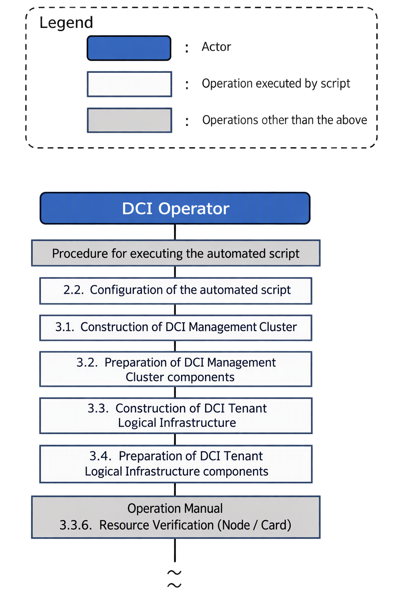
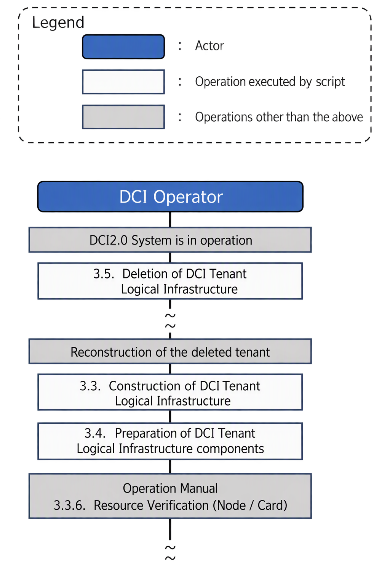

= Automation Script Manual
:toc: macro
:toclevels: 4
:sectnums:
:sectnumlevels: 4
:xrefstyle: short
: workdir: (working directory created in 2.2.)

Version 1.0

2026/11/05

NTT, Inc.

[width="100%",cols="9%,13%,13%,13%,38%,19%",]
|===
|Revision number | Revision date | Person in charge | Approval | Changes | Changes
|1.0 | 2026/11/05 | 1 Finity) Nakamura, Shigetome, Kitada | 1 Finity) Tamura | First edition |
|===

toc::[]

== INTRODUCTION

This automation script automates some of the procedures in the DCI-2.0 Setup Manual and DCI-2.0 Operation Manual.
System construction time can be greatly reduced and operational errors can be reduced. This document describes the procedures for deploying automation scripts,
Describes how to configure the script, how to set it up, how to run it, and how to check the results.

The automation scripts for each manual are:

* DCI-2.0 Setup Manual
** 3.3 Building a Cluster for DCI Management
** 3.4 Preparations for DCI Manager and DCI Physical Infrastructure Deployment
** 3.5 DCI Manager Deployment
** 3.6 DCI Physical Infrastructure Deployment
** 3.7 Deploying Components to a DCI Management Cluster
* DCI-2.0 Operation Manual
** 3.3.2 DCI Tenant Logical Infrastructure Construction
** 3.3.4 Post-Build Setup
// Todo: Check and update the chapter number when the construction manual is fixed
// (Chapter number as of 06/24/2026. Source branch: latest from feature/issue862_update_manuals_for_RV_at_the_end_of_May)

Note that this book requires a basic knowledge of Linux and Kubernetes.

=== Prerequisites
The automation script assumes that the DCI operator runs on the operating terminal. It is shown in the following figure (red frame in the figure).

image:../SetupManual/media/media/image_maincomponent_en.png[width=1000,height=311]

==== Operating terminal requirements

The operating terminal running this script must meet the following requirements:

. Ansible 2.14.18 or higher must be installed
+
[source,console]
----
# Installation Commands
python3 -m pip install --upgrade pip
python3 -m pip install ansible-core==2.14.18

# Installation Verification
ansible --version
----
. SSH connection is possible for the DCI management server to be constructed
+
[source,console]
----
# Example: When the username is admin and the destination IP address is 192.168.1.1
ssh admin@192.168.1.1
----
. SSH key authentication must be configured
+
[source,console]
----
# Example: Generate an SSH key pair below if it has not been created
ssh-keygen -t ed25519 -f ~/.ssh/id_ed25519

# Example: Register the generated public key with the destination node (for 192.168.1.1)
ssh-copy-id admin@192.168.1.1
----
. permission to run sudo without password must be set
+
[source,console]
----
sudo visudo
# Uncomment the following line (#)
%wheel        ALL=(ALL)       NOPASSWD: ALL
----

. Git must be installed
+
[source,console]
----
# Git Installation Verification
git --version

# If not installed (RHEL/CentOS example)
sudo yum install -y git
----

==== DCI Management Server Requirements

. The OS described in the Setup Manual must be installed
+
// Todo: Check and update the chapter number when the construction manual is fixed
// (Chapter number as of 06/24/2026. Source branch: latest from feature/issue862_update_manuals_for_RV_at_the_end_of_May)
Section 3.2.1 of the DCI-2.0 Setup Manual. Confirm that the OS described in "OS Installation and Initial Configuration" is installed.
+
[source,console]
----
$ cat /etc/redhat-release
Red Hat Enterprise Linux release 9.6 (Plow)
----
. RHEL subscriptions must be registered
+
[source,console]
----
$ rhc status
Connection status for mgr-cp-1:

● Connected to Red Hat Subscription Management
● Not connected to Red Hat Insights
● The Remote Host Configuration daemon is active

Manage your connected systems: https://red.ht/connector
----
. permission to run sudo without password must be set
+
[source,console]
----
sudo visudo
# Uncomment the following line (#)
%wheel        ALL=(ALL)       NOPASSWD: ALL
----

IMPORTANT: If all requirements are not met, an error occurs during script execution.

=== Important Notes, Restrictions

I will explain the precautions when using this script.

WARNING: Each script requires administrator privileges. For use outside of the test environment, this should be done by agreement with the parties involved.

IMPORTANT: Execute each script in the order in which it is executed. Incorrect ordering can cause errors and malfunctions.

== How to use automated scripts

This chapter describes the deployment procedures and script configuration for each automation script.

=== Automated Script Execution Flow

Shows the overall flow of work performed in an automation script.
Refer to System Initial Build Flow or DCI Tenant Logical Infrastructure Removal Flow depending on the purpose of the work.

==== Flow of initial system construction

There are four types of scripts that are used to initially build the system, and they are mainly used in two cases:

. Initial cluster build for DCI management
* DCI Management Cluster Build Script
* Component Deployment Script to DCI Management Cluster
. Tenant Initialization
* DCI Tenant Logical Infrastructure Build Script
* Component Deployment Script to DCI Tenant Logical Infrastructure

The entire workflow of the automation script is shown in the following diagram.
By performing these tasks sequentially from the top, you can build your DCI-2.0 system environment step-by-step.
The numbers in the figure indicate the number of each chapter, and each chapter explains how to work with specific scripts.

==== DCI Tenant Logical Infrastructure Removal Flow

Use the following script to remove the pre-built DCI tenant logical infrastructure.

* DCI Tenant Logical Infrastructure Removal Script

The following diagram shows the process of deleting a tenant.
The numbers in the figure indicate the chapter numbers, see the corresponding chapter for detailed instructions.

=== Automation script placement

. Create an empty working directory on the console
+
[source,console,subs="attributes+"]
----
mkdir /path/to/work
----
+
NOTE: The above is an example of directory creation. +
 The '/path/to/work` part can specify any path. (e.g. `mkdir/tmp/dci_work').

. Go to the directory you created
+
[source,console,subs="attributes+"]
----
cd /path/to/work
----

. Clone script from GitHub repository (develop branch)
+
[source,console]
----
git clone -b develop https://github.com/openkasugai/dci_common.git
----

. Check cloned directories
+
[source,console]
----
cd dci_common/script
ls -l
----
+
Ensure the following directories are located:
+
* manager_cluster_setup/
* manager_software_deploy/
* tenant_provisioning/
* tenant_deploy/
* tenant_delete/
* support_tools/

NOTE: Scripts can be placed in any directory. In the following steps, run the directory you have placed as the working directory.

=== Script Configuration

<<automation_script_deployment,2.2 Automation Script Deployment>> provides the following five automation scripts in the working directory; and
Support tools will be deployed. Below is a functional overview of each script.

[cols="^5,22,72",options="header,striped"]
|===
|# | script | description

|1
|manager_cluster_setup/
|Building a K8s cluster for management. Automate installation and configuration of Kubernetes, CRI-O, Calico, etc.

|2
|manager_software_deploy/
|Deployment of components to a DCI management cluster. Install Harbor, CNPG, Cluster API, Monitoring Stack, and more

|3
|tenant_provisioning/
|Building a DCI tenant logical infrastructure. Autoprovisioning using the Cluster API

|4
|tenant_deploy/
|Component deployment and access settings to the DCI tenant logical infrastructure. Generate kubeconfig for tenant operator

|5
|tenant_delete/
|Dismantling and post-dismantling of DCI tenant logical infrastructure. Delete K8s resource, Harbor certificate, CoreDNS, Harbor Replication

|6
|support_tools/
|Includes pre_setup_tools, diagnostic tools, and MinIO bucket management tools (minio_bucket_management)
|===

==== manager_cluster_setup

DCI Management Cluster Build Scripts

[source]
----
manager_cluster_setup/
├── manager_cluster_setup.sh
└── ansible/
    └── inventory/
        ├── hosts
        ├── group_vars/
        └── host_vars/
----

manager_cluster_setup.sh::
Main script to automatically build a cluster for DCI management

ansible/inventory/::
Ansible Inventory Configuration Directory
+
hosts:::
Inventory file that defines the list of nodes
+
group_vars/:::
Directory where group variables are stored
+
host_vars/:::
Directory containing host-specific variables

==== manager_software_deploy

Scripts for Deploying Components to a DCI Management Cluster

[source]
----
manager_software_deploy/
├── manager_software_deploy.sh
└── ansible/
    └── inventory/
        ├── hosts
        └── group_vars/
----

manager_software_deploy.sh::
Main script to deploy components to the DCI management cluster

ansible/inventory/::
Ansible Inventory Configuration Directory
+
hosts:::
Inventory file that defines the list of nodes
+
group_vars/:::
Directory where group variables are stored

==== tenant_provisioning

DCI Tenant Logical Infrastructure Building Scripts

[source]
----
tenant_provisioning/
├── tenant_provisioning.sh
└── ansible/
    └── inventory/
        ├── hosts
        └── group_vars/
----

tenant_provisioning.sh::
Main script to build DCI tenant logical infrastructure

ansible/inventory/::
Ansible Inventory Configuration Directory
+
hosts:::
Inventory file that defines the list of nodes
+
group_vars/:::
Directory where group variables are stored

==== tenant_deploy

Scripts for Deploying Components to DCI Tenant Logical Infrastructure

[source]
----
tenant_deploy/
├── tenant_deploy.sh
└── ansible/
    └── inventory/
        ├── hosts
        └── group_vars/
----

tenant_deploy.sh::
Main script to deploy components to DCI tenant logical infrastructure

ansible/inventory/::
Ansible Inventory Configuration Directory
+
hosts:::
Inventory file that defines the list of nodes
+
group_vars/:::
Directory where group variables are stored

==== tenant_delete

DCI Tenant Logical Infrastructure Demolition Scripts

[source]
----
tenant_delete/
├── tenant_delete.sh
└── ansible/
    └── inventory/
        ├── hosts
        └── group_vars/
----

tenant_delete.sh::
Main script to automate the DCI tenant logical infrastructure demolition process

ansible/inventory/::
Ansible Inventory Configuration Directory
+
hosts:::
Inventory file that defines the list of nodes (described for all nodes in a redundant configuration)
+
group_vars/:::
Directory where group variables are stored

==== support_tools

Support Tools

===== pre_setup_tools

Preparatory tools

[source]
----
pre_setup_tools/
├── data_collect_tools/
│   ├── nodes.csv
│   ├── switch.csv
│   ├── cdi.csv
│   └── make_all.sh
├── configuration_management_database/
│   ├── config.yaml
│   └── main_tmp.go
└── dci_tenant_infra_chart/
    └── values.yaml
----

data_collect_tools/::
Automatic infrastructure information collection tool. Collect hardware information from Maas and CDI equipment and automatically generate 'config.yaml' as an input to the configuration management DB registration tool (`configuration_management_database`) +
This tool runs on a * * Maas server * *.
+
nodes.csv:::
Configuration file describing node information (host name, Mac, IPMI information, etc.) to be registered with Maas
+
switch.csv:::
Configuration file describing network switch information (name, location, IP, port range, type)
+
cdi.csv:::
Configuration file describing CDI device connection information
+
make_all.sh:::
Main script to read three CSV files and generate `config.yaml` by sequentially executing Maas commission, hardware information collection, and CDI information acquisition

configuration_management_database/::
Script generation tool for configuration management DB registration
+
config.yaml:::
Script configuration file for configuration management DB registration (automatically generated with 'data_collect_tools` or manually edited)
+
main_tmp.go:::
Script generation tool body for configuration management DB registration

dci_tenant_infra_chart/::
Yaml generator for building DCI tenant logical infrastructure
+
values.yaml:::
Yaml generator configuration file for building DCI tenant logical infrastructure

===== minio_bucket_management

MinIO Bucket Management Tools +
A tool to create and delete Loki/Velero buckets via Ansible SSH.

[source]
----
minio_bucket_management/
├── minio_bucket_management.sh
├── inventory.ini
├── vars.yaml
├── minio_bucket_create.yaml
└── minio_bucket_delete.yaml
----

minio_bucket_management.sh::
Main script to execute bucket creation/deletion (argument: `create`/`delete`)

inventory.ini::
MinIO Server Inventory File

vars.yaml::
MinIO connection settings, MinIO credentials and list of bucket names to be created and deleted

minio_bucket_create.yaml::
Bucket Creation Playbook

minio_bucket_delete.yaml::
Bucket Delete Playbook

===== nfs_pv_cleanup

NFS PV Cleanup Tools Group +
It is a tool to delete the data on the NFS server used in the PV of the deleted tenant via Ansible SSH. +
Execute as step 0 before executing `tenant_delete.sh'.

[source]
----
nfs_pv_cleanup/
├── nfs_pv_cleanup.sh
├── inventory.ini
├── vars.yaml
└── nfs_pv_cleanup.yaml
----

nfs_pv_cleanup.sh::
Main script to perform tenant PV data deletion on NFS server

inventory.ini::
NFS Server Inventory File

vars.yaml::
Configuration file that defines the namespace and NFS server export path of the tenant to be deleted

nfs_pv_cleanup.yaml::
Playbook to delete data under the NFS export path for each tenant

===== diagnosis

Diagnostic tools group

[source]
----
diagnosis/
├── diagnosis.sh
└── overall_diagnosis.sh
----

diagnosis.sh::
Diagnostic Script

overall_diagnosis.sh::
Bulk Diagnostic Execution Script

<<<

<<<

== Run Automation Scripts

=== Building a Cluster for DCI Management

This section automates the initial setup of a DCI management cluster.
From the installation of Kubernetes, CRI-O, Calico,
Covers up to Control Plane/Worker node participation (kubeadm join).

// Todo: When the construction manual is fixed, check and update the following chapter number
// (Chapter number as of 06/24/2026. Source branch: latest from feature/issue862_update_manuals_for_RV_at_the_end_of_May)
The steps in the "DCI-2.0 Setup Manual" covered by this script are as follows.

* 3.3. Building a Cluster for DCI Management
** 3.3.1. Installing K8s
** 3.3.2. Installing CRI-O
** 3.3.3. CRI-O Settings
** 3.3.4. K8s Cluster Construction Preparations
** 3.3.5. K8s cluster construction
** 3.3.6. K8s Cluster Construction Confirmation

==== Scope of construction
image:../SetupManual/media/media/image0_en.png[width=1000,height=311]

==== Creating a Script Configuration File

This procedure shows how to edit the configuration file under `manager_cluster_setup/ansible/inventory` to fit the real environment.
Setup should be done in the following order:

. Go to target directory
+
[source,console,subs="attributes+"]
----
cd {workdir}/dci_common/script/manager_cluster_setup
----

. Confirm the file to be edited
+
[source,console]
----
ls -l ansible/inventory
find ansible/inventory/host_vars -maxdepth 2 -name vars.yaml
----

You can edit the following:

* `ansible/inventory/hosts`
* `ansible/inventory/group_vars/all/vars.yaml`
* `ansible/inventory/group_vars/dci_mgmt_k8s_control_plane/vars.yaml`
* `ansible/inventory/host_vars/< hostname >/vars.yaml`

[discrete]
====== 1. Configure hosts (node definition)

Under `ansible/inventory/hosts`, define the Control Plane node group and the Worker node group.
The syntax is "'<inventory>ansible_host = ansible_user =<SSH>'".

[source,ini]
----
[dci_mgmt_k8s_control_plane]
K8s Control Plane for # DCI Management Cluster
mgr-cp-1 ansible_host=192.168.1.1 ansible_user=admin
mgr-cp-2 ansible_host=192.168.1.2 ansible_user=admin
mgr-cp-3 ansible_host=192.168.1.3 ansible_user=admin

[dci_mgmt_k8s_node]
# K8s node in cluster for DCI management
mgr-wk-1 ansible_host=192.168.1.4 ansible_user=admin
mgr-wk-2 ansible_host=192.168.1.5 ansible_user=admin
----

Precautions when setting up:

* `mgr-cp-1` (at the beginning of the Control Plane group) is used as the target for cluster initialization.
* `mgr-cp-2` or later will be used for additional Control Plane participation.
* `dci_mgmt_k8s_node` is eligible for Worker participation.
* `ansible_user` must specify an SSH login and sudo executable user on each node.
* The hostname (e.g. `mgr-cp-1`) should match the directory name of `host_vars//vars.yaml' as described below.

NOTE: It also works with a single Control Plane configuration, but three or more are recommended for HA configurations.

[discrete]
====== 2. Set group_vars/all/vars.yaml (version network)

Configure the deployment version and network settings in `ansible/inventory/group_vars/all/vars.yaml'.

[source,yaml]
----
# Kubernetes
k8s_version_major: 1.34
k8s_version_minor: 2

# CRI-O
crio_version_major: 1.34
crio_version_minor: 2

# Calico
calico_version_major: 3.29
calico_version_minor: 2

# kube-vip Addressing
kube_vip_address: 172.28.161.30 # kube-vip IP address

# k8s Cluster Network Settings
pod_subnet: 172.17.10.0/24 # Pod Network CIDR
service_subnet: 172.17.20.0/24 # Service Network CIDR

# Proxy settings (only set if proxy is required for external communication)
proxy_setup_enabled: false
proxy_url: "http://192.168.1.1:8080/"   # Proxy URL (e.g. "http://192.168.1.1:8080/")
----

Precautions when setting up:

* `k8s_version_major` and `crio_version_major` must be in the same series.
* `*_minor` must specify a real distribution version.
* `kube_vip_address` must specify an unused IP in the same L2 segment.
* `pod_subnet` and `service_subnet` must specify CIDRs that do not overlap with existing networks or other clusters.
* Leave 'proxy_setup_enabled: false` if no proxy is required for external communication. Only change `proxy_setup_enabled: true` and `proxy_url` to the real environment value if a proxy is required.
* The `ansible_work_dir', repository URL, and package name in the same file are referenced internally, so do not change them unless required.

[discrete]
====== 3. Set group_vars/dci_mgmt_k8s_control_plane/vars.yaml (NIC/CRI settings)

In `ansible/inventory/group_vars/dci_mgmt_k8s_control_plane/vars.yaml`, set the Calico NIC detection method and the kube-vip interface/CIDR.

[source,yaml]
----
# Calico How to Autodetect NICs
calico_autodetect_method: "kubernetes-internal-ip"

# kube-vip
kube_vip_interface: eth1
kube_vip_cidr: 24

# k8s Cluster Settings
cri_socket: unix:///var/run/crio/crio.sock
----

Precautions when setting up:

* `kube_vip_interface` must be a NIC name common to all Control Plane nodes.
* Specify `kube_vip_cidr` according to the network of 'kube_vip_address` ('all/vars.yaml` setting).
* If the internal IP selection is not as expected in a multi-NIC environment,<CNINIC> specify it explicitly in the form of `calico_autodetect_method: interface =`.

[discrete]
====== 4. Configure host_vars//vars.yaml (host specific)

Set `cni_address' in `ansible/inventory/host_vars//vars.yaml` for each node.

[source,yaml]
----
# Example: ansible/inventory/host_vars/mgr-cp-1/vars.yaml
cni_address: 198.51.100.1
----

Precautions when setting up:

* Set 'cni_address` on all target nodes (Control Plane/Worker).
* `cni_address` must be unique per node.
* `cni_address` must<CNINIC> specify an IP address that belongs to the same subnet as the CNI NIC specified as` calico_autodetect_method: interface = `in Section 3.
+
(Example: if the CNI NIC belongs to `198.51.100.0/26', `cni_address` is specified in the range `198.51.100.x')
* The directory name of `host_vars` must match the inventory name of `hosts`.

[discrete]
====== 5. Pre-configuration check

Review the following items before performing the procedure.

* It is possible to connect to all nodes defined in `hosts` with SSH key authentication
+
[source,console]
----
command, e.g.
$ ansible -i ansible/inventory/hosts all -m ping
mgr-cp-1 | SUCCESS => { "ping": "pong" }
mgr-cp-2 | SUCCESS => { "ping": "pong" }
...
----
NOTE: If there are nodes that do not return `pong`, review the SSH settings, sudo settings, and firewall settings before running the playbook.

* `sudo` can be executed without a password in `ansible_user'
+
[source,console]
----
command, e.g.
$ ansible -i ansible/inventory/hosts all -b -m command -a "whoami"
mgr-cp-1 | CHANGED | rc=0 >>
root
mgr-cp-2 | CHANGED | rc=0 >>
root
...
----
* `kube_vip_address', 'pod_subnet', 'service_subnet' and `cni_address` must not overlap
+
[source,console]
----
command, e.g.
$ grep -r "kube_vip_address\|pod_subnet\|service_subnet\|cni_address" ansible/inventory/group_vars/ ansible/inventory/host_vars/
----

==== Script Execution Procedure

. Execute script
+
[source,console,subs="attributes+"]
----
cd {workdir}/dci_common/script/manager_cluster_setup
bash manager_cluster_setup.sh
----
+
[source,console]
----
command, e.g.
$ bash manager_cluster_setup.sh
+ set -e
++ dirname manager_cluster_setup.sh
+ CURRENT_DIR=.
+ INVENTORY=./ansible/inventory/hosts
...
(Omitted)
...
+ echo '[success] All playbook executions completed'
[success] All Playbook Executions Completed
----

. Checking the execution log
+
[source,console,subs="attributes+"]
----
cd {workdir}/dci_common/script/manager_cluster_setup

# Check the latest execution log directory
ls -1dt ansible/logs/*_manager_cluster_setup | head -1
# Replace the output directory name with the following YYYYMMDD_HHMMSS part
tail -f ansible/logs/YYYYMMDD_HHMMSS_manager_cluster_setup/01-pre_setup_proxy.log

# Example: Check the cluster initialization log (if checked after completion)
view ansible/logs/YYYYMMDD_HHMMSS_manager_cluster_setup/07-k8s_cluster_init.log
----

. Manual confirmation after script execution
+
NOTE: Run the following command after logging in with SSH on the K8s Control Plane * of the * DCI management cluster, which is the build target, rather than on the operating terminal where the automation script was run. +
(e.g. `ssh @<K8s Control PlaneIP>')
+
[source,console]
----
kubectl get nodes
kubectl get pods -A
kubectl cluster-info
----
+
[source,console]
----
command, e.g.
$ kubectl get nodes
NAME         STATUS   ROLES           AGE   VERSION
mgr-cp-1     Ready    control-plane   10m   v1.32.2
mgr-cp-2     Ready    control-plane   8m    v1.32.2
mgr-wk-1     Ready    <none>          5m    v1.32.2

$ kubectl get pods -A
NAMESPACE                           NAME                                                              READY   STATUS    RESTARTS       AGE
NAMESPACE     NAME                                       READY   STATUS    RESTARTS   AGE
kube-system   calico-kube-controllers-xxxxx-xxxxx        1/1     Running   0          3m6s
kube-system   calico-node-xxxxx                          1/1     Running   0          2m20s
kube-system   calico-node-xxxxx                          1/1     Running   0          3m6s
kube-system   calico-node-xxxxx                          1/1     Running   0          2m27s
...
(Omitted)
...
kube-system   kube-vip-mgr-cp-2                          1/1     Running   0          2m30s
kube-system   kube-vip-mgr-cp-3                          1/1     Running   0          2m26s

$ kubectl cluster-info
Kubernetes control plane is running at https://192.168.2.30:6443
CoreDNS is running at https://192.168.2.30:6443/api/v1/namespaces/kube-system/services/kube-dns:dns/proxy

To further debug and diagnose cluster problems, use 'kubectl cluster-info dump'.
----

NOTE: If it fails during execution, correct the settings and run `manager_cluster_setup.sh' again.

==== Check Script Execution Result

Use `support_tools/diagnosis` to diagnose the execution result of manager_cluster_setup.

. Run Diagnostic Tool
+
[source,console,subs="attributes+"]
----
cd {workdir}/dci_common/script/support_tools/diagnosis
./diagnosis.sh manager_cluster_setup --script-root {workdir}/dci_common/script
----
+
[source,console,subs="attributes+"]
----
command, e.g.
$ ./diagnosis.sh manager_cluster_setup --script-root {workdir}/dci_common/script
==============================================
DCI Diagnostic Tool
==============================================
Script name: manager_cluster_setup
Log directory: {workdir}/dci_common/script/manager_cluster_setup/ansible/logs/manager_cluster_setup_logdirectory
Inventory path: {workdir}/dci_common/script/manager_cluster_setup/ansible/inventory/hosts
Output directory: {workdir}/dci_common/script/support_tools/diagnosis/common/../diagnosis_reports/diagnosis_reports_logdirectory
Log Level: info
Timeout: 900 seconds
==============================================

2026-05-20 10:46:39,035 - __main__ - INFO - Initializing diagnosis engine...
2026-05-20 10:46:39,035 - __main__ - INFO - Validating prerequisites...
...
(Omitted)
...
[success] End Code 0: Diagnosis completed successfully

==============================================
✅ Diagnosis completed successfully - no resource state issues found
==============================================
Result:
  - Summary Report: {workdir}/dci_common/script/support_tools/diagnosis/common/../diagnosis_reports/diagnosis_reports_logdirectory/summary.md
  - Console log: {workdir}/dci_common/script/support_tools/diagnosis/common/../diagnosis_reports/diagnosis_reports_logdirectory/diagnosis_console.log
==============================================
----

. When diagnosing by specifying a specific log
+
[source,console,subs="attributes+"]
----
./diagnosis.sh manager_cluster_setup \
  --script-root {workdir}/dci_common/script \
  --log-dir-name YYYYMMDD_HHMMSS
----

. Checking diagnostic results
+
[source,console]
----
cat diagnosis_reports/*_manager_cluster_setup/summary.md
cat diagnosis_reports/*_manager_cluster_setup/diagnosis_console.log
----

Estimated exit code:

* No problem
* `1': diagnostic tool error
* `2': Critical Issue Detected
* `3': warning detected

<<<

<<<

=== Deploying Components to a DCI Management Cluster

This section deploys the necessary components for a DCI-managed cluster.
Harbor, CNPG PostgreSQL, Cluster API, Monitoring Stack, Physical Infrastructure Management, etc.
Performs automatic installation and configuration of a wide range of components.

// Todo: When the construction manual is fixed, check and update the following chapter number
// (Chapter number as of 06/24/2026. Source branch: latest from feature/issue862_update_manuals_for_RV_at_the_end_of_May)
The steps in the "DCI-2.0 Setup Manual" covered by this script are as follows.

* 3.4. Preparations for DCI Manager and DCI Physical Infrastructure Deployment
** 3.4.2. Proxy settings (only if proxy is required for external communication) @ control plane *, @ k8s node
** 3.4.3. Helm Installation @ control plane *
** 3.4.4. Installing the velero CLI @ control plane *
** 3.4.5. Installing git, buildah, go, yq @ control plane *, @ k8s node
** 3.4.6. NTP Server Settings @ control plane *, @ k8s node
* 3.5. DCI Manager Deployment
* 3.6. DCI Physical Infrastructure Deployment @ control plane
* 3.7. Deploying Components to a Management Cluster
* 3.8. Check the normal operation of the system in the cluster for DCI management @ control plane
* 4.2. Registering Resource Information in the Configuration Management DB @ control plane
** 4.2.1. Registering with the Configuration Management DB

==== Scope of construction
image:../SetupManual/media/media/image0_en.png[width=1000,height=311]

==== Automatic collection of infrastructure information

In this section, the `pre_setup_tools/data_collect_tools` tool is used to automatically collect infrastructure hardware information from Maas servers and CDI equipment.
Generate `config.yaml` which will be the input to the configuration management DB registration tool.

Running the tool will generate `pre_setup_tools/data_collect_tools/config.yaml`.
Copy and use this file to `pre_setup_tools/configuration_management_database/config.yaml`.

NOTE: If you want to create `config.yaml` manually, skip this section and go to the next section 'Creating Scripts for Configuration Management DB Registration` to edit `config.yaml` directly.

IMPORTANT: Run the tool on a * * Maas server * *. It cannot be executed from the operating terminal.

[discrete]
===== Prerequisites

* The `maas`, `jq` and `sshpass` commands are installed on the Maas server.
* Each target node must have `lldpd' (`lldpctl`), `lspci' and `ethtool` installed
* The SSH public key of the Maas server is registered in the Maas GUI

[discrete]
===== Procedure

. Navigate to the directory where the script was placed on the Maas server
+
[source,console,subs="attributes+"]
----
cd {workdir}/dci_common/script/support_tools/pre_setup_tools/data_collect_tools
----

. Edit `nodes.csv` to fit your environment
+
[source]
----
HOSTNAME,MAC,IPMI_ADDR,IPMI_USER,IPMI_PASS,SERVER_TYPE,SERVER_ROLE,DEPLOYMENT_TYPE
d1-m01-cots-worker01,aa:bb:cc:dd:ee:ff,172.28.160.59,testuser,xxxx,COTS,1,1
d1-m01-cots-compute01,aa:bb:cc:dd:ee:ff,172.28.160.202,testuser,xxxx,COMPUTE,,
----
+
[cols="2,5",options="header"]
|===
|Field | Description
|`hostname` | Server hostname
|`Mac` | MAC address of the NIC for the Manager
|`IPMI_addr` | IP address of BMC (IPMI)
|`IPMI_user` | BMC (IPMI) username
|`IPMI_pass` | BMC (IPMI) password
|`server_type` | The type of the server. `cots` or `compute`
|Specified for `server_role` | 'cots`. `0': K8S ControlPlane, `1': K8S Node
|Specified for `deployment_type` | `cots'. `0`: VM host, `1`: bare metal
|===

. Edit `switch.csv` to fit your environment
+
[source]
----
NW_SWITCH_NAME,LOCATION,NW_IP_ADDR,NW_USER,VENDOR,PRODUCT_NAME,OS,PORT_START,PORT_END,TYPE
d1-m01-l2-switch-host01,loc1.location,192.168.2.10,sw-user,edgecore networks,DCS208/AS5812-54X,Edgecore SONiC,Ethernet0,Ethernet32,host
d1-m01-l3-l2-switch-cni01,loc1.location,192.168.2.11,sw-user,edgecore networks,DCS208/AS5812-54X,Edgecore SONiC,Ethernet0,Ethernet32,cni
d1-m01-l2-switch-app01,loc2.location,192.168.2.12,sw-user,edgecore networks,DCS208/AS5812-54X,Edgecore SONiC,Ethernet0,Ethernet32,app
----
+
[cols="2,5",options="header"]
|===
|Field | Description
|`NW_switch_name` | Switch identifier
|`location` | Location identifier, specified in the format 'locX.location` such as` loc1.location `,' loc2.location '
|`NW_IP_addr` | IP address of the switch
|`NW_user` | Username to access the switch
|`vendor` | Vendor name of the switch
|`product_name` | Product name of the switch
|`OS` | Switch NOS (Network OS) name
|`port_start` | The starting port name of the port range corresponding to this type (e.g. `Ethernet0')
|`port_end` | The end port name of the port range corresponding to this type (e.g. `Ethernet32')
|`type` | Network Role. Specify one of `host`, `cni` or `app`
|===

. Edit `cdi.csv` to fit the environment (leave empty to not use CDI equipment)
+
[source]
----
HOST,USER,PASS,LOCATION,CDI_VERSION,GROUP_NAME,CDI_GUEST,CDI_USER,CDI_PASSWORD,CDIMGR_GUEST_USER,CDIMGR_GUEST_PASSWORD,CDIMGR_HOST,CDIMGR_HOST_USER,CDIMGR_HOST_PASSWORD,DIRECTOR_PASSWORD,PCIE_BOX_IP
172.28.161.199,ubuntu,xxxx,dc1,2.0,group0,172.20.30.150,dhrcsystem,yyyy,fujitsu,aaaa,1.1.1.1,fujitsu,bbbb,cccc,172.20.30.160
----
+
For detailed specifications for each field, see `support_tools/pre_setup_tools/data_collect_tools/README.md`.

. Execute `make_all.sh`
+
[source,console]
----
./make_all.sh
----
+
It will take you * * about 10 minutes * * to complete as you run the Maas commission twice in parallel per node.

. Verify that `config.yaml` has been generated
+
[source,console]
----
ls config.yaml
----

. Copy generated `config.yaml` to `configuration_management_database/'
+
[source,console,subs="attributes+"]
----
cp config.yaml {workdir}/dci_common/script/support_tools/pre_setup_tools/configuration_management_database/config.yaml
----

NOTE: Check the contents of `config.yaml` beforehand for incorrect values.

==== Creating a File for Initial Registration of Configuration Management DB
Used for initial registration of resource pool information to the configuration management DB (PostgreSQL)
Generate the Go code ('main.go') using the `pre_setup_tools/configuration_management_database` tool.

When you run the tool, `main.go' is generated under `pre_setup_tools/configuration_management_database`. By specifying this file as the variable `db_init_file` in `manager_software_deploy/ansible/inventory/group_vars/all/vars.yaml`, it is referenced as DB registration code when executing `manager_software_deploy` in the automation script.

[discrete]
===== Procedure

. Go to target directory
+
[source,console,subs="attributes+"]
----
cd {workdir}/dci_common/script/support_tools/pre_setup_tools/configuration_management_database
----

. Dependency Installation (First Time Only)
+
[source,console]
----
go mod tidy
----

. Review and edit `config.yaml` as needed
+
To use the `config.yaml` copied in the previous section `Automatic collection of infrastructure information`, proceed as is. To create it manually, edit the detailed specifications for each field by referring to `support_tools/pre_setup_tools/configuration_management_database/README.md`.

. Generate `main.go`
+
[source,console]
----
go run main_tmp.go > main.go
----
+
Upon successful completion, `main.go` will be generated in the current directory.

NOTE: If you changed `config.yaml`, rerun `go run main_tmp.go > main.go` and regenerate 'main.go'.

==== Creating a Script Configuration File

This procedure shows how to edit the configuration file under `manager_software_deploy/ansible/inventory` to fit the real environment.
Manage `vault.yaml` with sensitive information in Ansible Vault.

. Go to target directory
+
[source,console,subs="attributes+"]
----
cd {workdir}/dci_common/script/manager_software_deploy
----

. Confirm the file to be edited
+
[source,console]
----
ls -l ansible/inventory
find ansible/inventory/group_vars -maxdepth 3 -type f
----

Primary edit target:

* `ansible/inventory/hosts`
* `ansible/inventory/group_vars/all/vars.yaml`
* `ansible/inventory/group_vars/dci_mgmt_k8s_control_plane/vars.yaml`
* `ansible/inventory/group_vars/all/vault.yaml`
* `ansible/inventory/group_vars/dci_mgmt_k8s_control_plane/vault.yaml`
* `ansible/utility/db_init_main.go`

[discrete]
====== 1. Configure hosts (server definition for DCI management)

`ansible/inventory/hosts` uses the same configuration as manager_cluster_setup.
The first control plane host (the first one in `dci_mgmt_k8s_control_plane`) is the target of many playbooks.

[source,ini]
----
[dci_mgmt_k8s_control_plane]
mgr-cp-1 ansible_host=192.168.1.1 ansible_user=admin
mgr-cp-2 ansible_host=192.168.1.2 ansible_user=admin
mgr-cp-3 ansible_host=192.168.1.3 ansible_user=admin

[dci_mgmt_k8s_node]
mgr-wk-1 ansible_host=192.168.1.4 ansible_user=admin
mgr-wk-2 ansible_host=192.168.1.5 ansible_user=admin
----

Precautions when setting up:

* SSH key authentication and sudo permissions for `ansible_user` are required on all nodes.
* `mgr-cp-1` is used as the execution node for major component deployments such as Harbor/CNPG/monitoring.

[discrete]
====== 2. Set group_vars/all/vars.yaml (version/environment)

In `ansible/inventory/group_vars/all/vars.yaml`, configure the following for your real environment:

* OSS version groups (Helm/Go/cert-manager/Harbor/CNPG/Cluster API/Prometheus, etc.)
* DHRC version group (e.g. 'dci_common_version`)
* Image Rebuild Flag ('*_rebuild')
* Environment-specific parameters (bases, Maas, DNS, NFS, backup, firewalld, etc.)

Examples could include:

[source,yaml]
----
db_init_file: "{{ playbook_dir }}/../support_tools/pre_setup_tools/configuration_management_database/main.go"

locations:
  - dc1

maas_server_ip: "172.28.161.22"

nameservers:
  - 8.8.8.8
  - 1.1.1.1

nfs_server_ip: "203.0.113.1"
nfs_server_export_path: "/export/nfs"

tenant_nfs_server_ip: "172.28.197.102"
tenant_nfs_server_export_path: "/mnt/tenant_nfs_share"
----

Precautions when setting up:

* For `db_init_file`, specify the path of 'main.go` generated in the previous section `Creating a script for configuration management DB registration`.
* Specify a branch/tag where `dci_*_version` exists.
* Setting `*_rebuild` to `true` will build each time, so consider your work time and registry status.
* Be sure to check the IP path bucket name of the NFS/backup storage for each environment.

[discrete]
====== 3. Set group_vars/dci_mgmt_k8s_control_plane/vars.yaml (DCI management cluster ControlPlane specific)

In `ansible/inventory/group_vars/dci_mgmt_k8s_control_plane/vars.yaml`, set the Harbor connection, monitoring notifications, etc.

[source,yaml]
----
harbor_manager_url: "{{ kube_vip_address }}"
harbor_manager_port: 30003

postgrest_db_api_hostname: db-api.local
postgrest_db_api_port: 8443

monitoring_alert_email: "alert@example.com"
grafana_smtp_enable: false
grafana_smtp_host: "smtp.example.com"
grafana_smtp_port: "25"

ipmi_exporter_enabled: false
----

Precautions when setting up:

* `harbor_manager_url` refers to the equivalent of the kube-vip address (using the 'kube_vip_address` variable).
* `postgrest_db_api_hostname` and `postgrest_db_api_port` must be connected to the postgrestDB API.
* When using email notifications, change the SMTP settings and `monitoring_alert_email` to operational values.
* `ipmi_exporter_enabled` controls whether IPMI Exporter is enabled or disabled. Set to `true` if needed.

[discrete]
====== 4. Vault file editing procedure (required)

The vault target file immediately after Git clone is in clear text, but sensitive values such as passwords are registered in dummy values ('* * * * *', etc.).
When you use it for the first time, edit the dummy value to the actual value, then encrypt it, and use "Safe editing method (recommended)" when re-editing.

. Vault Target File

* `ansible/inventory/group_vars/all/vault.yaml`
* `ansible/inventory/group_vars/dci_mgmt_k8s_control_plane/vault.yaml`

. How to get started (first time only)

.. Edit the plaintext dummy value ('* * * * *', etc.) to the actual value of each environment
+
[source,console]
----
vi ansible/inventory/group_vars/all/vault.yaml
vi ansible/inventory/group_vars/dci_mgmt_k8s_control_plane/vault.yaml
----

.. Create vault password file
+
[source,console]
----
echo "YOUR_VAULT_PASSWORD" > ansible/.vault_pass
chmod 600 ansible/.vault_pass
----
+
NOTE: Replace `your_vault_password` with any string. This password is used to encrypt and decrypt Vault files. If you forget, you will not be able to decrypt it, so handle it carefully.

.. Encryption
+
[source,console]
----
ansible-vault encrypt \
  ansible/inventory/group_vars/all/vault.yaml \
  ansible/inventory/group_vars/dci_mgmt_k8s_control_plane/vault.yaml \
  --vault-password-file ansible/.vault_pass
----

. Safe to edit (recommended): When re-editing an encrypted file
+
[source,console]
----
ansible-vault edit ansible/inventory/group_vars/all/vault.yaml \
  --vault-password-file ansible/.vault_pass

ansible-vault edit ansible/inventory/group_vars/dci_mgmt_k8s_control_plane/vault.yaml \
  --vault-password-file ansible/.vault_pass
----

For `all/vault.yaml`, set the GitHub token, Maas API key, RHEL subscription information, MinIO password, etc.
For `dci_mgmt_k8s_control_plane/vault.yaml`, set Harbor credentials, physical infrastructure connection information, IPMI monitoring credentials, etc.

[discrete]
====== 5. Pre-configuration check

Before executing, confirm the following:

* `pre_setup_tools/configuration_management_database/main.go` must already be deployed
+
[source,console]
----
command, e.g.
$ ls ../support_tools/pre_setup_tools/configuration_management_database/main.go
../support_tools/pre_setup_tools/configuration_management_database/main.go
----
* The vault file must be encrypted (starting with '$ANSIBLE_VAULT;')
+
[source,console]
----
command, e.g.
$ head -1 ansible/inventory/group_vars/all/vault.yaml
$ANSIBLE_VAULT;1.1;AES256
----
* `ansible/.vault_pass` must be present and have permissions of 600
+
[source,console]
----
command, e.g.
$ ls -l ansible/.vault_pass
-rw------- 1 admin admin 24 Jun  4 10:00 ansible/.vault_pass
----
* Being able to communicate with all nodes
+
[source,console]
----
command, e.g.
$ cd ansible
$ ansible -i inventory/hosts all -m ping --vault-password-file .vault_pass
mgr-cp-1 | SUCCESS => { "ping": "pong" }
mgr-cp-2 | SUCCESS => { "ping": "pong" }
...
----
NOTE: If there are nodes that do not return `pong`, review the SSH settings, sudo settings, and firewall settings before running the playbook.

==== Script Execution Procedure

. Execute script
+
[source,console,subs="attributes+"]
----
cd {workdir}/dci_common/script/manager_software_deploy
bash manager_software_deploy.sh
----
+
[source,console]
----
command, e.g.
$ bash manager_software_deploy.sh
+ set -e
++ dirname manager_software_deploy.sh
+ CURRENT_DIR=.
+ INVENTORY=./ansible/inventory/hosts
...
(Omitted)
...
+ echo '[success] All playbook executions completed'
[success] All Playbook Executions Completed
----

. Checking the execution log
+
[source,console,subs="attributes+"]
----
cd {workdir}/dci_common/script/manager_software_deploy

# Check the latest execution log directory
ls -1dt ansible/logs/*_manager_software_deploy | head -1
# Replace the output directory name with the following YYYYMMDD_HHMMSS part
tail -f ansible/logs/YYYYMMDD_HHMMSS_manager_software_deploy/14-harbor_install.log

# Example: Review monitoring stack deployment logs (if checked after completion)
view ansible/logs/YYYYMMDD_HHMMSS_manager_software_deploy/17-monitoring_stack_apply.log
----

. Manual confirmation after script execution
+
NOTE: Run the following command after logging in with SSH on the K8s Control Plane * of the * DCI management cluster, which is the build target, rather than on the operating terminal where the automation script was run. +
(e.g. `ssh @<K8s Control PlaneIP>')
+
[source,console]
----
kubectl get pods -A
kubectl get pvc -A
kubectl get httproute -A
----
+
[source,console]
----
command, e.g.
$ kubectl get pods -A
NAMESPACE                           NAME                                                              READY   STATUS    RESTARTS      AGE
caaph-system                        caaph-controller-manager-xxxxx-xxxxx                              1/1     Running   0             19m
capdci-system                       cluster-api-provider-dci-controller-manager-xxxxx-xxxxx           1/1     Running   0             21m
capi-kubeadm-bootstrap-system       capi-kubeadm-bootstrap-controller-manager-xxxxx-xxxxx             1/1     Running   0             19m
...
(Omitted)
...
velero                              node-agent-xbncd                                                  1/1     Running   0             18m
velero                              velero-5f65b56fcd-9mrjq                                           1/1     Running   0             18m

$ kubectl get pvc -A
NAMESPACE    NAME                                                                                                     STATUS   VOLUME                                     CAPACITY   ACCESS MODES   STORAGECLASS   VOLUMEATTRIBUTESCLASS   AGE
database     database-cluster-1                                                                                       Bound    pvc-xxxxx-xxxxx-xxxxx-xxxxx-xxxxx          8Gi        RWO            nfs-client     <unset>                 24m
database     database-cluster-2                                                                                       Bound    pvc-xxxxx-xxxxx-xxxxx-xxxxx-xxxxx          8Gi        RWO            nfs-client     <unset>                 23m
database     database-cluster-3                                                                                       Bound    pvc-xxxxx-xxxxx-xxxxx-xxxxx-xxxxx          8Gi        RWO            nfs-client     <unset>                 22m
...
(Omitted)
...
prometheus   prometheus-grafana-b                                                                                     Bound    pvc-xxxxx-xxxxx-xxxxx-xxxxx-xxxxx          10Gi       RWO            nfs-client     <unset>                 24m
prometheus   prometheus-prometheus-kube-prometheus-prometheus-db-prometheus-prometheus-kube-prometheus-prometheus-0   Bound    pvc-xxxxx-xxxxx-xxxxx-xxxxx-xxxxx          10Gi       RWO            nfs-client     <unset>                 24m

$ kubectl get httproute -A
NAMESPACE   NAME              HOSTNAMES          AGE
loki        loki-route        ["loki.local"]     8d
postgrest   postgrest-route   ["db-api.local"]   8d
----

NOTE: Vault decryption fails if `ansible/.vault_pass` is incorrect or not placed. Review your vault settings first.

==== Check Script Execution Result

Use `support_tools/diagnosis` to diagnose the execution result of manager_software_deploy.

. Run Diagnostic Tool
+
[source,console,subs="attributes+"]
----
cd {workdir}/dci_common/script/support_tools/diagnosis
./diagnosis.sh manager_software_deploy --script-root {workdir}/dci_common/script
----
+
[source,console,subs="attributes+"]
----
command, e.g.
$ ./diagnosis.sh manager_software_deploy --script-root {workdir}/dci_common/script
==============================================
DCI Diagnostic Tool
==============================================
Script name: manager_software_deploy
Log directory: {workdir}/dci_common/script/manager_software_deploy/ansible/logs/manager_software_deploy_logdirectory
Inventory path: {workdir}/dci_common/script/manager_software_deploy/ansible/inventory/hosts
Output directory: {workdir}/dci_common/script/support_tools/diagnosis/common/../diagnosis_reports/diagnosis_reports_logdirectory
Log Level: info
Timeout: 900 seconds
==============================================

2026-05-20 10:46:39,035 - __main__ - INFO - Initializing diagnosis engine...
2026-05-20 10:46:39,035 - __main__ - INFO - Validating prerequisites...
...
(Omitted)
...
[success] End Code 0: Diagnosis completed successfully

==============================================
✅ Diagnosis completed successfully - no resource state issues found
==============================================
Result:
  - Summary Report: {workdir}/dci_common/script/support_tools/diagnosis/common/../diagnosis_reports/diagnosis_reports_logdirectory/summary.md
  - Console log: {workdir}/dci_common/script/support_tools/diagnosis/common/../diagnosis_reports/diagnosis_reports_logdirectory/diagnosis_console.log
==============================================
----

. Checking diagnostic results
+
[source,console]
----
cat diagnosis_reports/*_manager_software_deploy/summary.md
cat diagnosis_reports/*_manager_software_deploy/diagnosis_console.log
----

. Confirmation when an abnormality is detected
+
[source,console]
----
# Detailed information collected in diagnostics (if generated)
find diagnosis_reports/*_manager_software_deploy/resources -type f
----

NOTE: In the case of a critical error (exit code `2`), determine the recovery policy by matching both the applicable playbook log and `summary.md'.

<<<

<<<

=== DCI Tenant Logical Infrastructure Construction
This section automatically provisions a K8s cluster of DCI tenant logical infrastructure.
tenant network configurations, node definitions, Harbor certificates,
Start the K8s cluster by applying tenant-specific settings.

// Todo: When the construction manual is fixed, check and update the following chapter number
// (Chapter number as of 06/24/2026. Source branch: latest from feature/issue862_update_manuals_for_RV_at_the_end_of_May)
The steps in the "DCI-2.0 Setup Manual" covered by this script are as follows.

* 3.3. Tenant contract and initial construction work
** 3.3.1. Pre-Build Setup
** 3.3.2. Building Tenant Logical Infrastructure

==== Scope of construction
image:../OperationManual/media/media/env_component_tenant_en.png[width=1000,height=311]

==== Creating a yaml file for building tenants

For building DCI tenant logical infrastructure (Cluster API + DCI resources)
Generate a Kubernetes manifest (YAML) using the `pre_setup_tools/dci_tenant_infra_chart` tool.

When you run the tool, `.yaml' is generated under `pre_setup_tools/dci_tenant_infra_chart`.
By specifying this file as the variable `tenant_yaml_path` in `tenant_provisioning/ansible/inventory/group_vars/all/vars.yaml`,
Referenced as a tenant build manifest when running the automation script `tenant_provisioning`.

[discrete]
===== Procedure

. Go to target directory
+
[source,console,subs="attributes+"]
----
cd {workdir}/dci_common/script/support_tools/pre_setup_tools/dci_tenant_infra_chart
----

. Edit `values.yaml` to fit your environment
+

See `support_tools/pre_setup_tools/dci_tenant_infra_chart/README.md` for detailed specifications for each field.

. Kubernetes
+
[source,console]
----
helm template <> . -f values.yaml | sed '/^# Source: /d' > <>.yaml
----
+
[source,console]
----
# :  tenant-1
helm template tenant-1 . -f values.yaml | sed '/^# Source: /d' > tenant-1.yaml
----
+
、 `<>.yaml` 。
Kubernetes 。
+
[cols="2,5",options="header,striped"]
|===
||description

|`Cluster` |Cluster API
|`DCICluster` |DCI (configuration)
|`KubeadmControlPlane` |configuration(kubeadmkube-vipauditd )
|`MachineDeployment` |Nodeconfiguration
|`DCIMachineTemplate` |DCI (GPUNIC )
|`KubeadmConfigTemplate` |Node kubeadm configuration
|===

NOTE: `values.yaml` 、`helm template` execution YAML 。

==== Creating a Script Configuration File

`tenant_provisioning/ansible/inventory` configurationprocedure。
Vault ()。

. Go to target directory
+
[source,console,subs="attributes+"]
----
cd {workdir}/dci_common/script/tenant_provisioning
----

. Confirm the file to be edited
+
[source,console]
----
ls -l ansible/inventory
find ansible/inventory/group_vars -maxdepth 3 -type f
----

Primary edit target:

* `ansible/inventory/hosts`
* `ansible/inventory/group_vars/all/vars.yaml`
* `ansible/inventory/group_vars/all/vault.yaml`
* `ansible/utility/<tenant>.yaml`

[discrete]
====== 1. hosts configuration(DCI Management Cluster)

`ansible/inventory/hosts` 、executionDCI Management ClusterK8s Control Plane1。

[source,ini]
----
[dci_mgmt_k8s_control_plane]
mgr-cp-1 ansible_host=192.168.1.1 ansible_user=admin
----

Precautions when setting up:

* Playbook  `dci_mgmt_k8s_control_plane[0]` execution。
* 、 inventory execution1。

[discrete]
====== 2. group_vars/all/vars.yaml configuration(NWSpare Node)

`ansible/inventory/group_vars/all/vars.yaml` 、configuration。

1. `tenants[]`
2. `manager_nw` / `cni_nw` / `host_nw`
3. `spare_nodes[]` Spare Node

：

[source,yaml]
----
tenants:
  - tenant_name: tenant-1
    tenant_namespace: tenant-1
    tenant_yaml_file: tenant-1.yaml
    tenant_yaml_path: "{{ playbook_dir }}/../support_tools/pre_setup_tools/dci_tenant_infra_chart/tenant-1.yaml"
    harbor_private_key_file: tenant-1.key
    harbor_ca_file: tenant-1.crt
    harbor_ca_name: tenant-1
    harbor_ca_expiration: 3650
----

：

[source,yaml]
----
manager_nw:
  cidr: 172.28.193.0/24
  ip_range:
    start: 172.28.193.70
    end: 172.28.193.78
  vid: 1193

cni_nw:
  cidr: 172.28.166.0/24
  ip_range:
    start: 172.28.166.10
    end: 172.28.166.200
  vid: 1166

host_nw:
  cidr: 172.28.163.0/24
  ip_range:
    start: 172.28.163.10
    end: 172.28.163.200
  vid: 1163
----

Spare Node：

[source,yaml]
----
spare_nodes:
  - node_name: spare-node01
    node_yaml_file: spare-node01.yaml
    location: dc1
    server_type: COTSServer
    os:
      distribution: rhel
      version: 9.6-custom
    gpu:
      model: NVIDIA-BLACKWELL
      num: 1
    nic:
      model: NVIDIA-CONNECTX-6-DX
      num: 1
----

Precautions when setting up:

* `tenant_yaml_path` 、「Kubernetes 」procedure YAML 。
* `cni_nw`  `host_nw` setupYAML。
* `spare_nodes` 、deletion。

[discrete]
====== 4. Vault file editing procedure (required)

The vault target file immediately after Git clone is in clear text, but sensitive values such as passwords are registered in dummy values ('* * * * *', etc.).
When you use it for the first time, edit the dummy value to the actual value, then encrypt it, and use "Safe editing method (recommended)" when re-editing.

. Vault Target File

* `ansible/inventory/group_vars/all/vault.yaml`

. How to get started (first time only)

.. Edit the plaintext dummy value ('* * * * *', etc.) to the actual value of each environment
+
[source,console]
----
vi ansible/inventory/group_vars/all/vault.yaml
----

.. Create vault password file
+
[source,console]
----
echo "YOUR_VAULT_PASSWORD" > ansible/.vault_pass
chmod 600 ansible/.vault_pass
----
+
NOTE: Replace `your_vault_password` with any string. This password is used to encrypt and decrypt Vault files. If you forget, you will not be able to decrypt it, so handle it carefully.

.. Encryption
+
[source,console]
----
ansible-vault encrypt ansible/inventory/group_vars/all/vault.yaml \
  --vault-password-file ansible/.vault_pass
----

. Safe to edit (recommended): When re-editing an encrypted file
+
[source,console]
----
ansible-vault edit ansible/inventory/group_vars/all/vault.yaml \
  --vault-password-file ansible/.vault_pass
----

`all/vault.yaml`  configuration。

[discrete]
====== 5. Pre-configuration check

Before executing, confirm the following:

* `tenants[]`  `tenant_name` / `tenant_namespace`
+
[source,console]
----
command, e.g.
$ grep -E "tenant_name:|tenant_namespace:" ansible/inventory/group_vars/all/vars.yaml
    tenant_name: tenant-1
    tenant_namespace: tenant-1
----
* `manager_nw` / `cni_nw` / `host_nw`
+
[source,console]
----
command, e.g.
$ grep -A1 "manager_nw:\|cni_nw:\|host_nw:" ansible/inventory/group_vars/all/vars.yaml | grep "cidr:"
  cidr: 192.168.193.0/24
  cidr: 192.168.166.0/24
  cidr: 192.168.163.0/24
----
* The vault file must be encrypted (starting with '$ANSIBLE_VAULT;')
+
[source,console]
----
command, e.g.
$ head -1 ansible/inventory/group_vars/all/vault.yaml
$ANSIBLE_VAULT;1.1;AES256
----
* `ansible/.vault_pass` must be present and have permissions of 600
+
[source,console]
----
command, e.g.
$ ls -l ansible/.vault_pass
-rw------- 1 admin admin 24 Jun  4 10:00 ansible/.vault_pass
----
* DCI Management ClusterK8s Control Plane
+
[source,console]
----
command, e.g.
$ cd ansible
$ ansible -i inventory/hosts dci_mgmt_k8s_control_plane -m ping --vault-password-file .vault_pass
mgr-cp-1 | SUCCESS => { "ping": "pong" }
mgr-cp-2 | SUCCESS => { "ping": "pong" }
...
----
NOTE: If there are nodes that do not return `pong`, review the SSH settings, sudo settings, and firewall settings before running the playbook.

==== Script Execution Procedure

. Execute script
+
[source,console,subs="attributes+"]
----
cd {workdir}/dci_common/script/tenant_provisioning
bash tenant_provisioning.sh
----
+
[source,console]
----
command, e.g.
$ bash tenant_provisioning.sh
+ set -e
++ dirname tenant_provisioning.sh
+ CURRENT_DIR=.
+ INVENTORY=./ansible/inventory/hosts
...
(Omitted)
...
+ echo '[success] All playbook executions completed'
[success] All Playbook Executions Completed
----

. Checking the execution log
+
[source,console,subs="attributes+"]
----
cd {workdir}/dci_common/script/tenant_provisioning

# Check the latest execution log directory
ls -1dt ansible/logs/*_tenant_provisioning | head -1
# Replace the → output directory name with the following YYYYMMDD_HHMMSS part
tail -f ansible/logs/YYYYMMDD_HHMMSS_tenant_provisioning/01-tenant_logical_infra_components_prepare.log

# : verification(verification)
view ansible/logs/YYYYMMDD_HHMMSS_tenant_provisioning/02-tenant_logical_infra_provisioning.log
----

. Manual confirmation after script execution
+
NOTE: Run the following command after logging in with SSH on the K8s Control Plane * of the * DCI management cluster, which is the build target, rather than on the operating terminal where the automation script was run. +
(e.g. `ssh @<K8s Control PlaneIP>')
+
[source,console]
----
kubectl get cluster -A
kubectl get kubeadmcontrolplane -A
kubectl get machinedeployment -A
----
+
[source,console]
----
command, e.g.
$ kubectl get cluster -A
NAMESPACE   NAME       CLUSTERCLASS   AVAILABLE   CP DESIRED   CP AVAILABLE   CP UP-TO-DATE   W DESIRED   W AVAILABLE   W UP-TO-DATE   PHASE         AGE     VERSION
tenant-1    tenant-1                  True        1            1              1               1           1             1              Provisioned   5h18m   

$ kubectl get kubeadmcontrolplane -A
NAMESPACE   NAME           CLUSTER    AVAILABLE   DESIRED   CURRENT   READY   AVAILABLE   UP-TO-DATE   INITIALIZED   AGE     VERSION
tenant-1    controlplane   tenant-1   True        1         1         1       1           1            true          5h18m   v1.34.2

$ kubectl get machinedeployment -A
NAMESPACE   NAME          CLUSTER    AVAILABLE   DESIRED   CURRENT   READY   AVAILABLE   UP-TO-DATE   PHASE     AGE     VERSION
tenant-1    md-worker-1   tenant-1   True        1         1         1       1           1            Running   5h18m   v1.34.2
----

NOTE: DCI Tenant Logical Infrastructure、`kubectl get cluster -A`  `Ready` verification。

==== Check Script Execution Result

`support_tools/diagnosis` 、tenant_provisioning Execution Result。

. Run Diagnostic Tool
+
[source,console,subs="attributes+"]
----
cd {workdir}/dci_common/script/support_tools/diagnosis
./diagnosis.sh tenant_provisioning --script-root {workdir}/dci_common/script
----
+
[source,console,subs="attributes+"]
----
command, e.g.
$ ./diagnosis.sh tenant_provisioning --script-root {workdir}/dci_common/script
==============================================
DCI Diagnostic Tool
==============================================
: tenant_provisioning
: {workdir}/dci_common/script/tenant_provisioning/ansible/logs/tenant_provisioning_logdirectory
: {workdir}/dci_common/script/tenant_provisioning/ansible/inventory/hosts
Output directory: {workdir}/dci_common/script/support_tools/diagnosis/common/../diagnosis_reports/diagnosis_reports_logdirectory
Log Level: info
Timeout: 900 seconds
==============================================

2026-05-20 10:46:39,035 - __main__ - INFO - Initializing diagnosis engine...
2026-05-20 10:46:39,035 - __main__ - INFO - Validating prerequisites...
...
(Omitted)
...
[success] End Code 0: Diagnosis completed successfully

==============================================
✅ Diagnosis completed successfully - no resource state issues found
==============================================
Result:
  - Summary Report: {workdir}/dci_common/script/support_tools/diagnosis/common/../diagnosis_reports/diagnosis_reports_logdirectory/summary.md
  - Console log: {workdir}/dci_common/script/support_tools/diagnosis/common/../diagnosis_reports/diagnosis_reports_logdirectory/diagnosis_console.log
==============================================
----

. Checking diagnostic results
+
[source,console]
----
cat diagnosis_reports/*_tenant_provisioning/summary.md
cat diagnosis_reports/*_tenant_provisioning/diagnosis_console.log
----

. execution
+
[source,console,subs="attributes+"]
----
./diagnosis.sh tenant_provisioning \
  --script-root {workdir}/dci_common/script \
  --log-dir-name YYYYMMDD_HHMMSS
----

<<<

<<<

=== DCI Tenant Logical InfrastructureComponentsdeployment

、setupDCI Tenant Logical Infrastructuredeployment、
Tenant Operatorconfiguration(ServiceAccount、kubeconfig)。

// Todo: When the construction manual is fixed, check and update the following chapter number
// (Chapter number as of 06/24/2026. Source branch: latest from feature/issue862_update_manuals_for_RV_at_the_end_of_May)
The steps in the "DCI-2.0 Setup Manual" covered by this script are as follows.

* 3.3. Tenant contract and initial construction work
** 3.3.3.  ()
** 3.3.4. setup
** 3.3.5. setupverification

==== Scope of construction
image:../OperationManual/media/media/env_component_tenant_en.png[width=1000,height=311]

==== Creating a Script Configuration File

`tenant_deploy/ansible/inventory` configurationprocedure。
Vault 、`vault.yaml` procedure。

. Go to target directory
+
[source,console,subs="attributes+"]
----
cd {workdir}/dci_common/script/tenant_deploy
----

. Confirm the file to be edited
+
[source,console]
----
ls -l ansible/inventory
find ansible/inventory/group_vars -maxdepth 3 -type f
----

Primary edit target:

* `ansible/inventory/hosts`
* `ansible/inventory/group_vars/all/vars.yaml`
* `ansible/inventory/group_vars/dci_mgmt_k8s_control_plane/vars.yaml`
* `ansible/inventory/group_vars/all/vault.yaml`
* `ansible/inventory/group_vars/dci_mgmt_k8s_control_plane/vault.yaml`

[discrete]
====== 1. hosts configuration(DCI Management Cluster＋DCI Tenant Logical Infrastructure)

`ansible/inventory/hosts` 、DCI Management ClusterK8s Control PlaneDCI Tenant Logical Infrastructure。

[source,ini]
----
[dci_mgmt_k8s_control_plane]
mgr-cp-1 ansible_host=192.168.1.1 ansible_user=admin
mgr-cp-2 ansible_host=192.168.1.2 ansible_user=admin
mgr-cp-3 ansible_host=192.168.1.3 ansible_user=admin

[dci_tenants:children]
tenant_1

[dci_tenant_k8s_control_plane_primary]
tenant-1-cp-1

[tenant_1:children]
tenant_1_k8s_control_plane
tenant_1_k8s_node

[tenant_1_k8s_control_plane]
tenant-1-cp-1 ansible_host=192.168.2.1 ansible_user=admin
tenant-1-cp-2 ansible_host=192.168.2.2 ansible_user=admin
tenant-1-cp-3 ansible_host=192.168.2.3 ansible_user=admin

[tenant_1_k8s_node]
tenant-1-wk-1 ansible_host=192.168.2.4 ansible_user=admin
tenant-1-wk-2 ansible_host=192.168.2.5 ansible_user=admin
----

Precautions when setting up:

* `dci_tenants` 、。
* `dci_tenant_k8s_control_plane_primary`  primary CP 。
* `tenant_2` 。

[discrete]
====== 2. group_vars/all/vars.yaml configuration()

`ansible/inventory/group_vars/all/vars.yaml` 、configuration。

[source,yaml]
----
manager_harbor_url: 172.28.161.30
manager_harbor_port: 30003
mgr_gateway_loadbalancer_vip: 172.28.161.31

smtp_server: smtp.example.com
smtp_port: 25

# firewalld false configuration
firewall_setup_enabled: false

#  true configuration
proxy_setup_enabled: false
----

Precautions when setting up:

* `manager_harbor_url` / `manager_harbor_port`  manager_software_deploy 。
* `mgr_gateway_loadbalancer_vip`  manager NWIP。
* `firewall_setup_enabled` firewalldconfiguration。firewalld `false` 。
* `proxy_setup_enabled` Node `true` configuration。

[discrete]
====== 3. group_vars/dci_mgmt_k8s_control_plane/vars.yaml configuration()

`ansible/inventory/group_vars/dci_mgmt_k8s_control_plane/vars.yaml`  `tenants[]` 、deployment。

[source,yaml]
----
tenants:
  - tenant_name: tenant-1
    tenant_namespace: tenant-1
    kubeconfig_file: tenant-1.kubeconfig
    sa_config_for_tenant: "/home/{{ ansible_user }}/tenant-1_provided.kubeconfig"
    gateway_loadbalancer_vip: 172.28.161.31
    tenant_cni_cidr: 192.168.20.0/24
    harbor_private_key_file: tenant-1.key
    harbor_ca_file: tenant-1.crt
    tenant_harbor_url: 192.168.1.1
    tenant_harbor_port: 30003
    tenant_harbor_user: "{{ tenant_1_harbor_user }}"
    tenant_harbor_password: "{{ tenant_1_harbor_password }}"
    alert_email: "changeme@example.com"
----

Precautions when setting up:

* `tenant_harbor_user` / `tenant_harbor_password`  Vault 。
* `gateway_loadbalancer_vip` VIPconfiguration。
* `tenant_cni_cidr` setupCNICIDRconfiguration。
* `alert_email` 。

[discrete]
====== 4. Vault file editing procedure (required)

The vault target file immediately after Git clone is in clear text, but sensitive values such as passwords are registered in dummy values ('* * * * *', etc.).
When you use it for the first time, edit the dummy value to the actual value, then encrypt it, and use "Safe editing method (recommended)" when re-editing.

. Vault Target File

* `ansible/inventory/group_vars/all/vault.yaml`
* `ansible/inventory/group_vars/dci_mgmt_k8s_control_plane/vault.yaml`

. How to get started (first time only)

.. Edit the plaintext dummy value ('* * * * *', etc.) to the actual value of each environment
+
[source,console]
----
vi ansible/inventory/group_vars/all/vault.yaml
vi ansible/inventory/group_vars/dci_mgmt_k8s_control_plane/vault.yaml
----

.. Create vault password file
+
[source,console]
----
echo "YOUR_VAULT_PASSWORD" > ansible/.vault_pass
chmod 600 ansible/.vault_pass
----
+
NOTE: Replace `your_vault_password` with any string. This password is used to encrypt and decrypt Vault files. If you forget, you will not be able to decrypt it, so handle it carefully.

.. Encryption
+
[source,console]
----
ansible-vault encrypt \
  ansible/inventory/group_vars/all/vault.yaml \
  ansible/inventory/group_vars/dci_mgmt_k8s_control_plane/vault.yaml \
  --vault-password-file ansible/.vault_pass
----

. Safe to edit (recommended): When re-editing an encrypted file
+
[source,console]
----
ansible-vault edit ansible/inventory/group_vars/all/vault.yaml \
  --vault-password-file ansible/.vault_pass

ansible-vault edit ansible/inventory/group_vars/dci_mgmt_k8s_control_plane/vault.yaml \
  --vault-password-file ansible/.vault_pass
----

`all/vault.yaml`  manager Harbor configuration。
`dci_mgmt_k8s_control_plane/vault.yaml`  Harbor (：`tenant_1_harbor_user`)configuration。

[discrete]
====== 5. Pre-configuration check

Before executing, confirm the following:

* `hosts`  `tenants[]`
+
[source,console]
----
command, e.g.
$ grep -E "^\[tenant_|tenant_name:" ansible/inventory/hosts ansible/inventory/group_vars/all/vars.yaml
ansible/inventory/hosts:[tenant_1:children]
ansible/inventory/group_vars/all/vars.yaml:    tenant_name: tenant-1
----
* Vault
+
[source,console]
----
command, e.g.
$ head -1 ansible/inventory/group_vars/all/vault.yaml
$ANSIBLE_VAULT;1.1;AES256
$ head -1 ansible/inventory/group_vars/dci_mgmt_k8s_control_plane/vault.yaml
$ANSIBLE_VAULT;1.1;AES256
----
* `ansible/.vault_pass` 、600
+
[source,console]
----
command, e.g.
$ ls -l ansible/.vault_pass
-rw------- 1 admin admin 24 Jun  4 10:00 ansible/.vault_pass
----
* DCI Management ClusterNode
+
[source,console]
----
command, e.g.
$ cd ansible
$ ansible -i inventory/hosts dci_mgmt_k8s_control_plane -m ping --vault-password-file .vault_pass
mgr-cp-1 | SUCCESS => { "ping": "pong" }
$ ansible -i inventory/hosts dci_tenants -m ping --vault-password-file .vault_pass
tenant-1-cp-1 | SUCCESS => { "ping": "pong" }
tenant-1-cp-2 | SUCCESS => { "ping": "pong" }
...
----
NOTE: If there are nodes that do not return `pong`, review the SSH settings, sudo settings, and firewall settings before running the playbook.

==== MinIO

Loki/Velero。 +
`support_tools/minio_bucket_management` Ansible SSHexecution。

. Go to target directory
+
[source,bash,subs="attributes+"]
----
cd {workdir}/dci_common/script/support_tools/minio_bucket_management
----

. Confirm the file to be edited
+
[source,bash]
----
ls -l
----

Primary edit target:

* `inventory.ini`
* `vars.yaml`

[discrete]
===== inventory.ini configuration(MinIO)

`inventory.ini` MinIOIP、。

[source,ini]
----
[minio_servers]
minio-server01 ansible_host=192.168.2.105 ansible_user=cloud-user ansible_password="******" ansible_become_password="******"
----

[discrete]
===== vars.yaml configuration()

`vars.yaml` MinIOconfiguration、configuration。

[source,yaml]
----
minio_network: "kes-net"
minio_image: "minio/mc:RELEASE.2024-08-17T11-33-50Z"
minio_alias: "local"
minio_endpoint: "http://minio:9000"
----

`buckets` 。 +
Loki `<prefix>-<>``<prefix>-<>-admin``<prefix>-<>-ruler` 3、
Velero `<velero-bucket-name>` 1。

[source,yaml]
----
buckets:
  - "loki-f01-tenant-1"
  - "loki-f01-tenant-1-admin"
  - "loki-f01-tenant-1-ruler"
  - "test-velero-bucket-f01-tenant-1"
----

MinIOconfiguration。

[source,yaml]
----
minio_user: "minio"          # MinIO()
minio_password: "*****"      # MinIO()
----

[discrete]
===== Execution Steps

. Execute script
+
[source,bash,subs="attributes+"]
----
cd {workdir}/dci_common/script/support_tools/minio_bucket_management
bash minio_bucket_management.sh create
----

NOTE: execution `vars.yaml`  `buckets` verification。()。

==== Script Execution Procedure

. Execute script
+
[source,console,subs="attributes+"]
----
cd {workdir}/dci_common/script/tenant_deploy
bash tenant_deploy.sh
----
+
[source,console]
----
command, e.g.
$ bash tenant_deploy.sh
+ set -e
++ dirname tenant_deploy.sh
+ CURRENT_DIR=.
+ INVENTORY=./ansible/inventory/hosts
...
(Omitted)
...
+ echo '[success] All playbook executions completed'
[success] All Playbook Executions Completed
----

. Checking the execution log
+
[source,console,subs="attributes+"]
----
cd {workdir}/dci_common/script/tenant_deploy

# Check the latest execution log directory
ls -1dt ansible/logs/*_tenant_deploy | head -1
# Replace the output directory name with the following YYYYMMDD_HHMMSS part
tail -f ansible/logs/YYYYMMDD_HHMMSS_tenant_deploy/02-complete_check.log

# : ServiceAccount(verification)
view ansible/logs/YYYYMMDD_HHMMSS_tenant_deploy/06-create_service_account.log
----

. Manual confirmation after script execution
+
NOTE: Run the following command after logging in with SSH on the K8s Control Plane * of the * DCI management cluster, which is the build target, rather than on the operating terminal where the automation script was run. +
(e.g. `ssh @<K8s Control PlaneIP>')
+
[source,console]
----
# kubeconfigverification
ls -l /home/$(whoami)/*_provided.kubeconfig

# verification()
kubectl --kubeconfig=/home/$(whoami)/tenant-1_provided.kubeconfig get nodes
----
+
[source,console]
----
command, e.g.
$ ls -l /home/$(whoami)/*_provided.kubeconfig
-rw------- 1 admin admin 5892 5 28 14:30 /home/admin/tenant-1_provided.kubeconfig

$ kubectl --kubeconfig=/home/$(whoami)/tenant-1_provided.kubeconfig get nodes
NAME                                STATUS   ROLES           AGE   VERSION
tenant-1-controlplane-xxxxx         Ready    control-plane   15m   v1.34.2
tenant-1-md-worker-1-xxxxx-xxxxx    Ready    <none>          12m   v1.34.2
----

NOTE: Vault 。execution `ansible/.vault_pass`  `vault.yaml` verification。

==== Check Script Execution Result

`support_tools/diagnosis` 、tenant_deploy Execution Result。

. Run Diagnostic Tool
+
[source,console,subs="attributes+"]
----
cd {workdir}/dci_common/script/support_tools/diagnosis
./diagnosis.sh tenant_deploy --script-root {workdir}/dci_common/script
----
+
[source,console,subs="attributes+"]
----
command, e.g.
$ ./diagnosis.sh tenant_deploy --script-root {workdir}/dci_common/script
==============================================
DCI Diagnostic Tool
==============================================
: tenant_deploy
: {workdir}/dci_common/script/tenant_deploy/ansible/logs/tenant_deploy_logdirectory
: {workdir}/dci_common/script/tenant_deploy/ansible/inventory/hosts
Output directory: {workdir}/dci_common/script/support_tools/diagnosis/common/../diagnosis_reports/diagnosis_reports_logdirectory
Log Level: info
Timeout: 900 seconds
==============================================

2026-05-20 10:46:39,035 - __main__ - INFO - Initializing diagnosis engine...
2026-05-20 10:46:39,035 - __main__ - INFO - Validating prerequisites...
...
(Omitted)
...
[success] End Code 0: Diagnosis completed successfully

==============================================
✅ Diagnosis completed successfully - no resource state issues found
==============================================
Result:
  - Summary Report: {workdir}/dci_common/script/support_tools/diagnosis/common/../diagnosis_reports/diagnosis_reports_logdirectory/summary.md
  - Console log: {workdir}/dci_common/script/support_tools/diagnosis/common/../diagnosis_reports/diagnosis_reports_logdirectory/diagnosis_console.log
==============================================
----

. Checking diagnostic results
+
[source,console]
----
cat diagnosis_reports/*_tenant_deploy/summary.md
cat diagnosis_reports/*_tenant_deploy/diagnosis_console.log
----

. verification()
+
[source,console,subs="attributes+"]
----
./overall_diagnosis.sh --script-root {workdir}/dci_common/script
cat diagnosis_reports/*_overall/overall_summary.md
----

NOTE: `manager_cluster_setup` → `manager_software_deploy` → `tenant_provisioning` → `tenant_deploy` 。

<<<

<<<

=== DCI Tenant Logical Infrastructuredeletion

、DCI Tenant Logical Infrastructuredeletion、DCI Management Cluster。
Cluster APIdeletion、K8sHarborCoreDNSconfigurationHarbor Replicationdeletion。

==== NFS PVdeletion

`tenant_delete.sh` execution0、deletionPVNFSdeletion。 +
`support_tools/nfs_pv_cleanup` Ansible SSHexecution。

IMPORTANT: procedure `tenant_delete.sh` execution。`tenant_delete.sh` executiondeletion、deletionverification。

. Go to target directory
+
[source,console,subs="attributes+"]
----
cd {workdir}/dci_common/script/support_tools/nfs_pv_cleanup
----

. Confirm the file to be edited
+
[source,console]
----
ls -l
----
+
Primary edit target:
+
* `inventory.ini`
* `vars.yaml`

[discrete]
===== inventory.ini configuration(NFS)

`inventory.ini` NFSIP、。

[source,ini]
----
[nfs_servers]
nfs-server01 ansible_host=192.168.2.xxx ansible_user=cloud-user ansible_password="******" ansible_become_password="******"
----

[discrete]
===== vars.yaml configuration(deletion)

`vars.yaml` deletionnamespace、NFSconfiguration。 +
`nfs_server_export_path` 、 `nfs-subdir-external-provisioner.yaml`  `path:` configuration。

[source,yaml]
----
tenants:
  - tenant_namespace: tenant-1
    nfs_server_export_path: "/export/nfs/tenant-1"
#  - tenant_namespace: tenant-2
#    nfs_server_export_path: "/export/nfs/tenant-2"
----

Precautions when setting up:

* deletion。
* `nfs_server_export_path` deletion()。executiondeletionverification。

[discrete]
===== Execution Steps

. Execute script
+
[source,console,subs="attributes+"]
----
cd {workdir}/dci_common/script/support_tools/nfs_pv_cleanup
bash nfs_pv_cleanup.sh
----

NOTE: execution `vars.yaml`  `tenants` deletionverification。()。

==== Creating a Script Configuration File

`tenant_delete/ansible/inventory` configuration、procedure。

. Go to target directory
+
[source,console,subs="attributes+"]
----
cd {workdir}/dci_common/script/tenant_delete
----

. Confirm the file to be edited
+
[source,console]
----
ls -l ansible/inventory
find ansible/inventory/group_vars -maxdepth 3 -type f
----

Primary edit target:

* `ansible/inventory/hosts`
* `ansible/inventory/group_vars/all/vars.yaml`
* `ansible/inventory/group_vars/dci_mgmt_k8s_control_plane/vars.yaml`
* `ansible/inventory/group_vars/all/vault.yaml`
* `ansible/inventory/group_vars/dci_mgmt_k8s_control_plane/vault.yaml`

[discrete]
====== 1. Configure hosts (server definition for DCI management)

`ansible/inventory/hosts` DCI Management ClusterCPIP。
`03-cleanup_certs_and_crio.yaml` CPexecution、。

[source,ini]
----
[dci_mgmt_k8s_control_plane]
mgr-cp-1 ansible_host=192.168.1.1 ansible_user=admin
mgr-cp-2 ansible_host=192.168.1.2 ansible_user=admin  # DCI Management Clusterdeletion
mgr-cp-3 ansible_host=192.168.1.3 ansible_user=admin  # DCI Management Clusterdeletion
----

Precautions when setting up:

* Playbook `01`,`02`,`04`,`06`  `dci_mgmt_k8s_control_plane[0]`(Node)execution。
* Playbook `03`,`05`  `dci_mgmt_k8s_control_plane` ****execution(`03`: Harbor CAdeletionCRI-O、`05`: firewallddeletion)。

[discrete]
====== 2. group_vars/all/vars.yaml configuration(Harbor)

`ansible/inventory/group_vars/all/vars.yaml` Harborconfiguration。

[source,yaml]
----
manager_harbor_url: 192.168.1.1
manager_harbor_port: 30003
mgr_gateway_loadbalancer_vip: 192.168.2.31
----

Precautions when setting up:

* `manager_harbor_url` / `manager_harbor_port`  manager_software_deploy 。
* `mgr_gateway_loadbalancer_vip`  gateway-lb.yaml configurationDCI ManagerLoadBalancer VIP。

[discrete]
====== 3. group_vars/dci_mgmt_k8s_control_plane/vars.yaml configuration(deletion)

`ansible/inventory/group_vars/dci_mgmt_k8s_control_plane/vars.yaml`  `tenants[]` 、deletion。
deletion。

[source,yaml]
----
tenants:
  - tenant_name: tenant-1
    tenant_namespace: tenant-1
    kubeconfig_file: tenant-1.kubeconfig
    harbor_ca_file: harbor-tenant-1-ca.crt
    harbor_private_key_file: harbor-tenant-1-ca.key
    tenant_harbor_url: 192.168.2.32
    tenant_harbor_port: 30003
    tenant_harbor_user: "{{ tenant_1_harbor_user }}"
    tenant_harbor_password: "{{ tenant_1_harbor_password }}"
    gateway_loadbalancer_vip: 192.168.2.31
    tenant_cni_cidr: 192.168.20.0/24
----

Precautions when setting up:

* `kubeconfig_file`  `~/dci_manager/others/tenant-infrastructure-management/resources/accounts/tenant-manager/` kubeconfig。
* `harbor_ca_file`  `/etc/pki/ca-trust/source/anchors/` crt。
* `harbor_private_key_file`  `/etc/pki/CA/private/` key。
* `gateway_loadbalancer_vip` CoreDNSVIP。tenant_deploy configuration。
* `tenant_cni_cidr` deletionCNICIDRconfiguration。
* `tenant_harbor_user` / `tenant_harbor_password`  Vault 。

[discrete]
====== 4. Vault file editing procedure (required)

`tenant_delete.sh` execution `ansible/.vault_pass`  Vault 。

. Create vault password file
+
[source,console]
----
cat > ansible/.vault_pass <<'EOF'
<Vault>
EOF
chmod 600 ansible/.vault_pass
----

. Vault Target File

* `ansible/inventory/group_vars/all/vault.yaml`
* `ansible/inventory/group_vars/dci_mgmt_k8s_control_plane/vault.yaml`

. ()
+
[source,console]
----
ansible-vault edit ansible/inventory/group_vars/all/vault.yaml \
  --vault-password-file ansible/.vault_pass

ansible-vault edit ansible/inventory/group_vars/dci_mgmt_k8s_control_plane/vault.yaml \
  --vault-password-file ansible/.vault_pass
----

. ()
+
[source,console]
----
ansible-vault decrypt ansible/inventory/group_vars/dci_mgmt_k8s_control_plane/vault.yaml \
  --vault-password-file ansible/.vault_pass
vi ansible/inventory/group_vars/dci_mgmt_k8s_control_plane/vault.yaml
ansible-vault encrypt ansible/inventory/group_vars/dci_mgmt_k8s_control_plane/vault.yaml \
  --vault-password-file ansible/.vault_pass
----

`all/vault.yaml` Harbor(`manager_harbor_user`/`manager_harbor_password`)configuration。
`dci_mgmt_k8s_control_plane/vault.yaml` Harbor(：`tenant_1_harbor_user`/`tenant_1_harbor_password`)configuration。

[discrete]
====== 5. Pre-configuration check

Before executing, confirm the following:

* It is possible to connect to all nodes defined in `hosts` with SSH key authentication
* The vault file must be encrypted (starting with '$ANSIBLE_VAULT;')
* `ansible/.vault_pass` must be present and have permissions of 600
* DCI Management ClusterCP

[source,console]
----
cd ansible
ansible -i inventory/hosts all -m ping
----

==== Script Execution Procedure

. Execute script
+
[source,console,subs="attributes+"]
----
cd {workdir}/dci_common/script/tenant_delete
bash tenant_delete.sh
----

. Checking the execution log
+
[source,console]
----
# Check the latest execution log directory
ls -1dt ansible/logs/*_tenant_delete | head -1

# : deletionverification
tail -f ansible/logs/YYYYMMDD_HHMMSS_tenant_delete/01-tenant_logical_infra_delete.yaml.log

# : CRI-Overification
tail -f ansible/logs/YYYYMMDD_HHMMSS_tenant_delete/03-cleanup_certs_and_crio.yaml.log
----

. Manual confirmation after script execution
+
[source,console]
----
# deletionverification
kubectl get cluster -A

# Harbor Replicationdeletionverification
kubectl get pods -A
----

==== MinIOdeletion

deletionMinIOLoki/Velerodeletion。 +
`support_tools/minio_bucket_management` Ansible SSHexecution。

NOTE: deletion()。

. Go to target directory
+
[source,console,subs="attributes+"]
----
cd {workdir}/dci_common/script/support_tools/minio_bucket_management
----

. Confirm the file to be edited
+
[source,console]
----
ls -l
----

Primary edit target:

* `inventory.ini`
* `vars.yaml`

[discrete]
===== inventory.ini configuration(MinIO)

`inventory.ini` MinIOIP、。

[source,ini]
----
[minio_servers]
minio-server01 ansible_host=192.168.2.105 ansible_user=cloud-user ansible_password="******" ansible_become_password="******"
----

[discrete]
===== vars.yaml configuration()

`vars.yaml` MinIOconfiguration、deletionconfiguration。

[source,yaml]
----
minio_network: "kes-net"
minio_image: "minio/mc:RELEASE.2024-08-17T11-33-50Z"
minio_alias: "local"
minio_endpoint: "http://minio:9000"
----

`buckets` deletion。 +
Loki `<prefix>-<>``<prefix>-<>-admin``<prefix>-<>-ruler` 3、
Velero `<velero-bucket-name>` 1。

[source,yaml]
----
buckets:
  - "loki-f01-tenant-1"
  - "loki-f01-tenant-1-admin"
  - "loki-f01-tenant-1-ruler"
  - "test-velero-bucket-f01-tenant-1"
----

MinIOconfiguration。

[source,yaml]
----
minio_user: "minio"          # MinIO()
minio_password: "*****"      # MinIO()
----

[discrete]
===== Script Execution Procedure

. Execute script
+
[source,console,subs="attributes+"]
----
cd {workdir}/dci_common/script/support_tools/minio_bucket_management
bash minio_bucket_management.sh delete
----

NOTE: execution `vars.yaml`  `buckets` deletionverification。

<<<

<<<

== Appendix

=== See the corresponding procedure.

* DCI-2.0 Setup Manual +
https://github.com/openkasugai/dci_common/blob/develop/docs/manual/SetupManual/DCI-2.0_SetupManual.adoc
* DCI-2Operations Manual +
https://github.com/openkasugai/dci_common/blob/develop/docs/manual/OperationManual/DCI-2.0_OperationManual.adoc

=== automation scriptPlaybooklist

automation scriptPlaybooklistoverview。 +
Playbookexecution、execution。

==== manager_cluster_setup(DCI Management Clustersetup)

DCI Management ClustersetupPlaybooklist。

[cols="^7,28,60",options="header,striped"]
|===
|# | |overview

|1
|01-pre_setup_proxy.yaml
|Nodeconfiguration(DNFconfigurationCRI-Oconfiguration)

|2
|02-k8s_install.yaml
|NodeKubernetes

|3
|03-crio_install.yaml
|NodeCRI-O

|4
|04-crio_config.yaml
|NodeCRI-Oconfiguration(configuration)

|5
|05-k8s_cluster_pre_setup_1.yaml
|setup1(SELinux)

|6
|06-k8s_cluster_pre_setup_2.yaml
|setup23(kube-vip)

|7
|07-k8s_cluster_init.yaml
|Control Plane 1(kubeadm init)

|8
|08-k8s_cluster_join_cp.yaml
|Control Plane 2join(kubeadm join)

|9
|09-k8s_cluster_join_wk.yaml
|WorkerNodejoin(kubeadm join)
|===

==== manager_software_deploy(DCI Management ClusterComponentsdeployment)

DCI Management ClusterComponentsdeploymentPlaybooklist。

[cols="^5,32,46",options="header,striped"]
|===
|# | |overview

|1
|01-pre_setup_all_node.yaml
|Node(RHEL)

|2
|02-pre_setup_cp_only.yaml
|Control PlaneNodeHelm

|3
|03-kubectl_confirmation_plugin_setup.yaml
|kubectlconfiguration

|4
|04-etcd_encryption_prepare.yaml
|etcd secretconfiguration

|5
|05-etcd_encryption_apply.yaml
|etcd secret(kube-apiserverconfiguration)

|6
|06-etcd_encryption_reencrypt.yaml
|secretetcd

|7
|07-kube_apiserver_audit_setup.yaml
|kube-apiserverconfiguration

|8
|08-auditd_custom_rules_setup.yaml
|auditdconfiguration

|9
|09-kyverno_install.yaml
|Kyvernodeploymentconfigurationdeployment

|10
|10-nfs_client_install.yaml
|NodeNFS Client

|11
|11-nfs_subdir_external_provisioner_setup.yaml
|NFS Subdir External Provisionerdeployment(StorageClass)

|12
|12-cert_manager_install.yaml
|cert-managerdeployment

|13
|13-nginx_gateway_fabric_apply.yaml
|NGINX Gateway Fabric(Gateway API)deployment

|14
|14-harbor_install.yaml
|Harbor

|15
|15-harbor_certificate_setup.yaml
|HarborCRI-ODockerconfiguration

|16
|16-harbor_provisioning.yaml
|Harbor

|17
|17-monitoring_stack_apply.yaml
|Prometheus/Grafana

|18
|18-worker_rsyslog_setup.yaml
|workerNodersyslogconfiguration(SW)

|19
|19-monitoring_stack_vector_apply.yaml
|Vector/NPD/IPMI Exporterdeployment

|20
|20-cnpg_postgresql_install.yaml
|CNPGKubernetes PostgreSQLsetup

|21
|21-resource_pool_manager_deploy.yaml
|Resource Pooldeployment

|22
|22-postgrest_api_setup.yaml
|PostgREST API(DB-API)deployment

|23
|23-physical_infrastructure_install.yaml
|DCI Physical Infrastructuredeployment

|24
|24-dci_capdci_build_apply.yaml
|DCICluster API Provider

|25
|25-cluster_api_install.yaml
|Cluster API

|26
|26-scale_controller_logicalserver_role_setup.yaml
|Scaling ControllerLogicalServerRoleconfiguration

|27
|27-dci_manager_backup_setup.yaml
|DCI ManagerVelerodeployment

|28
|28-velero_cli_setup.yaml
|Velero CLI
|===

==== tenant_provisioning(DCI Tenant Logical Infrastructuresetup)

DCI Tenant Logical InfrastructuresetupPlaybooklist。

[cols="^5,32,46",options="header,striped"]
|===
|# | |overview

|1
|01-tenant_logical_infra_components_prepare.yaml
|DCI Tenant Logical Infrastructure(HarborHelmChartProxy)

|2
|02-tenant_logical_infra_provisioning.yaml
|DCI Tenant Logical Infrastructure(Cluster API DCI Tenant Logical Infrastructuresetup)
|===

==== tenant_deploy(DCI Tenant Logical InfrastructureComponentsdeployment)

DCI Tenant Logical InfrastructureComponentsdeploymentPlaybooklist。

[cols="^5,32,46",options="header,striped"]
|===
|# | |overview

|1
|01-add_firewall_rules_on_manager.yaml
|DCI ManagerCPfirewalld(CNI→kube-apiserver(6443)/LB VIP(8443))

|2
|02-complete_check.yaml
|Nodecloud-initverification

|3
|03-restart_coreDNS_on_tenant.yaml
|DCI Tenant Logical InfrastructureCoreDNS()

|4
|04-prep_of_components_on_manager.yaml
|(Harbor)

|5
|05-deploy_prep_on_manager.yaml
|configuration

|6
|06-create_service_acount.yaml
|Tenant OperatorServiceAccountkubeconfig
|===

==== tenant_delete(DCI Tenant Logical Infrastructuredeletion)

DCI Tenant Logical InfrastructuredeletionPlaybooklist。

[cols="^5,32,46",options="header,striped"]
|===
|# | |overview

|1
|01-tenant_logical_infra_delete.yaml
|DCI Tenant Logical Infrastructuredeletion(Cluster API)deletion(1800s)

|2
|02-cleanup_k8s_resources.yaml
|DCI Tenant Logical InfrastructureK8sScrapeConfignamespaceplacementdeletion

|3
|03-cleanup_certs_and_crio.yaml
|DCI ManagerHarborCAdeletion`update-ca-trust extract`CRI-O(CP)

|4
|04-cleanup_coredns.yaml
|DCI Tenant Logical InfrastructureCoreDNS ConfigMapPrometheusdeletion

|5
|05-remove_firewall_rules_on_manager.yaml
|DCI ManagerCPfirewallddeletion(CNI→kube-apiserver(6443)/LB VIP(8443)deletion)

|6
|06-cleanup_harbor_replication.yaml
|DCI ManagerHarborReplicationRegistrydeletion(API)
|===

++++

Copyright 2026 NTT, Inc.

++++
