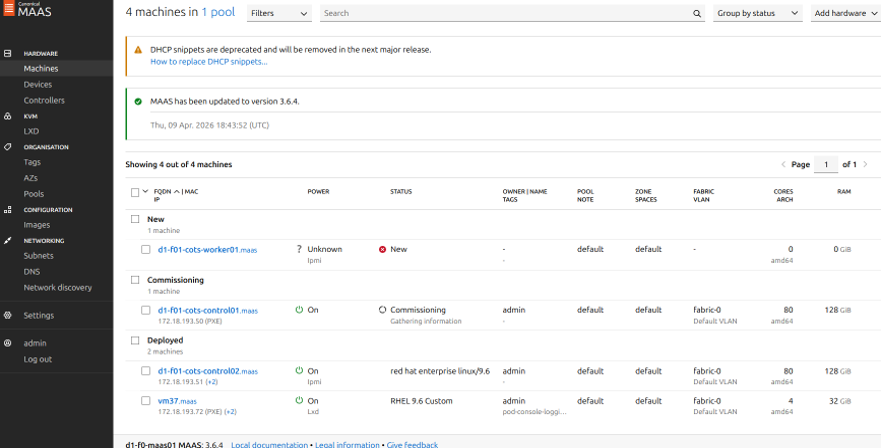
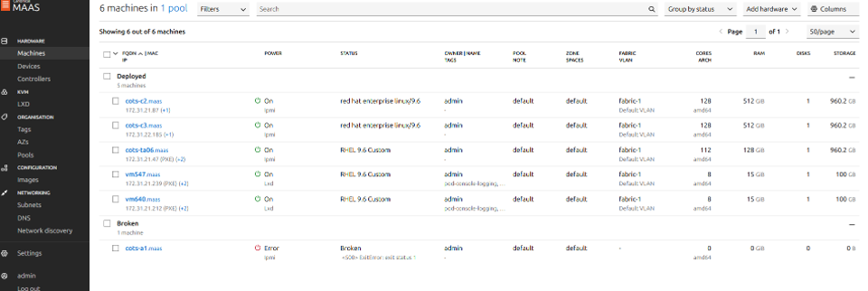
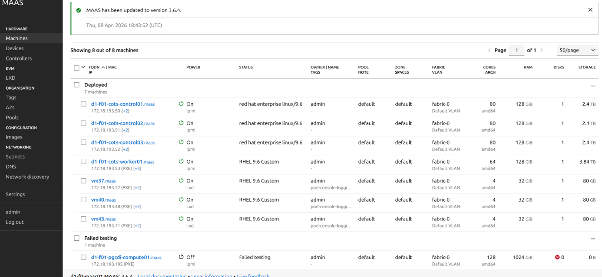
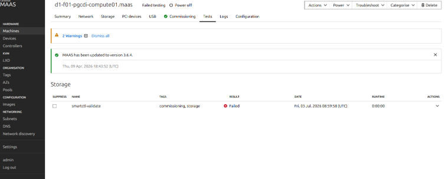
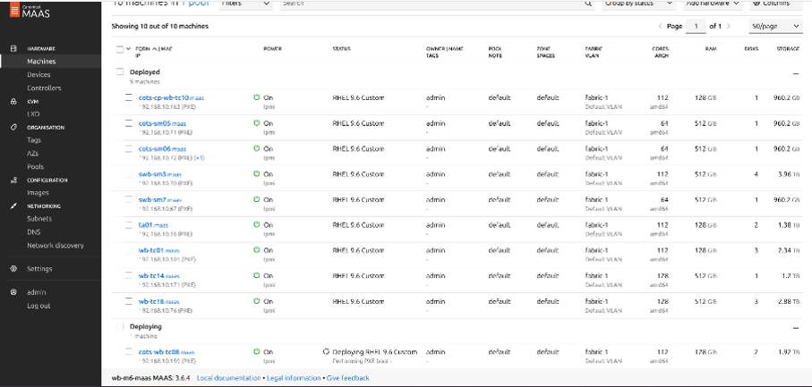
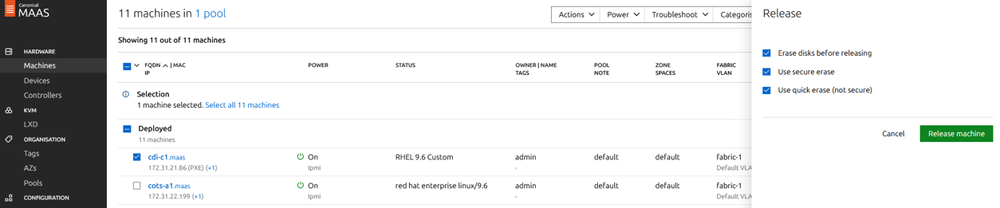
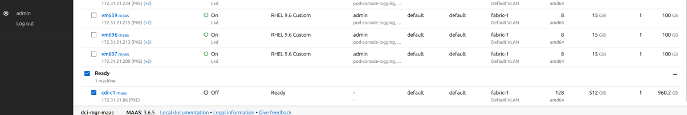
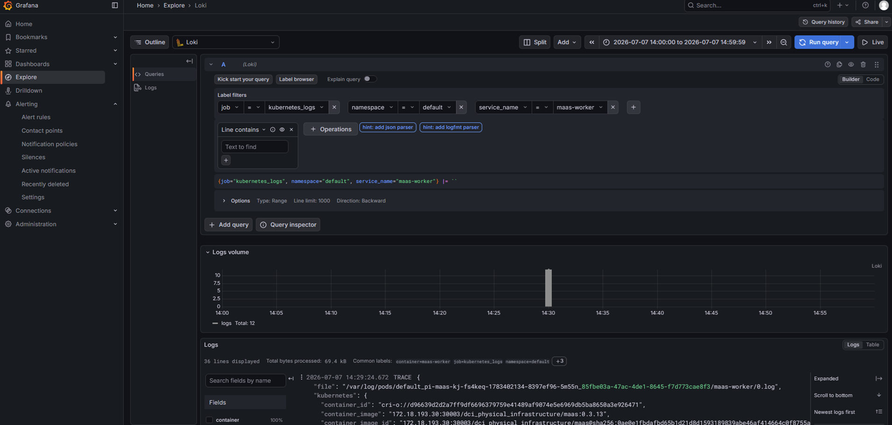

= DCI-2.0 トラブルシューティングマニュアル
:toc: macro
:toclevels: 3
:sectnums:
:sectnumlevels: 4
:xrefstyle: full
:section-refsig: 章
:figure-caption: 図
:table-caption: 表
:docinfo: shared
:source-highlighter: highlight.js
:highlightjs-theme: vs2015

第1.0版

2026年11月5日

NTT株式会社

.目次
toc::[]

== はじめに

本書は、DCI-2.0システムのトラブルシューティングについて、
DCI運用者やテナント運用者の実施作業を対象に説明するものです。

=== 環境およびバージョン差異に関する留意事項

本書に記載している画面キャプチャ、コマンド例、実行結果および確認結果は、説明を目的とした一例です。
利用する環境、ソフトウェアのバージョン、設定状態等により、表示内容や文言が一部異なる場合があるが、記載内容と大きく乖離していない限り、手順の実施可否や結果の正否には影響しません。

=== 章分類に関する留意事項

DCI管理用クラスタおよびDCIテナント論理インフラの双方で発生する問題が存在します。
該当する問題の記載が見つからない場合は、もう一方の章も併せてご確認ください。

== DCI管理用クラスタの問題

=== 構成管理DBのテーブルを再作成してデータ再登録する手順
本節は、構成管理DBを再構築する手段について説明します。

. ログインする構成管理DBのpodを確認する
+
database-cluster-rw の Endpoint のIPアドレスを持つpodを確認します。
+
以下の例では、database-cluster-rwのEndpoint のIPアドレス（172.17.10.219）を持つpodは「database-cluster-1」です。
+
[source, console]
----
$ kubectl get ep -n database -o wide
Warning: v1 Endpoints is deprecated in v1.33+; use discovery.k8s.io/v1 EndpointSlice
NAME                  ENDPOINTS                                                AGE
database-cluster-r    172.17.10.101:5432,172.17.10.219:5432,172.17.10.5:5432   66d
database-cluster-ro   172.17.10.101:5432,172.17.10.5:5432                      66d
database-cluster-rw   172.17.10.219:5432                                       66d

$ kubectl get pod -n database -o wide
NAME                 READY   STATUS    RESTARTS        AGE   IP              NODE            NOMINATED NODE   READINESS GATES
database-cluster-1   1/1     Running   1 (11d ago)     12d   172.17.10.219   wb-m6-mgr-cp2   <none>           <none>
database-cluster-2   1/1     Running   2 (7d22h ago)   12d   172.17.10.101   wb-m6-mgr-cp1   <none>           <none>
database-cluster-3   1/1     Running   10 (9d ago)     12d   172.17.10.5     wb-m6-mgr-cp3   <none>           <none>
----

. 構成管理DBのpodからPostgreSQLにログインする
+
1.の手順で確認したpodからPostgreSQLにログインします。
+
[source, console]
----
$ kubectl exec -it -n database database-cluster-1 -- bash
Defaulted container "postgres" out of: postgres, bootstrap-controller (init)
postgres@database-cluster-1:/$ psql -U postgres -d app
psql (17.0 (Debian 17.0-1.pgdg110+1))
Type "help" for help.

app=#
----

. 全テーブルを削除する
+
[source, console]
----
app=# drop table t_cdi, t_cdi_box, t_cdi_compute_pool, t_cdi_gpu, t_cdi_nic, t_cdi_ssd, t_cots_server_gpu, t_cots_server_pool, t_location, t_logical_server, t_maas, t_nw_port, t_nw_switch, t_os_info, t_physical, t_tenant, t_vlan ;
----

. テーブル削除されたこと確認する
+
[source, console]
----
app=# \dt;
----

. 各テーブルを作成するSQLを実行する
+
以下のyamlファイルのL8～L294をコピペして実行してください。
+
[source, console]
----
dci_manager/others/configuration-management-database/database-cluster
/database-init.yaml
----

. テーブルが作成されたこと確認する
+
[source, console]
----
app=# \dt;
----

. DB-API用のuserにテーブル操作権限を付与する
+
[source, console]
----
app=# GRANT SELECT, INSERT, UPDATE, DELETE ON ALL TABLES IN SCHEMA public TO api_user;
----

. 権限が付与されたことを確認する
+
[source, console]
----
app=# SELECT table_name, privilege_type FROM information_schema.role_table_grants WHERE table_schema = 'public'  AND grantee = 'api_user'  AND privilege_type IN ('SELECT', 'INSERT', 'UPDATE', 'DELETE') ORDER BY table_name, privilege_type;
 table_name | privilege_type 
--------------------+----------------
 t_cdi              | DELETE
 t_cdi              | INSERT
 t_cdi              | SELECT
 t_cdi              | UPDATE
 t_cdi_box          | DELETE
 t_cdi_box          | INSERT
 t_cdi_box          | SELECT
 t_cdi_box          | UPDATE
 t_cdi_compute_pool | DELETE
 t_cdi_compute_pool | INSERT
 t_cdi_compute_pool | SELECT
 t_cdi_compute_pool | UPDATE
 t_cdi_gpu          | DELETE
 t_cdi_gpu          | INSERT
 t_cdi_gpu          | SELECT
 t_cdi_gpu          | UPDATE
 t_cdi_nic          | DELETE
 t_cdi_nic          | INSERT
 t_cdi_nic          | SELECT
 t_cdi_nic          | UPDATE
 t_cdi_ssd          | DELETE
 t_cdi_ssd          | INSERT
 t_cdi_ssd          | SELECT
 t_cdi_ssd          | UPDATE
 t_cots_server_gpu  | DELETE
 t_cots_server_gpu  | INSERT
 t_cots_server_gpu  | SELECT
 t_cots_server_gpu  | UPDATE
 t_cots_server_pool | DELETE
 t_cots_server_pool | INSERT
 t_cots_server_pool | SELECT
 t_cots_server_pool | UPDATE
 t_location         | DELETE
 t_location         | INSERT
 t_location         | SELECT
 t_location         | UPDATE
 t_logical_server   | DELETE
 t_logical_server   | INSERT
 t_logical_server   | SELECT
 t_logical_server   | UPDATE
 t_maas             | DELETE
 t_maas             | INSERT
 t_maas             | SELECT
 t_maas             | UPDATE
 t_nw_port          | DELETE
 t_nw_port          | INSERT
 t_nw_port          | SELECT
 t_nw_port          | UPDATE
 t_nw_switch        | DELETE
 t_nw_switch        | INSERT
 t_nw_switch        | SELECT
 t_nw_switch        | UPDATE
 t_os_info          | DELETE
 t_os_info          | INSERT
 t_os_info          | SELECT
 t_os_info          | UPDATE
 t_physical         | DELETE
 t_physical         | INSERT
 t_physical         | SELECT
 t_physical         | UPDATE
 t_tenant           | DELETE
 t_tenant           | INSERT
 t_tenant           | SELECT
 t_tenant           | UPDATE
 t_vlan             | DELETE
 t_vlan             | INSERT
 t_vlan             | SELECT
 t_vlan             | UPDATE
(68 rows)
----

. main.goを使って構成管理DBにデータを再登録する
+
構築マニュアルの「構成管理DBへのリソース情報の登録」をご参照ください。

=== PodがCrashLoopBackOffを繰り返す場合の対処
==== xxx-node-feature-discovery-worker-yyyのPodの場合

本節では xxx-node-feature-discovery-worker-yyy の Pod が CrashLoopBackOff を繰り返す場合の対処方法を説明する。本事象は、ノード追加時に発生する場合があります。

以下では、gpu-operatorとnetwork-operatorのnode-feature-discovery-workerのpodがCrashLoopBackOffを繰り返す場合の例を説明します。

. Daemonset名を確認する。
+
[source, console]
----
$ kubectl get daemonsets.apps -n gpu-operator 
$ kubectl get daemonsets.apps -n nvidia-network-operator
----

. Podをrestsrtする。
+
[source, console]
----
$ kubectl rollout restart ds -n gpu-operator gpu-operator-node-feature-discovery-worker
$ kubectl rollout restart ds -n nvidia-network-operator network-operator-node-feature-discovery-worker
----

. Podの状態を確認する。
+
[source, console]
----
$ kubectl get pod -n gpu-operator 
$ kubectl get pod -n nvidia-network-operator 
----

==== k8s-dra-driver-gpuのkubelet pluginのPodの場合
本節では、k8s-dra-driver-gpuのkubelet pluginのPodがCrashLoopBackOffを繰り返す場合の対処方法を説明します。

* 事象
+
--
k8s-dra-driver-gpuのkubelet pluginのPodがCrashLoopBackOffを繰り返している。

[source, console]
----
$ kubectl get pod -n dra-driver-nvidia-gpu -o wide 
NAME                                               READY   STATUS             RESTARTS        AGE     IP                NODE                         NOMINATED NODE   READINESS GATES
dra-driver-nvidia-gpu-controller-b94fd47b6-5kzzw   1/1     Running            0               2d12h   192.168.117.59    d1-f01-cots-control01.maas   <none>           <none>
dra-driver-nvidia-gpu-kubelet-plugin-w2h2p         0/2     CrashLoopBackOff   34 (100s ago)   46m     192.168.117.215   d1-f01-pgcdi-compute02.maas        <none>           <none>
----

CrashLoopBackOffを引き起こしているPodをdescribeで確認してください。
[source, console]
----
Events:
  Type     Reason          Age                  From               Message
  ----     ------          ----                 ----               -------
  ...
  Warning  Unhealthy       5s (x7 over 2m25s)   kubelet            Liveness probe failed: timeout: failed to connect service "10.245.117.215:51516" within 10s: context deadline exceeded <1>
----
<1> LivenessProbeのタイムアウトが発生していたら該当します。
--

* 原因
+
--
51515, 51516 の2つのPortのLISTENが完了していない場合に上記の事象が発生します。
以下の例では、51515のみがLISTEN状態であり、51516がLISTEN状態となっていません。
[source, console]
----
$ kubectl exec -it -n dra-driver-nvidia-gpu dra-driver-nvidia-gpu-kubelet-plugin-w2h2p -- bash
Defaulted container "compute-domains" out of: compute-domains, gpus, init-container (init)
bash-5.2# netstat -tuln
Active Internet connections (only servers)
Proto Recv-Q Send-Q Local Address           Foreign Address         State       
tcp        0      0 :::51515                :::*                    LISTEN 
----
--

* 対処方法
+
--
PortのLISTENに時間がかかっているため、LivenessProbeの待ち時間(timeoutSeconds)を延長してください。
デフォルトでは10秒に設定してあり、こちらを任意の値に増やすことで延長できます。

[source, console]
----
$ kubectl -n dra-driver-nvidia-gpu edit daemonsets.apps dra-driver-nvidia-gpu-kubelet-plugin
  ...
        livenessProbe:
          failureThreshold: 3
          grpc:
            port: 51516 <1>
            service: liveness
          periodSeconds: 30
          successThreshold: 1
          timeoutSeconds: 10　　<2> 
----
<1> `grpc.port` が上記でLISTENしていなかったPortに該当する livenessProbe すべてについて、
<2> `timeoutSeconds` の値を増やしてください。
--

=== PVの異常により管理用クラスタ（テナント）に異常が生じた場合の対処

本章では、PVの異常（例：PV用ストレージが正常に起動していない、ディスクに空き容量がない場合など）により、
管理用クラスタおよびテナントに異常が発生した場合の対処方法について説明します。

以下では、PVとしてNFSを使用している場合の手順について説明します。

* 事象
+
--
NFSサーバにおけるサービス状態の確認手順の一例を以下に示します。

.NFSサーバでメモリ不足によりサービスが停止した場合の例
[source, console]
----
$ sudo systemctl status nfs-server.service 
× nfs-server.service - NFS server and services
     Loaded: loaded (/usr/lib/systemd/system/nfs-server.service; enabled; preset: enabled)
    Drop-In: /run/systemd/generator/nfs-server.service.d
             └─order-with-mounts.conf
     Active: failed (Result: exit-code) since Fri 2026-03-13 06:27:39 UTC; 1h 25min ago
   Duration: 1w 6d 22h 42min 56.315s
   Main PID: 114341 (code=exited, status=1/FAILURE)
        CPU: 22ms

Mar 13 06:27:39 d1-c01-nfs02 exportfs[114338]: exportfs: /etc/exports [1]: Neither 'subtree_check' or 'no_subtree_check' specified for export "*:/export/nfs".
Mar 13 06:27:39 d1-c01-nfs02 exportfs[114338]:   Assuming default behaviour ('no_subtree_check').
Mar 13 06:27:39 d1-c01-nfs02 exportfs[114338]:   NOTE: this default has changed since nfs-utils version 1.0.x
Mar 13 06:27:39 d1-c01-nfs02 rpc.nfsd[114341]: error starting threads: errno 12 (Cannot allocate memory)
Mar 13 06:27:39 d1-c01-nfs02 systemd[1]: nfs-server.service: Main process exited, code=exited, status=1/FAILURE
Mar 13 06:27:39 d1-c01-nfs02 systemd[1]: nfs-server.service: Failed with result 'exit-code'.
Mar 13 06:27:39 d1-c01-nfs02 systemd[1]: Stopped nfs-server.service - NFS server and services.
----
--

* 対処方法
+
--
. NFSサーバの問題解消 +
NFSサーバのメモリ不足や設定不備等を解消してください。 +
具体的な手順は、NFSサーバのマニュアル等を参照してください。

. システムまたはプロセス（Pod）の再起動 +
システム全体に影響が及んでいる場合は、システムの再起動を実施してください。 +
特定のプロセス（Pod）のみに異常が発生している場合は、該当Podを再起動してください。
--

=== PG-CDIの論理サーバの操作でエラーが発生する場合

停電復旧後や運用中に特定のユニットが再起動してしまった場合、PG-CDIの起動順が守られないことで論理サーバの操作でエラーが発生することがあります。 +
具体的には、論理サーバに組み込まれたSSDリソースが故障ステータスになり、MAASによるコミッショニングに失敗するなどの事象が発生します。 +
この場合は、PG-CDIの「システム構築手順書」の「Power Cycle 手順」の章を実施し、PG-CDIのシステムを再起動してください。

== DCIテナント論理インフラの問題
=== テナント構築に失敗した場合の対処
==== 払い出し対象の論理サーバのMAASマシン登録に失敗した場合
logicalserver の STATE が `Registering` のままとなっている場合、
MAAS GUIで該当マシンの状態を確認してください。

.MAASマシン登録に失敗した場合の logicalserver の例
[source, console]
----
$ kubectl get logicalservers.example.com -n dcirpm
NAME                               CLUSTER             ROLE                        LOCATION   TYPE         SERVER-ID                              STATE         AGE
tenant-1-controlplane-snt62        tenant-1-tenant-1   control-plane                                                                                            8s
tenant-1-controlplane-snt62-host   spare-cluster       host-for-vm-control-plane   dc1        COTSServer   8d7dd2b3-bd2a-4286-821c-9808cb652d68   Registering   5m1s
----

[[sec_case1_tenant_creation_failed_mass_error]]
===== ケース1：MAAS上のマシン状態がエラーとなる場合

* 事象
+
--
MAAS GUI では該当マシンの STATUS に失敗を示す赤色の × マークが表示されており、
POWER が `Unknown` となっています。

.MAAS上のマシン状態がエラーとなる場合の画面例

--
+
* 対処方法
+
--
[arabic]
** logicalserverのROLEがcontrol-planeまたはworkerまたはspareの場合
+
. MAAS上のマシン名（例：d1-f01-cots-worker01.maas）をもとにlogicalserverリソースからMachineリソースのnamespaceとnameを取得する
+
.実行手順
[source, console]
----
$ kubectl get logicalservers.example.com -n dcirpm -o json | jq -r '.items[]
  | select(.status.hostName=="<MAAS上のマシン名から末尾の".maas"を削除した文字列>")
  | [.spec.consumerRef.namespace, .spec.consumerRef.name]
  | @tsv'
----
+
.コマンド例 / 実行結果
[source, console]
----
$ kubectl get logicalservers.example.com -n dcirpm -o json | jq -r '.items[]
  | select(.status.hostName=="cdi-c1")
  | [.spec.consumerRef.namespace, .spec.consumerRef.name]
  | @tsv'
tenant-1        worker-md-1-t4x5k-khjl2
----
+
. 手順1で取得したリソース名のMachineを削除する
+
.実行手順
[source, console]
----
$ kubectl delete machine -n  <手順1で取得したMachineリソースのnamespace> <手順1で取得したMachineリソースのname>
----
+
.コマンド例 / 実行結果
[source, console]
----
$ kubectl delete machine -n tenant-1 worker-md-1-t4x5k-khjl2
machine.cluster.x-k8s.io "worker-md-1-t4x5k-khjl2" deleted from tenant-1 namespace
----
+
この対処を実施すると、MAAS上から対象マシンが削除され、新たにmachineとlogicalserverのリソースが作られて、MAASへのマシン登録から再実施されます。
+
** logicalserverのROLEがhost-for-vm-control-planeまたはhost-for-vm-workerの場合
+
. 対象のlogicalserverを削除する
+
.実行手順
[source, console]
----
$ kubectl delete logicalservers.example.com -n dcirpm <logicalserverのリソース名>
----
+
.コマンド例 / 実行結果
[source, console]
----
$ kubectl delete logicalservers.example.com -n dcirpm tenant-1-controlplane-snt62-host
logicalserver.example.com "tenant-1-controlplane-snt62-host" deleted from dcirpm namespace
----
+
この対処を実施すると、MAAS上から対象マシンが削除され、新たにVMホストのlogicalserverのリソースが作られて、MAASへのマシン登録から再実施されます。
--

===== ケース2：MAAS上のマシン状態がCommissioningから進まない場合
MAAS 上で Machine が Commissioning 状態となった後、通常は 5～10 分程度で完了し、テスト実行および OS デプロイへ遷移します。 +
10 分以上経過しても状態が遷移しない場合、または Failed commissioning となった場合は、
<<sec_case1_tenant_creation_failed_mass_error>>の手順を実施してください。

===== ケース3：MAAS上のマシン状態がBrokenとなる場合
構成管理DBのt_cdi_compute_poolとt_cots_server_poolの ipmi_userやipmi_passwordの設定値に誤りがある場合、
本事象が発生することがあります。

* 事象
+
--
MAAS GUI では該当マシンの STATUS に `Broken` が表示されており、
POWER が `Error` または `Unknown` となっています。

.MAAS上のマシン状態がBrokenとなる場合の画面例

--
+
+
* 対処方法
+
--
構成管理DBの対象の設定値を修正（update）を実施したうえで、
<<sec_case1_tenant_creation_failed_mass_error>>と同じ対処方法を実施してください。

.実行手順 / コマンド例
[source, console]
----
kubectl exec -n database database-cluster-2 -c postgres -- psql -U postgres -d app -c "update t_cdi_compute_pool set ipmi_password = '*****' where host_name = 'test-pgcdi-compute01'"
----
--

===== ケース4：MAAS上のマシン状態がFailed testingとなる場合
払い出し対象の論理サーバにて、コミッショニングの後テストに失敗しています。 +
CDI による論理サーバ作成時にアタッチされる SSD リソースに異常がある場合、
本事象が発生することがあります。

* 事象
+
--
MAAS GUI では該当マシンの STATUS に `Failed testing` が表示されています。

.MAAS上のマシン状態がFailed testingとなる場合の画面例（状態）

加えて、MAAS GUI の該当マシンの Tests 情報において、
Storage のテスト結果（RESULT）が `Failed` となっています。

.MAAS上のマシン状態がFailed testingとなる場合の画面例（テスト結果）

--
+
* 対処方法
+
--
CDI のコマンドを使用して論理サーバの状態およびアタッチされている SSD リソースの状態を確認してください。

異常が認められた SSD リソースについては、当該 SSD リソースが論理サーバへアタッチされないよう、
構成管理DB上で故障フラグを設定するなどの対処を実施してください。

その後、<<sec_case1_tenant_creation_failed_mass_error>>と同様の対処を実施してください。
--

==== 払い出し対象の論理サーバのOSデプロイが完了しない場合
* 事象
+
--
logicalserver の STATE が `Deploying` のままとなっている場合、
MAAS GUIで該当マシンの状態を確認してください。 +
MAAS GUI でも該当マシンの STATUS が `Deploying` のままで、
1時間以上経過しても `Deployed` にならない場合があります。

.払い出し対象の論理サーバのOSデプロイが完了しない場合の logicalserver の例
[source, console]
----
$ kubectl get logicalserver -A
NAMESPACE   NAME                               CLUSTER                   ROLE            LOCATION   TYPE         SERVER-ID                              STATE         AGE
dcirpm      tenant-1-controlplane-87pjg        tenant-1-cots3-tenant-1   control-plane   dc1        COTSServer   ec674a62-5a3f-472d-b07e-28a70c8d8e5e   Provisioned   47d
dcirpm      tenant-1-controlplane-mclnd        tenant-1-cots3-tenant-1   control-plane   dc1        COTSServer   c7a38ab4-b7d2-424b-84fc-105340af456e   Provisioned   22d
dcirpm      tenant-1-controlplane-p565s        tenant-1-cots3-tenant-1   control-plane   dc1        COTSServer   d98139e6-422b-4d1a-99f9-365330c87d59   Deploying     46m
dcirpm      tenant-1-worker-md-1-rn628-lcghh   tenant-1-cots3-tenant-1   worker          dc1        COTSServer   241038a9-6f3b-4da8-82da-3a5138038317   Provisioned   47d
----

.MAAS上のマシン状態がDeployingから変化しない場合の画面例

--
+
* 対処方法
+
--
本事象は、構成管理DBおよびテナント構築用 YAML に不備がない場合でも、特定のサーバにおいて低頻度で発生することが確認されています。

その後、<<sec_case1_tenant_creation_failed_mass_error>>と同様の対処を実施し、
MAASへのマシン登録から再度実施してください。
--

[[sec_case_tenant_creation_failed_cloud-init_error]]
==== 払い出し対象の論理サーバのOSデプロイ時にcloud-init処理が失敗した場合
MAAS GUIでは払い出し対象の論理サーバのステータスが「Deployed」と表示されているものの、
Machineリソースにおいて READY が True となっていない場合があります。
その場合、cloud-initのログを確認してください。処理が失敗している場合があります。

本節では、このような状態が発生した場合の対処方法について一例を説明します。

* 事象
+
--
. Machineリソースの確認
+
.Machineリソースの状態の例
[source, console]
----
$ kubectl get machine -A
NAMESPACE   NAME                           CLUSTER    NODE NAME        READY     AVAILABLE   UP-TO-DATE   PHASE          AGE    VERSION
tenant-1    controlplane-8n6qn             tenant-1   vm640.maas       True      True        True         Running        29h    v1.36.3
tenant-1    controlplane-9m5td             tenant-1   vm547.maas       True      True        True         Running        19d    v1.36.3
tenant-1    controlplane-n27d9             tenant-1   vm654.maas       True      True        True         Running        68m    v1.36.3
tenant-1    worker-md-comp-1-4hlt8-mtwzw   tenant-1                    False     False       True         Provisioning   16h    v1.36.3
----
+
. cloud-initのログの確認
+
cloud-initのログは、
DCIマネージャのコントロールプレーン（CP）から当該論理サーバへSSH接続（ユーザ名：cloud-user）し、
`/var/log/cloud-init-output.log` を参照して確認します。
+
例えば、`rhc connect` による外部（RHELサブスクリプション管理）への接続に失敗した場合、
ログに以下のエラーが出力されます。
その影響で dnf によるパッケージインストールも失敗しています。
+
.cloud-intのログの例（rhc connect失敗）
[source, console]
----
...
TYPE   STEP  ERROR
ERROR  rhsm  cannot connect to Red Hat Subscription Management: error: [Errno -2] Name or service not known
rhc connect failed on attempt 8, retrying in 5 seconds...
Connecting vm720.maas to Red Hat.
This might take a few seconds.

! Cannot connect to Red Hat Subscription Management
𐄂 Skipping connection to Red Hat Insights
𐄂 Skipping activation of Remote Host Configuration daemon

Manage your connected systems: https://red.ht/connector

The following errors were encountered during connect:

TYPE   STEP  ERROR
ERROR  rhsm  cannot connect to Red Hat Subscription Management: error: [Errno -2] Name or service not known
rhc connect failed on attempt 9, retrying in 5 seconds...
Connecting vm720.maas to Red Hat.
This might take a few seconds.

! Cannot connect to Red Hat Subscription Management
𐄂 Skipping connection to Red Hat Insights
𐄂 Skipping activation of Remote Host Configuration daemon

Manage your connected systems: https://red.ht/connector

The following errors were encountered during connect:

TYPE   STEP  ERROR
ERROR  rhsm  cannot connect to Red Hat Subscription Management: error: [Errno -2] Name or service not known
rhc connect failed after 10 attempts
2026-05-25 15:02:14,217 - cc_scripts_user.py[WARNING]: Failed to run module scripts_user (scripts in /var/lib/cloud/instance/scripts)
...
----
--

* 対処方法の例
+
[arabic]
** ケース1：YAMLに不備が無い場合
+
--
テナント構築用 YAML の KubeadmControlPlane および KubeadmConfigTemplate の `runcmd` に記載されたコマンドに不備がなく、一時的なネットワーク障害などの環境要因によって cloud-init が失敗した場合は、<<sec_case1_tenant_creation_failed_mass_error>>と同様の対処を実施してください。
--
+
** ケース2：YAMLに不備がある場合
+
--
テナント構築用 YAML の KubeadmControlPlane および KubeadmConfigTemplate の `runcmd` に記載されたコマンドに不備があり、cloud-init が失敗している場合があります。

例えば、`CNI_GW` の設定値誤りにより、上記の例で実行される `rhc connect` が失敗することがあります。
この場合は、下記の手順に従ってテナント論理インフラを削除したうえで、
テナント構築用 YAML の不備を修正してください。
その後、テナント論理インフラ構築を再実施してください。

. テナント論理インフラ削除　（DCIの管理用クラスタ K8s C-Planeで実行）
+
.実行手順
[source, console]
----
$ kubectl delete cluster -n <テナント構築yaml記載のClusterのnamespace> <テナント構築yaml記載のClusterのname>
----
+
.コマンド例
[source, console]
----
$ kubectl delete cluster tenant-1 -n tenant-1
----
+
テナント論理インフラが正常に削除できたことの確認方法は、運用マニュアルの「3.5.2.1 テナント論理インフラ削除」を参照してください。

. テナント論理インフラ構築　（DCI管理用クラスタ K8s C-Planeで実行）
+
.実行手順
[source, console]
----
$ cd <テナント構築yamlファイル格納ディレクトリ>
$ kubectl apply -f <テナント構築.yamlファイル名>
----
+
.コマンド例
[source, console]
----
$ kubectl apply -f tenant-a.yaml
----
-- 

==== 構成品配備失敗時の対処
本節では、構成品配備時にコンポーネントの配備に失敗した場合の切り戻し手順について説明します。

切り戻しの基本的な流れとしては、DCIマネージャから配備に失敗したコンポーネントをアンインストールし、
その後再インストールを実施します。

NOTE: 構成品配備時に付与されるラベルを削除することでもコンポーネントのアンインストールは可能です。
ただし、この方法では配備に失敗したコンポーネント以外も含めてアンインストールされるため、
本手順ではコンポーネント単位で個別に切り戻しを実施します。

===== HelmChartProxyによって配備されるコンポーネントの切り戻し
NOTE: NVIDIA Network Operator は ClusterResourceSet と組み合わせて配備されているため、
<<sec_replace_network_operator>> の手順をご参照ください。

対象のPodとyamlファイルの対応は以下の通りである。

[options="header"]
.HelmChartProxyのファイル名と対応するPod
|===
|ファイル名 |Pod
|argo-events.yaml	
|argo-events-controller-manager

.4+|cert-manager.yaml	
|cert-manager
|cert-manager-cainjector
|cert-manager-startupapicheck-k45td
|cert-manager-webhook

|cluster-autoscaler.yaml
|cluster-autoscaler-clusterapi-cluster-autoscaler

.4+|kyverno.yaml
|kyverno-admission-controller
|kyverno-background-controller
|kyverno-cleanup-controller
|kyverno-reports-controller

.5+|loki.yaml
|loki
|loki-canary
|loki-chunks-cache
|loki-gateway
|loki-results-cache

|nfs-subdir-external-provisioner.yaml
|nfs-provisioner-nfs-subdir-external-provisioner

.2+|nginx-gateway-fabric.yaml
|ngf-nginx-gateway-fabric
|gateway-nginx

|node-problem-detector.yaml
|node-problem-detector

.6+|nvidia-network-operator.yaml
|network-operator
|network-operator-node-feature-discovery-gc
|network-operator-node-feature-discovery-master
|network-operator-node-feature-discovery-worker
|network-operator-sriov-network-operator
|sriov-network-config-daemon

.2+|policy-reporter.yaml
|policy-reporter
|policy-reporter-kyverno-plugin

.8+|temporal.yaml
|elasticsearch-master
|temporal-stack-admintools
|temporal-stack-cassandra
|temporal-stack-frontend
|temporal-stack-history
|temporal-stack-matching
|temporal-stack-web
|temporal-stack-worker

.7+|tigera-operator.yaml
|tigera-operator
|calico-apiserver
|calico-kube-controllers
|calico-node
|calico-typha
|goldmane
|whisker

|vector.yaml
|vector

|vector-audit.yaml
|vector-audit

.2+|velero.yaml
|velero
|node-agent
|===

. 対象のアンインストール
+
[source,console]
----
$ cd <テナント構築に用いたdci_managerのパス>
$ cd others/tenant-infrastructure-management/deployments/<テナントnamespace>-components/
$ kubectl delete -f <対象yamlファイル>
----

. 対象の再インストール
+
[source,console]
----
$ kubectl apply -f <対象yamlファイル>
----

===== ClusterResourceSet（CRS）によって配備されるコンポーネントの切り戻し
====== CRSのJob経由でインストールされたコンポーネント
対象のPodとyamlファイルの対応は以下の通りである。

[options="header"]
.ConfigMapのファイル名と生成されたJobから配備されるPod
|===
|ファイル名 |Pod
|app-conn-info-maker-dci-config.yaml
|app-conn-info-maker-dci-controller-manager

.8+|harbor-config.yaml
|harbor-core
|harbor-database
|harbor-jobservice
|harbor-nginx
|harbor-portal
|harbor-redis
|harbor-registry
|harbor-trivy

.11+|nvidia-gpu-operator-config.yaml
|gpu-feature-discovery
|gpu-operator
|gpu-operator-node-feature-discovery-gc
|gpu-operator-node-feature-discovery-master
|gpu-operator-node-feature-discovery-worker
|nvidia-container-toolkit-daemonset
|nvidia-cuda-validator
|nvidia-dcgm-exporter
|nvidia-driver-daemonset
|nvidia-mig-manager
|nvidia-operator-validator
|dra-driver-nvidia-gpu-controller
|dra-driver-nvidia-gpu-kubelet-plugin

|prometheus-adapter-config.yaml
|prometheus-adapter

.9+|prometheus-config.yaml
|alertmanager-prometheus-kube-prometheus-alertmanager
|prometheus-b-grafana
|prometheus-b-kube-promethe-operator
|prometheus-grafana
|prometheus-kube-prometheus-operator
|prometheus-kube-state-metrics
|prometheus-prometheus-b-kube-promethe-prometheus
|prometheus-prometheus-kube-prometheus-prometheus
|prometheus-prometheus-node-exporter

.2+|scale-controller-config.yaml
|scale-controller-alert-receiver
|scale-controller-controller-manager
|===

. 対象の確認
+
[source,console]
----
$ helm --kubeconfig=<テナント用kubeconfig> list -A
----

. 対象のアンインストール
+
[source,console]
----
$ helm --kubeconfig=<テナント用kubeconfig> uninstall \
  -n <対象namespace> \
  <リリース名>
----

. 対象の再インストール
+
[source,console]
----
$ cd <テナント構築に用いたdci_managerのパス>
$ cd others/tenant-infrastructure-management/deployments/<テナントnamespace>-components/
$ vi <対象yamlファイル>
----
+
以下のように設定値を変更する。
+
[source,yaml]
----
ttlSecondsAfterFinished: 300  # ← 既存値から変更（例：400）
----
+
[source,console]
----
$ kubectl apply -f <対象yamlファイル>
----

====== sriov-device-settings の切り戻し
対象Podは以下の通りです。

[options="header"]
.対象のPod名
|===
|Pod名
|sriov-device-settings-job
|===

. Job削除
+
[source,console]
----
$ kubectl --kubeconfig=<kubeconfig> delete job \
  -n sriov-device-settings \
  sriov-device-settings-job
----

. Job設定変更
+
[source,console]
----
$ cd <テナント構築に用いたdci_managerのパス>
$ cd others/tenant-infrastructure-management/deployments/<テナントnamespace>-components/
$ vi sriov-device-settings-config.yaml
----
+
以下のように設定値を変更する。
+
[source,yaml]
----
ttlSecondsAfterFinished: 300  # ← 例：400に変更
----

. Job再インストール
+
[source,console]
----
$ kubectl apply -f sriov-device-settings-config.yaml
----

====== Watch GPU Status の切り戻し
対象Podは以下の通りです。

[options="header"]
.対象のPod名
|===
|Pod名
|watch-gpu-status-job
|mig-config-labeler
|===

. Job削除
+
[source,console]
----
$ kubectl --kubeconfig=<kubeconfig> delete job \
  -n watch-gpu-status \
  watch-gpu-status-job
----

. DaemonSet削除
+
[source,console]
----
$ kubectl --kubeconfig=<kubeconfig> delete daemonset \
  -n watch-gpu-status \
  mig-config-labeler
----

. 設定変更
+
インストールするyamlの設定に差分がない場合、ClusterAPIが再配備しないため、
metadataに無意味なデータを追記し、強制的に差分を作ってください。
+
[source,console]
----
$ cd <テナント構築に用いたdci_managerのパス>
$ cd others/tenant-infrastructure-management/deployments/<テナントnamespace>-components/
$ vi watch-gpu-status-config.yaml
----
+
[source,yaml]
----
spec:
  selector:
    matchLabels:
      app: mig-config-labeler
  template:
    metadata:
      labels:
          app: mig-config-labeler
      annotations:                            ← 意味のないアノテーションを追加
        force-restart: "2026-06-18T20:00:00"  ← 再インストールした時刻を記載
----
+
以下のように設定値を変更する。
+
[source,yaml]
----
ttlSecondsAfterFinished: 300  # ← 例：400に変更
----
+
NOTE: YAMLに差分がない場合、ClusterAPIが再配備を行わないため、無意味な差分を付与すること。

. 再インストール
+
[source,console]
----
$ kubectl apply -f watch-gpu-status-config.yaml
----

====== SR-IOV CNI の切り戻し
.対象のPod名
|===
|Pod名
|kube-sriov-cni-ds
|===

. DaemonSet削除
+
[source,console]
----
$ kubectl --kubeconfig=<kubeconfig> delete daemonset \
  -n nvidia-network-operator \
  kube-sriov-cni-ds
----

. 設定変更
+
インストールするyamlの設定に差分がない場合、ClusterAPIが再配備しないため、
metadataに無意味なデータを追記し、強制的に差分を作ってください。
+
[source,console]
----
$ cd <テナント構築に用いたdci_managerのパス>
$ cd others/tenant-infrastructure-management/deployments/<テナントnamespace>-components/
$ vi sriov-cni-daemonset-config.yaml
----
+
[source,yaml]
----
spec:
  selector:
    matchLabels:
      name: sriov-cni
  template:
    metadata:
      labels:
        name: sriov-cni
        tier: node
        app: sriov-cni
      annotations:                            ← 意味のないアノテーションを追加
        force-restart: "2026-06-18T20:00:00"  ← 再インストールした時刻を記載
----

. 再配備
+
[source,console]
----
$ kubectl apply -f sriov-cni-daemonset-config.yaml
----

====== temporal（OSS以外）の切り戻し
Temporalの再インストール手順は<<sec_reinstall_temporal>>をご参照ください。 +
対象Podは以下の通りです。

[options="header"]
.対象のPod名
|===
|Pod名
|temporal-client
|temporal-gateway
|temporal-workflow
|===

====== argo-events（OSS以外）の切り戻し
対象Podは以下の通りです。

[options="header"]
.対象のPod名
|===
|Pod名
|alertmanager-temporal-signal-sensor-sensor
|alertmanager-webhook-eventsource
|eventbus-default-js
|vector-temporal-signal-sensor-sensor
|vector-webhook-eventsource
|===

. EventSource削除
+
[source,console]
----
$ kubectl --kubeconfig=<kubeconfig> delete -n argo-events eventsource alertmanager-webhook
$ kubectl --kubeconfig=<kubeconfig> delete -n argo-events eventsource vector-webhook
----

. Sensor削除
+
[source,console]
----
$ kubectl --kubeconfig=<kubeconfig> delete -n argo-events sensor alertmanager-temporal-signal-sensor
$ kubectl --kubeconfig=<kubeconfig> delete -n argo-events sensor vector-temporal-signal-sensor
----

. EventBus削除
+
[source,console]
----
$ kubectl --kubeconfig=<kubeconfig> delete -n argo-events eventbus default
----

. 設定変更
+
[source,console]
----
$ cd <テナント構築に用いたdci_managerのパス>
$ cd others/tenant-infrastructure-management/deployments/<テナントnamespace>-components/
$ vi argo-events-config.yaml
----
+
以下のように設定値を変更する。
+
[source,yaml]
----
ttlSecondsAfterFinished: 300  # ← 例：400に変更
----

. 再インストール
+
[source,console]
----
$ kubectl apply -f argo-events-config.yaml
----

[[sec_replace_network_operator]]
===== NVIDIA Network Operator の切り戻し
NOTE: NVIDIA Network Operator は ClusterResourceSet と組み合わせて配備されているため、
HelmChartProxy と CRS 双方の再配備が必要になります。

対象Podは以下の通りです。

[options="header"]
.対象のPod名
|===
|Pod名
|network-operator
|sriov-network-config-daemon
|kube-multus-ds
|nv-ipam-controller
|nv-ipam-node
|他
|===

. NicClusterPolicy取得・削除
+
[source,console]
----
$ kubectl get configmap -n <namespace> nic-cluster-policy-config \
  -o jsonpath='{.data.nic-cluster-policy\.yaml}' > nic-cluster-policy.yaml
$ kubectl --kubeconfig=<kubeconfig> delete -f nic-cluster-policy.yaml
----

. Operator削除
+
[source,console]
----
$ cd <テナント構築に用いたdci_managerのパス>
$ cd others/tenant-infrastructure-management/deployments/<テナントnamespace>-components/
$ kubectl delete -f nvidia-network-operator.yaml
----

. 再インストール
+
[source,console]
----
$ kubectl apply -f nvidia-network-operator.yaml
----

. NicClusterPolicy再適用
+
[source,console]
----
$ kubectl --kubeconfig=<kubeconfig> apply -f nic-cluster-policy.yaml
----

==== テナント構築yamlをapplyしたがMAAS GUIに何も表示されない場合
テナント構築yamlをapplyし、5分以上経過してもMAAS GUIの `Machines` に何も表示されない場合は、主な原因として以下2つのことが考えられます。

- 構成管理DBの `t_maas` テーブルに登録されているMAASのURLもしくはAPIキーに誤りがある。 +
- テナント構築yamlの `DCIMachineTemplate` の `spec.template.spec` で定義している要求を満たすサーバが構成管理DBの `t_cots_server_pool` / `t_cdi_compute_pool` に登録されていない。

また、リソースプール管理のPodログを確認することで、多くの場合の原因を特定できますので、下記手順でログを確認し、必要な対処を行ったうえで <<sec_case_tenant_creation_failed_cloud-init_error>>の対処方法のケース2と同じ様に、テナント論理インフラを削除して テナント論理インフラ構築をやり直してください。 +

.リソースプール管理のPodログの確認手順
[source, console]
----
$ kubectl get pod -n resource-pool-manager-system 
NAME                                                        READY   STATUS    RESTARTS   AGE
resource-pool-manager-alert-receiver-5d5db447df-t7br5       1/1     Running   0          30d
resource-pool-manager-controller-manager-6c4cf95ffc-g5r9h   1/1     Running   0          30d
$ kubectl logs -n resource-pool-manager-system resource-pool-manager-controller-manager-6c4cf95ffc-g5r9h --tail 100
----

=== テナント削除に失敗した場合の対処
==== テナント削除の途中でノード削除に失敗した場合
テナント削除の途中でのノード削除において、<<sec_nodescaling_failed>>と同じ事象が発生する可能性があります。
この場合は同じ対処方法を実施してください。

=== DHRCの構成品のプロセス（Pod）の問題

DHRCの構成品（自作コンポとOSS）のプロセスは、Podとして動作するので、
K8sの機能（kubectl rollout restart Deployment / StatefulSet / DaemonSet）を用いて
Pod を手動で再起動してください。

* 例： リソースプール管理のPodの再起動
+
DCI運用者がDCI管理用クラスタのC-Planeにて以下を実施
+
[source, console]
----
$ kubectl rollout restart deployment -n resource-pool-manager-system  resource-pool-manager-controller-manager
----

ただし、以下については、kubectl rollout restartでは正しく再起動できないため、後述する個別の手順で再起動してください。

* Temporal
* ArgoEventsのeventbusのPV故障時

==== Temporalに問題が生じた場合の対処

本節では、Temporalに関する問題の対処方法を説明します。

===== OSS部のPodのセルフヒーリングに失敗した場合

Temporal の OSS 部の Pod が1台以上セルフヒーリングで復旧しなかった場合の対処方法を説明します。 +
OSS部だけを入れなおした場合でも、自作部側の対応（temporal-clientの再配備）も必要になります。

* 対象
+
--
OSS部のPodとは以下のPodです。

* elasticsearch-master
* temporal-stack-cassandra
* temporal-stack-frontend
* temporal-stack-history
* temporal-stack-matching
* temporal-stack-web
* temporal-stack-worker
--

* 対処方法
+
--
. OSS部全体をアンインストールする
+
[source, console]
----
$ helm uninstall temporal-stack -n temporal		
$ kubectl delete pvc -n temporal --all
----
. OSS部を再インストールする
+
[source, console]
----
$ cd <DCIアプリ監視設定時に使用したdci_tenant_infrastructureのパス>
$ cd app-monitor-dci/temporal/
$ helm install temporal-stack oci://$HARBOR_TNT:30003/offerings/temporal -n temporal --create-namespace -f temporal_values.yaml		
----
. temporal-clientを再配備する
[arabic]
.. temporal-clientを削除する	
+
[source, console]
----
$ kubectl delete -f k8s-client.yaml
----
.. temporal-clientを再配備する
+
[source, console]
----
$ kubectl apply -f k8s-client.yaml
----
--

===== 自作部のPodのセルフヒーリングに失敗した場合

Temporal の 自作部の Pod が1台以上セルフヒーリングで復旧しなかった場合の対処方法を説明します。

* 対象
+
--
自作部のPodとは以下のPodです。

* temporal-workflow
* temporal-gateway
* temporal-client
--

* 対処方法
+
--
. 該当コンポを削除する
+
[source, console]
----
$ cd <DCIアプリ監視設定時に使用したdci_tenant_infrastructureのパス>
$ cd app-monitor-dci/temporal/
$ kubectl delete -f k8s-workflow.yaml
$ kubectl delete -f k8s-client.yaml
$ kubectl delete -f k8s-signal-gateway.yaml
----

. 該当コンポを再配備する
+
再配備前にマニフェストを編集してください。手順は運用マニュアル「SHARD数の変更手順」の「Temporal関連コンポーネントの再配備」を参照してください。別名でファイルを作成した場合は、適宜 apply 対象のファイル名を変更してください。
+
その後、以下の手順で再配備を行ってください。
+
[source, console]
----
$ kubectl apply -f k8s-workflow.yaml
$ kubectl apply -f k8s-client.yaml
$ kubectl apply -f k8s-signal-gateway.yaml
----
--

===== Elasticsearch の Pod が一度でも全滅した場合

発生し得るケースとして、同施設に複数環境を置いている際に、施設で停電が起こった場合が考えらえます（計画停電の場合を含む）。Elasticsearch の Pod が一度でも全滅すると、インデックス部が破損してしまい、OSS 部を upgrade してインデックス部を再作成する必要があります。

* 事象
+
--
インデックス部が破損している場合、frontend / history / matching / worker が再起動を試みると Pod のステータスが init:2/3 から進まなくなります。
--

* 対処方法
+
--
. helm upgradeでインデックス部を再作成する
+
[source, console]
----
$ cd <DCIアプリ監視設定時に使用したdci_tenant_infrastructureのパス>
$ cd app-monitor-dci/temporal/
$ helm upgrade --install temporal-stack oci://$HARBOR_TNT:30003/offerings/temporal -n temporal -f temporal_values.yaml
----
--

===== PV破損時

本事象は、NFS の空き容量が無くなった場合に発生します。
PVが破損した場合、Cassandra が書き込みができなくなり、既存のワークフローも停止します。
一度PVが破損したら NFS の容量を確保するだけでは解決せず、
容量を確保したうえで、手動で以下のPV復旧手順を実施する必要があります。

. PV 故障が認められる Pod を削除する
+
例：database が故障していた場合
+
[source, console]
----
$ kubectl scale statefulset temporal-stack-cassandra --replicas=0 -n temporal
----

. 該当PVCを削除する
+
[source, console]
----
$ kubectl delete pvc -n temporal data-temporal-stack-cassandra-0
----

. Velero による restore を実行する
+
[source, console]
----
$ velero restore create --from-backup <backup-name> --include-namespaces temporal
----

. リストアのステータスを確認する
+
[source, console]
----
$ velero restore describe <restore-name>
----

. リソースとPVの復旧を確認する
+
[source, console]
----
$ kubectl get pod -n temporal
$ kubectl get pvc -n temporal
----

[[sec_reinstall_temporal]]
===== Temporalの再インストール方法

本節では、テナントに対してTemporalを再インストールする手順を説明します。

. テナントからTemporalをアンインストール
+
[source, console]
----
$ cd <DCIアプリ監視設定時に使用したdci_tenant_infrastructureのパス>
$ cd app-monitor-dci/temporal/
$ kubectl delete -f k8s-workflow.yaml
$ kubectl delete -f k8s-client.yaml
$ kubectl delete -f k8s-signal-gateway.yaml
$ helm uninstall -n temporal temporal-stack
$ kubectl delete pvc -n temporal --all
----

. OSS部を以下の手順でインストールする
+
[source, console]
----
$ helm install temporal-stack oci://$HARBOR_TNT:30003/offerings/temporal -n temporal --create-namespace -f temporal_values.yaml		
----

. しばらく待ってからOSS部の配備状態を確認する
+
[source, console]
----
$ kubectl get pod -n temporal
----

. 自作部を以下の手順でインストールする
+
インストール前にマニフェストを編集してください。手順は運用マニュアル「SHARD数の変更手順」の「Temporal関連コンポーネントの再配備」を参照してください。別名でファイルを作成した場合は、適宜 apply 対象のファイル名を変更してください。
+
その後、以下の手順でインストールを行ってください。
+
[source, console]
----
$ kubectl apply -f k8s-workflow.yaml
$ kubectl apply -f k8s-client.yaml
$ kubectl apply -f k8s-signal-gateway.yaml
----

. しばらく待ってから自作部の配備状態を確認する
+
[source, console]
----
$ kubectl get pod -n temporal
----

==== ArgoEventsのeventbusのPV破損時の対処

本事象は、NFS の空き容量が無くなった場合に発生します。
PV が破損したら eventbus が書き込めなくなり、既存のワークフローも停止します。
一度PVが破損したら NFS の容量を確保するだけでは解決せず、
容量を確保したうえで、手動で以下のPV復旧手順を実施する必要があります。

. eventbusのPodを削除する
+
[source, console]
----
$ kubectl scale statefulset eventbus-default-js --replicas=0 -n argo-events
----

. PVCを削除する
+
[source, console]
----
$ kubectl delete pvc -n argo-events eventbus-default-js-vol-eventbus-default-js-0
----

. Veleroによるrestoreを実行する
+
[source, console]
----
$ velero restore create --from-backup <backup-name> --include-namespaces argo-events
----

. リストアのステータスを確認する
+
[source, console]
----
$ velero restore describe <restore-name>
----

. リソースとPVの復旧を確認する
+
[source, console]
----
$ kubectl get pod -n argo-events
$ kubectl get pvc -n argo-events
----

=== app-conn-info-maker-dci-controller-managerが配備されない場合の対処
本節では、app-conn-info-maker-dci-controller-manager が配備されない場合の対処方法を説明します。 +
配備内容に影響しないパラメータを書き換え、Cluster APIにjobの再配備を行わせてください。

* DCIマネージャで実施
+
--
. app-conn-info-maker-dci-controller-managerのconfigmapを修正する
+
[source, console]
----
$ kubectl edit configmap -n <テナントのネームスペース> app-conn-info-maker-dci-config
----
+
例：`ttlSecondsAfterFinished: 300` の値を、設定されている値と異なる値に書き換える (ex.400など)

. Podの配備状況を確認する
+
[source, console]
----
$ kubectl --kubeconfig=<テナント用のkubeconfig> get pod -n dci
----
+
.出力例
+
[source, console]
----
NAME                                                          READY   STATUS      RESTARTS   AGE
app-conn-info-maker-dci-controller-manager-67c74f97b5-lrxxr   1/1     Running     0          4m46s <1>
app-conn-info-maker-dci-controller-manager-67c74f97b5-td7fk   1/1     Running     0          4m46s <1>
app-conn-info-maker-dci-install-job-pppmq                     0/1     Completed   0          4m48s
prometheus-adapter-7cdbf989cd-km92f                           1/1     Running     0          2d18h
prometheus-adapter-7cdbf989cd-ndrml                           1/1     Running     0          2d18h
----
<1> のPodが配備されています。
--

=== network=enabledの構成配備で失敗した場合の対処
本節では、network=enabledの構成配備で失敗した場合に、nvidia-network-operator関連をアンインストールする方法を説明します。
workerノードのSR-IOVが有効になっていないときにVF作成されずに、結果的にofedのpodがRunningならず、workerノードがrebootを繰り返すときなどに実施してください。

* DCIマネージャ側で実施：アンインストール
+
--
. NicClusterPolicyを削除する
+
[source, console]
----
$ kubectl get configmap -n <テナントのネームスペース> nic-cluster-policy-config -o jsonpath='{.data.nic-cluster-policy\.yaml}' > nic-cluster-policy.yaml
$ kubectl --kubeconfig=<テナント用のkubeconfig> delete -f nic-clouster-policy.yaml
----

. NVIDIA Network Operatorをアンインストールする
+
[source, console]
----
$ cd <テナント構築に用いたdci_managerのパス>
$ cd others/tenant-infrastructure-management/deployments/<テナントのネームスペース>-components/
$ kubectl delete -f nvidia-network-operator.yaml
----
--

* DCIマネージャ側で実施：再インストール
+
--
. NVIDIA Network Operatorを再インストールする
+
[source, console]
----
$ kubectl apply -f nvidia-network-operator.yaml
----

. Podを確認する
+
[source, console]
----
$ kubectl --kubeconfig=<テナント用のkubeconfig> get pod -n nvidia-network-operator
----
+
.出力例
+
[source, console]
----
NAME                                                             READY   STATUS    RESTARTS   AGE
kube-sriov-cni-ds-k5mt8                                          1/1     Running   1          21d
kube-sriov-cni-ds-ncwb7                                          1/1     Running   7          21d
kube-sriov-cni-ds-qkng7                                          1/1     Running   1          21d
kube-sriov-cni-ds-t8j6x                                          1/1     Running   1          21d
network-operator-67f6cc999d-rqw89                                1/1     Running   0          22s
network-operator-node-feature-discovery-gc-5f67b5d754-psknj      1/1     Running   0          22s
network-operator-node-feature-discovery-master-6c99ff55d-rw8nv   1/1     Running   0          22s
network-operator-node-feature-discovery-worker-4r9hb             1/1     Running   0          22s
network-operator-node-feature-discovery-worker-hnsqt             1/1     Running   0          22s
network-operator-node-feature-discovery-worker-msnrs             1/1     Running   0          22s
network-operator-node-feature-discovery-worker-q9zxk             1/1     Running   0          22s
network-operator-sriov-network-operator-764694bcc6-2z5hm         1/1     Running   0          22s
sriov-device-plugin-kr65r                                        1/1     Running   0          21s
sriov-network-config-daemon-2bcts                                1/1     Running   0          21s
sriov-network-config-daemon-5t4p6                                1/1     Running   0          21s
----

. NicClusterPolicyを再設定する
+
[source, console]
----
$ cd <1.のnic-cluster-policy.yamlの格納ディレクトリのパス>
$ kubectl --kubeconfig=<テナント用のkubeconfig> apply -f nic-cluster-policy.yaml
----
. Podの確認
+
[source, console]
----
$ kubectl --kubeconfig=<テナント用のkubeconfig> get pod -n nvidia-network-operator
----
+
.出力例
+
[source, console]
----
NAME                                                             READY   STATUS    RESTARTS   AGE
kube-multus-ds-2wsqm                                             1/1     Running   0          3m43s
kube-sriov-cni-ds-k5mt8                                          1/1     Running   1          22d
kube-sriov-cni-ds-ncwb7                                          1/1     Running   7          22d
kube-sriov-cni-ds-qkng7                                          1/1     Running   1          22d
kube-sriov-cni-ds-t8j6x                                          1/1     Running   1          22d
mofed-rhel9.6-756589c66-ds-c6l79                                 1/1     Running   0          118s
network-operator-67f6cc999d-rqw89                                1/1     Running   0          4m51s
network-operator-node-feature-discovery-gc-5f67b5d754-9zpxz      1/1     Running   0          2m1s
network-operator-node-feature-discovery-master-6c99ff55d-rw8nv   1/1     Running   0          4m51s
network-operator-node-feature-discovery-worker-4r9hb             1/1     Running   0          4m51s
network-operator-node-feature-discovery-worker-hnsqt             1/1     Running   0          4m51s
network-operator-node-feature-discovery-worker-msnrs             1/1     Running   0          4m51s
network-operator-node-feature-discovery-worker-q9zxk             1/1     Running   0          4m51s
network-operator-sriov-network-operator-764694bcc6-2z5hm         1/1     Running   0          4m51s
nv-ipam-controller-7f7cc85798-ctwnt                              1/1     Running   0          3m42s
nv-ipam-controller-7f7cc85798-gmvmn                              1/1     Running   0          3m42s
nv-ipam-node-gnqgq                                               1/1     Running   0          3m42s
rdma-shared-dp-ds-wgpxg                                          1/1     Running   0          57s
sriov-device-plugin-nnvtm                                        1/1     Running   0          57s
sriov-network-config-daemon-2bcts                                1/1     Running   0          4m50s
sriov-network-config-daemon-rpz22                                1/1     Running   0          57s
----

. (必要であれば) mofedドライバおよびGPU DriverのPodのトラブル対応を実施する
+
<<mofed-rhel9.6-XXXX>>を実施してください。

. VFの作成完了を確認する
+
[source, console]
----
$ kubectl --kubeconfig=<テナント用のkubeconfig> get sriovnetworknodestate -A
----
対象ノードのSYNC STATUSが「Succeeded」になるまで待ってください。
+
.出力例
+
[source, console]
----
NAMESPACE                 NAME             SYNC STATUS   DESIRED SYNC STATE   CURRENT SYNC STATE   AGE
nvidia-network-operator   cots-sm05.maas   Succeeded     Idle                 Idle                 6m56s
nvidia-network-operator   cots-sm06.maas   Succeeded     Idle                 Idle                 6m56s
----
--

=== GPUのMIG分割ポリシーが変更できなくなった場合の対処

本節では、使用中のGPUに対してMIG分割ポリシー変更操作を実行したことにより、以降のポリシー変更ができなくなった場合の対処方法を説明します。

各ノードのGPUに対しては、MIGの分割ポリシーを変更することが可能です。しかし、使用中のGPU（例：DCIアプリに割当中）に対してポリシー変更を実行した場合、変更処理が失敗し、その後のポリシー変更ができなくなる場合があります。

* 前提
+
--
選択可能なMIG分割ポリシーは、以下のコマンドで確認できます。

[source, console]
----
$ kubectl --kubeconfig=/home/cloud-user/tenant-for-{テナント用のネームスペース}.kubeconfig describe cm -n gpu-operator custom-mig-parted-configs
----
上記コマンドの出力に含まれる `config.yaml:` 内の `mig-configs[]` リストからポリシーを選択してください。

対象ノードのGPUのMIGの分割ポリシーは、以下のコマンドで変更できます。

[source, console]
----
$ kubectl --kubeconfig=/home/cloud-user/tenant-for-{テナント用のネームスペース}.kubeconfig label nodes <MIG分割を行うノード名> nvidia.com/mig.config=<MIG分割ポリシー> --overwrite	
----
--

* 事象
+
--
使用中のGPUに対してMIG分割ポリシーを変更した場合、変更処理が失敗し、以降は他のポリシーへの変更ができなくなります。
本問題が発生した場合、以下のログが出力されます。

.mig-manager のログ	
[source, console]
----
level=error msg="\nThe following GPUs could not be reset:\n  GPU 00000000:D5:00.0: In use by another client\n\n1 device is currently being used by one or more other processes (e.g., Fabric Manager, CUDA application, graphics application such as an X server, or a monitoring application such as another instance of nvidia-smi). Please first kill all processes using this device and all compute applications running in the system.\n"

level=debug msg="Running apply-exit hook"

level=fatal msg="Error applying MIG configuration with hooks: error resetting all GPUs: exit status 255"
----

.対象ノードの dmesg
[source, console]
----
[975580.582841] NVRM: nvCheckOkFailedNoLog: Check failed: Requested object not found [NV_ERR_OBJECT_NOT_FOUND] (0x00000057) returned from gisubscriptionGetGPUInstanceSubscription(pRsClient, RES_GET_HANDLE(pSubdevice), &pGPUInstanceSubscription) @ kernel_mig_manager.c:3091
----
--

* 対処方法
+
--
本問題が発生した場合、当該ノードを再起動することで回復できます。ただし、テナント運用者はノードへ直接アクセスできないため、DCI運用者へ対応を依頼する必要があります。

再起動の際は、ワークロード退避のためスケジューリング制御を実施してください。

. 対象ノードをスケジュール対象外にする
+
[source, console]
----
$ kubectl cordon <対象ノード名>
----
+
対象ノード上のDCIアプリが他のノードへ退避されるまで待機してください。

. DCI運用者に連絡して、対象ノードを再起動する
+
テナント運用者は、ssh等によるノードへのアクセスおよびノード上での操作ができません。 +
そのため、ノードの再起動はDCI運用者が実施する必要があります。
+
再起動後、対象ノードが `Ready` になるまで待機してください。

. 対象ノードをスケジュール対象に戻す	
+
[source, console]
----
$ kubectl uncordon <対象ノード名>	
----
--

=== NodeScalingRequestによるノード手動追加で失敗した場合の対処
本節では、NodeScalingRequestによるノード手動追加が失敗した場合の対処方法について説明します。
発生した事象に応じて、以下の対処方法を実施してください。

==== Nodeのスケールアップに失敗した場合（既存のMachineDeploymentのレプリカ数の増加時の失敗）
本節は、これまでテナントに存在した従来構成のサーバを追加しようとして失敗した場合の対処方法を説明します。その場合、テナントに従来構成のサーバを追加するために、既存の MachineDeployment のレプリカ数の増加が実施されています。

失敗状態から復旧する際は、失敗の状況（進行段階／原因）を確認し、必要な手順を実施してください。例えば、あるリソースの作成／変更前に失敗していた場合、そのリソースの削除／修正の手順はスキップしてください。

. NodeScalingRequest名を確認し、NodeScalingRequestを削除する。
+
.コマンド例
[source, console]
----
$ kubectl --kubeconfig=/home/cloud-user/tenant-1-sa.kubeconfig get nodescalingrequest -n tenant-1
$ kubectl --kubeconfig=/home/cloud-user/tenant-1-sa.kubeconfig delete nodescalingrequest <nodescalingrequest名> -n tenant-1
----
. MachineDeploymentに関連するMachineSetを取得し、`PausedAnnotation（"cluster.x-k8s.io/paused"）` に `true` を設定する。
. MachineDeploymentにラベル `"scaling.my.domain/in-progress-uid"` が付与されている場合は削除する。
. MachineDeploymentのレプリカ数を1減らす。
. 対象のMachineを削除する。
. 手順2で設定したMachineSetの `PausedAnnotation（"cluster.x-k8s.io/paused"）` を削除する。

通常、手順1を実施すると、NSRコントローラーが手順3および手順6も自動的に実施します。
ただし、Management Clusterとの通信異常などにより途中で処理が停止している場合は、
手動対応が必要となります。
一方、手順2、4、5はNSRコントローラーでは実施されないため、
これらの段階まで処理が進んだ状態で失敗している場合は、必ず手動で実施してください。

補足として、プロビジョニング完了前のLogicalServerが存在していても、
API ServerおよびDBが正常に動作している場合は、
手順5でMachineを削除することで連動してLogicalServerも削除されるため対処は不要です。

==== 新規構成のサーバ追加に失敗した場合（MachineDeploymentの新規作成時の失敗）
本節は、これまでテナントに存在しなかった新規構成のサーバを追加しようとして失敗した場合の対処方法を説明します。この場合、テナントに新規構成のサーバを追加するために、新規の MachineDeployment（及びDCIMachineTemplate）の作成が実施されています。

失敗状態から復旧する際は、失敗の状況（進行段階／原因）を確認し、必要な手順を実施してください。例えば、あるリソースの作成／変更前に失敗していた場合、そのリソースの削除／修正の手順はスキップしてください。

. NodeScalingRequestを削除する。
. MachineDeploymentが参照しているDCIMachineTemplateを確認する。
+
.実行手順
[source, console]
----
$ kubectl get machinedeployment \
  -n tenant-1 <machinedeployment名> \
  -o jsonpath='namespace={.metadata.namespace}{" name="}{.spec.template.spec.infrastructureRef.name}{"\n"}'
  
namespace=tenant-1 name=worker-1  # 参照しているDCIMachineTemplate名とNamespaceが出力されます
$ kubectl get dcimachinetemplates.infrastructure.cluster.x-k8s.io -n tenant-1 worker-1
NAME       AGE
worker-1   10h
$
----
. MachineDeployment名を確認し、MachineDeploymentを削除します。
+
.実行手順
[source, console]
----
$ kubectl get machinedeployment -n tenant-1
$ kubectl delete machinedeployment <machinedeployment名> -n tenant-1
----
. 手順2で確認したDCIMachineTemplateを削除する。

MachineDeploymentを削除することで、OwnerReferenceなどによりMachine、DCIMachine、LogicalServerも削除されます。上記のMachineDeployment削除後に、各リソースがなくなるまで待機頂き、すべてのリソース削除確認後に再度ノード追加をリトライしてください。

なお、復旧後のノード手動追加やり直し時に、あらかじめ用意したDCIMachineTemplateを使うような場合は、2.と4.をスキップしてください。

[[sec_nodescaling_failed]]
=== NodeScalingRequestによるノード手動削除で失敗した場合の対処
本節では、NodeScalingRequestによるノード手動削除が失敗した場合の対処方法について説明します。
発生した事象に応じて、以下の対処方法を実施してください。

==== マネージャネットワーク用NICの故障に起因する失敗
DCI運用者またはテナント運用者からノードの手動削除要求があった際に、
削除対象ノードのマネージャネットワーク用NICの故障によって
ノード削除処理が途中で失敗した場合の対処方法を説明します。

本事象は、ログ監視等によってDCI運用者がノード削除処理の異常を検知した場合を想定しています。

以下、`cdi-c1.maas` というノードを削除しようとした場合を例にします。 +
当該ノードのマネージャネットワークのIPアドレス（172.28.21.86）が疎通していません。

. ノード削除処理が途中で失敗していることを確認する
+
--
以下の例のように、対象 Machine の `PHASE` が `Deleting` となっている一方で、
対応する logicalserver の `STATE` が `Provisioned` のままとなっていることを確認してください。

.確認手順 / 確認結果
[source, console]
----
$ kubectl get machine -n tenant-2
NAME                           CLUSTER    NODE NAME     READY   AVAILABLE   UP-TO-DATE   PHASE      AGE     VERSION
controlplane-85xnq             tenant-2   vm697.maas    True    True        True         Running    5h53m   v1.36.3
controlplane-fs6f5             tenant-2   vm657.maas    True    True        True         Running    3d8h    v1.36.3
controlplane-p2sxf             tenant-2   vm659.maas    True    True        True         Running    3d5h    v1.36.3
worker-md-comp-1-pvkmb-7m77h   tenant-2   cdi-c1.maas   False   False       True         Deleting   55m     v1.36.3

$ kubectl get logicalservers.example.com -n dcirpm 
NAME                                    CLUSTER             ROLE                        LOCATION   TYPE             SERVER-ID                              STATE         AGE
(省略)
tenant-2-worker-md-comp-1-pvkmb-7m77h   tenant-2-tenant-2   worker                      dc1        ComposedServer   7cba6159-e514-46e3-bcec-7b9a8e96164b   Provisioned   55m
----

物理インフラの MAAS 制御用 Pod のログには、以下のようなメッセージが出力されています。

[source,text]
----
Host 172.28.21.86 failed: Task failed: Failed to connect to the host via ssh
----

この状態は、削除対象ノードへ SSH 接続して RHEL のサブスクリプション登録解除コマンドを実行する処理において、
SSH 接続に失敗したため、ノード削除処理が途中で停止していることを示しています。

.確認手順 / 確認結果
[source, console]
----
$ kubectl logs physical-infrastructure-maas-deployment-5987bd7b58-7dxz8 --tail 20
(省略)
I0703 15:55:40.479369       1 main.go:224] "end OsRelease" reply="result:ERROR error_message:\"{\\\"errorCode\\\":13,\\\"detailCode\\\":61,\\\"message\\\":\\\"Host 172.28.21.86 failed: Task failed: Failed to connect to the host via ssh: ssh: connect to host 172.28.21.86 port 22: No route to host\\\"}\"" err=null
----
--
+
. MAAS GUIにて、対象ノードを手動でリリースする
+
--
erase関連の3つのオプションはすべてチェック（✓）し、「Release machine」を押してください。

.MAAS GUIにて、対象ノードを手動でリリースする場合の画面例

以下のように対象リソースのステータスが `Ready` となっていることを確認してください。 +
`Ready` となっている場合、リリース処理は完了しています。

.MAAS GUIにて、対象ノードの手動リリース処理完了後の画面例

リリース処理完了後、削除処理のリトライが実行され、以降の削除処理が継続されます。 +
なお、削除処理のリトライ間隔は最大で約15分です。
--
+
. 削除対象ノードの削除を確認する
+
--
削除対象ノードのlogicalserverとmachineが消えていることを確認してください。

.確認手順 / 確認結果
[source, console]
----
$ kubectl get logicalservers.example.com -n dcirpm tenant-2-worker-md-comp-1-pvkmb-7m77h 
Error from server (NotFound): logicalservers.example.com "tenant-2-worker-md-comp-1-pvkmb-7m77h" not found

$ kubectl get machine -n tenant-2
NAME                 CLUSTER    NODE NAME    READY   AVAILABLE   UP-TO-DATE   PHASE     AGE     VERSION
controlplane-85xnq   tenant-2   vm697.maas   True    True        True         Running   6h28m   v1.36.3
controlplane-fs6f5   tenant-2   vm657.maas   True    True        True         Running   3d8h    v1.36.3
controlplane-p2sxf   tenant-2   vm659.maas   True    True        True         Running   3d5h    v1.36.3
----
--
+
. 削除対象ノードのサブスクリプション登録を解除する
+
--
ブラウザでRedHat コンソール（ https://console.redhat.com/insights ）にログインし、削除対象ノードのサブスクリプション登録を解除してください。
--

=== GrafanaでLokiに保存されているログが見れないノードがある場合の対処

本節では、GrafanaでLokiに保存されているログが見れないノードがある場合の対処方法を説明します。

ログが見れないノードの vector pod は Running になっているが、pod ログに以下の ERROR が出ている場合、
その vector pod を `kubectl delete pod` して再作成してください。

* 事象
+
--
[source, console]
----
$ kubectl get pod -n vector -o wide 
NAME                 READY   STATUS    RESTARTS   AGE     IP                NODE           NOMINATED NODE   READINESS GATES
vector-7nkbz         1/1     Running   0          2d18h   192.168.101.142   swb-sm3.maas   <none>           <none>
vector-927nr         1/1     Running   1          10d     192.168.101.41    wb-tc18.maas   <none>           <none>
vector-audit-blvnk   1/1     Running   1          11d     192.168.101.4     wb-tc18.maas   <none>           <none>
vector-mmmcc         1/1     Running   0          2d3h    192.168.101.198   swb-sm7.maas   <none>           <none>

$ kubectl logs -n vector vector-mmmcc |grep ERROR |grep 'failed with error client error' |tail -5
2026-05-29T04:21:26.456926Z ERROR kube_client::client::builder: Internal log [failed with error client error (Connect)] is being suppressed to avoid flooding.
2026-05-29T04:21:34.339229Z ERROR kube_client::client::builder: Internal log [failed with error client error (Connect)] has been suppressed 1 times.
2026-05-29T04:21:34.339241Z ERROR kube_client::client::builder: failed with error client error (Connect)
2026-05-29T04:21:47.236764Z ERROR kube_client::client::builder: failed with error client error (Connect)
2026-05-29T04:21:53.348466Z ERROR kube_client::client::builder: Internal log [failed with error client error (Connect)] is being suppressed to avoid flooding.

$ kubectl logs -n vector vector-7nkbz |grep ERROR |grep 'failed with error client error' |tail -5
2026-05-29T04:21:33.207073Z ERROR kube_client::client::builder: failed with error client error (Connect)
2026-05-29T04:21:58.831177Z ERROR kube_client::client::builder: failed with error client error (Connect)
2026-05-29T04:22:05.028195Z ERROR kube_client::client::builder: Internal log [failed with error client error (Connect)] is being suppressed to avoid flooding.
2026-05-29T04:22:15.455379Z ERROR kube_client::client::builder: Internal log [failed with error client error (Connect)] has been suppressed 2 times.
2026-05-29T04:22:15.455390Z ERROR kube_client::client::builder: failed with error client error (Connect)
----
--

=== Resource Claim Template の適用に失敗した場合の対処
Resource Claim Template の適用時に、クラスタでサポートされている API バージョンと
マニフェストに記載された `apiVersion` が一致しない場合は、適用に失敗します。
その場合は、Resource Claim Template の `apiVersion` を修正してください。

* 事象
+
--
Resource Claim Template を適用した際に、以下のような API バージョン不一致を示すエラーが発生します。

.ログの出力例
[source,console]
----
$ kubectl apply -f resourceClaimTemplates-gpu.yaml
resource mapping not found for name: "single-gpu" namespace: "dci" from "resourceClaimTemplates-gpu.yaml": no matches for kin
d "ResourceClaimTemplate" in version "resource.k8s.io/v1beta1"
ensure CRDs are installed first
...
----
--
+
* 原因
+
--
クラスタでサポートされている Resource Claim Template の API バージョンと、
マニフェストに記載された `apiVersion` が一致していません。

.K8s クラスタでサポートされている API バージョン
[source,console]
----
$ kubectl api-versions | grep resource.k8s.io
resource.k8s.io/v1
----
上記の結果から、クラスタでは `resource.k8s.io/v1` がサポートされていることが分かります。

.Resource Claim Template の apiVersion
[source,yaml]
----
apiVersion: resource.k8s.io/v1beta1
kind: ResourceClaimTemplate
metadata:
  name: single-gpu
  namespace: dci
spec:
  spec:
    devices:
      requests:
      - name: t4
        deviceClassName: gpu.nvidia.com
        selectors:
        - cel:
            expression: "device.attributes['gpu.nvidia.com'].productName=='Tesla T4'"
----
マニフェストでは `resource.k8s.io/v1beta1` が指定されており、
クラスタでサポートされている API バージョンと一致していません。

--
+
* 対処
+
--
Resource Claim Template の `apiVersion` を、
クラスタでサポートされている API バージョンに変更してください。

なお、API バージョンの変更に伴い、Resource Claim Template の定義形式も変更されているため、
`apiVersion` の修正に加えて、マニフェストを以下のように修正してください。

.修正例 
[source,yaml]
----
apiVersion: resource.k8s.io/v1              <1>
kind: ResourceClaimTemplate
metadata:
  name: single-gpu
  namespace: dci
spec:
  spec:
    devices:
      requests:
      - name: t4
        exactly:                            <2>
          deviceClassName: gpu.nvidia.com   <3>
          selectors:
          - cel:
              expression: "device.attributes['gpu.nvidia.com'].productName=='Tesla T4'"
----
<1> API バージョンを「v1」に変更してください
<2> name の直後に「exactly」を加えてください
<3> 以降のインデントをずらしてください
--

=== DCIアプリが配備できない場合の対処
サンプルアプリPodが起動しない場合、以下の内容を確認し、対処を実施してください。

該当しない場合は、Pod のマニフェストを確認し、必要に応じて修正した上で再配備を実施してください。 +
再配備により問題が解消する場合があります。

==== 2nd NIC (Multus) のIP割当に失敗している場合
Multus の IPAM コンポーネント (`nv-ipam-node`) に問題が発生している場合があります。 +
その場合は、`nv-ipam-node` Daemonsetを再起動することで復旧する場合があります。

* 事象
+
--
サンプルアプリPodのイベントまたはログに、
以下のような Multus ネットワークに関するエラーが繰り返し出力されます。

.ログの出力例
[source,console]
----
$ kubectl describe pod -n dci dciapp-nixlcomm-conn-3z-b78f78bcc-5d9km
...
Warning  FailedCreatePodSandBox  2s     kubelet            Failed to create pod sandbox: rpc error: code = Unknown desc = failed to create pod network sandbox k8s_dciapp-nixlcomm-conn-3z-b78f78bcc-5d9km_dci_6be9375e-ee6a-46b9-8bd9-206d907ad3f1_0(5d60c6d2c9792f55884c050953a604dfddcdd4f6ba24852349f4f1947f35ed6d): error adding pod dci_dciapp-nixlcomm-conn-3z-b78f78bcc-5d9km to CNI network "multus-cni-network": plugin type="multus" name="multus-cni-network" failed (add): [dci/dciapp-nixlcomm-conn-3z-b78f78bcc-5d9km/6be9375e-ee6a-46b9-8bd9-206d907ad3f1:demo-network2]: error adding container to network "demo-network2": grpc call failed: rpc error: code = DeadlineExceeded desc = stream terminated by RST_STREAM with error code: CANCEL
Normal   AddedInterface          1s     multus             Add eth0 [10.245.221.172/32] from k8s-pod-network
----

配備先ノードで稼働している `nv-ipam-node` Podのログに、
「network is unreachable」というメッセージが出力されます。

.Pod一覧の例
[source,console]
----
$ kubectl get pod -A -o wide | grep nv-ipam
nvidia-network-operator           nv-ipam-controller-fb5946c77-sfcrb                                1/1     Running                       0               32h     192.168.100.12    cots-wb-tc08.maas      <none>           <none>
nvidia-network-operator           nv-ipam-controller-fb5946c77-xnsvv                                1/1     Running                       0               32h     192.168.100.250   cots-sm05.maas         <none>           <none>
nvidia-network-operator           nv-ipam-node-crxpg                                                1/1     Running                       0               32h     192.168.100.133   cots-sm06.maas         <none>           <none>
----

Pod 名が「nv-ipam-node-crxpg」であることを確認したため、当該 Pod のログを確認します。

.ログの出力例
[source,console]
----
$ kubectl logs -n nvidia-network-operator  nv-ipam-node-crxpg
{"ts":1784801741664.4934,"logger":"UnhandledError","caller":"cache/reflector.go:166","msg":"Unhandled Error","err":"pkg/mod/k8s.io/client-go@v0.32.6/tools/cache/reflector.go:251: Failed to watch *v1alpha1.IPPool: failed to list *v1alpha1.IPPool: Get \"h
ttps://10.96.0.1:443/apis/nv-ipam.nvidia.com/v1alpha1/namespaces/nvidia-network-operator/ippools?resourceVersion=113614\": dial tcp 10.96.0.1:443: connect: network is unreachable"}
{"ts":1784801777414.5015,"caller":"cache/reflector.go:569","msg":"pkg/mod/k8s.io/client-go@v0.32.6/tools/cache/reflector.go:251: failed to list *v1alpha1.CIDRPool: Get \"https://10.96.0.1:443/apis/nv-ipam.nvidia.com/v1alpha1/namespaces/nvidia-network-op
erator/cidrpools?resourceVersion=113588\": dial tcp 10.96.0.1:443: connect: network is unreachable","v":0}
----
--
+
* 対処
+
--
`nv-ipam-node` Daemonset を再起動します。 +
再起動後、しばらく待つとサンプルアプリPodが正常に配備される場合があります。

. Daemonset 名を確認する
+
[source,console]
----
$ kubectl get daemonset -n nvidia-network-operator
...
nv-ipam-node                                                2         2         2       2            2           <none>                                                                                                                                                                                                                                          49d
...
----

. `nv-ipam-node` Daemonset を再起動する
+
[source,console]
----
$ kubectl rollout restart daemonset nv-ipam-node -n nvidia-network-operator
daemonset.apps/nv-ipam-node restarted
----
--

=== DCIAppState CRが作成されない場合の対処
本節では、DCIアプリ配備時に、本来連動して作成される DCIAppState CR が作成されない場合の対処方法について説明します。特に、TemporalおよびそのバックエンドであるCassandraの異常に起因するケースを対象とし、ログの確認方法と代表的な原因（ストレージ容量不足など）、ならびに復旧手順を示します。

* 事象
+
--
Temporalの各コンポーネントのログに以下のようなエラーが出力されます。

* Temporalの各コンポーネントのログ例
+
TemporalのPod名は以下のコマンドで確認できます。
+
[source,console]
----
$ kubectl get pod -n temporal
----
+
また、各Podのログは以下のコマンドで確認できます。
+
[source,console]
----
$ kubectl logs <Temporalの各コンポーネントのPod名> -n temporal
----
+
主なログ例を以下に示します。
+
** temporal-gateway
*** Workflowへの問い合わせ失敗（CANCEL、timeout）
** temporal-workflow
*** タスク取得失敗（stream terminated / context deadline exceeded）
** temporal-frontend、temporal-history
*** Cassandraへの接続失敗（connection refused、no hosts available）
** temporal-cassandra
*** FS書き込みエラー（ClosedChannelException など）
--

* 原因
+
--
本事象が発生している場合、特にNFSを使用しているtemporal-cassandraにおいて、ストレージ容量不足が原因となっている可能性があります。

* ストレージの容量確認例
+
.空き容量不足時の例
[source,console]
----
$ kubectl exec -n temporal temporal-stack-cassandra-0 -- df -h
Filesystem                                                                     Size     Used    Avail    Use%     Mounted on
...
172.28.197.102:/export/nfs/temporal-data-temporal-stack-cassandra-0-pvc-XXXX   1018G   966G     0G   100%   /var/lib/cassandra
----
--

* 対処方法
+
--
. NFSストレージの容量確保 +
不要なデータの削除等により、NFSの空き容量を確保してください。

. Temporalの再配備 +
NFSの容量確保後、Temporal全体を再配備してください。 +
再配備手順については、<<sec_reinstall_temporal>>を参照してください。
--

=== DCIアプリを削除できない場合の対処
本節では、DCIアプリを削除する際に、マニフェスト (yamlファイル) による削除 (kubectl delete -f) を実行しても、Deployment / ReplicaSet / Podが削除されない場合の対処方法について説明します。
この場合、Podに設定されているfinalizerが削除処理をブロックしている可能性があるため、finalizerを手動で削除します。

* DCIアプリ削除時にPodが削除されない場合の対処

. 削除対象のPodを確認する  (@テナント論理インフラ Control Plane)
+
以下のコマンドで削除対象Podを特定してください。以下の例では、dciapp-nixlcomm-XXX が対象の場合で説明します。
+
.実行手順
[source, console]
----
$ kubectl get pod -n dci
----
+
.コマンド例 / 実行結果
[source, console]
----
$ kubectl get pod -n dci
...
dciapp-nixlcomm-xxx-xxxxx   Running
...
----

. Podのfinalizerを削除する  (@テナント論理インフラ Control Plane)
+
.実行手順
[source, console]
----
$ kubectl edit -n dci pod <削除対象Podの名前>
...
metadata:
  finalizers: <1>
  - example.com/finalizer <1>
...
----
<1> 上記の finalizers 部分を削除してください。

. Podが削除されることを確認する  (@テナント論理インフラ Control Plane)
+
.実行手順
[source, console]
----
$ kubectl get pod -n dci
----
+
.コマンド例 / 実行結果
[source, console]
----
削除対象Podが一覧に表示されなければ成功
----

=== CardScalingRequestによるカード手動追加で失敗した場合の対処
本節では、CardScalingRequestによるカード手動追加が失敗した場合の対処方法について説明します。 発生した事象に応じて、以下の対処方法を実施してください。

==== カード手動追加で指定した枚数の空きGPUがなくカード追加が成功しない場合
本節は、テナント運用者がカード追加要求後、十分時間(※)が経過してもカード追加が成功しないことからカード追加を諦めてDCI運用者に依頼し、DCI運用者がカード追加要求される前のノードに復旧する際の手順を説明します。 +
(※)約10分以上。要求したGPUの空きがある場合は約10分間でカード追加が成功(完了)します。

* 事象 +
テナント運用者によるカード追加の確認で、十分時間が経過してもCardScalingRequestのPHASEがNodeScalingUpままとなり、同名のNodeScalingRequestのPHASEがCreatingから変わらない状況になる場合、カード追加が成功していないことになります。
+
--
[source, console]
.テナント運用者によるCardScalingRequestの確認例 (@テナント論理インフラ K8s Control Plane)
----
$ kubectl get cardscalingrequests.cluster.my.domain -A
NAMESPACE   NAME           TARGETNODE                    OPERATION   PHASE           AGE
default     add-failed-2   d1-m02-pgcdi-compute02.maas   add         NodeScalingUp   17m
----
[source, console]
.テナント運用者によるNodeScalingRequestの確認例 (@テナント論理インフラ K8s Control Plane)
----
$ kubectl get nodescalingrequests.cluster.my.domain -A
NAMESPACE   NAME           TYPE     PHASE      AGE
default     add-failed-2   create   Creating   17m
----
--
DCI運用者側では、LogicalServerのSTATEがDRPowerdOffから変わっていないことと、リソースプール管理のpodログに対象のLogicalServerに関して”no available CDI resource found”のメッセージが繰り返し出力されていることで、要求されたGPUが不足してカード追加が成功していないことを確認できます。
+
--
[source, console]
.DCI運用者によるLogicalServerの確認例 (@DCI管理用クラスタ K8s Control Plane)
----
$ kubectl get logicalservers.example.com -n dcirpm 
NAME                                   CLUSTER             ROLE            LOCATION   TYPE             SERVER-ID                              STATE          AGE
tenant-1-controlplane-hw8dp            tenant-1-tenant-1   control-plane   dc1        COTSServer       72ec9021-d7f0-4b15-bd23-0a9a055c3062   Provisioned    60d
tenant-1-worker-md-1-dx5wz-pc8mc       tenant-1-tenant-1   worker          dc1        COTSServer       85f13157-47f0-422c-84f2-573c7ee32c63   Provisioned    60d
tenant-1-worker-md-snyku-6sdhf-8mqhk   tenant-1-tenant-1   worker          dc1        ComposedServer   1a985af0-c8e6-40a1-a539-7d58594d0768   Provisioned    8d
tenant-2-controlplane-qdct9            tenant-2-tenant-2   control-plane   dc1        COTSServer       875b9c04-bd83-4150-8e67-9f01087c7604   Provisioned    6d16h
tenant-2-worker-md-94ier-rvllp-fpskv   tenant-2-tenant-2   worker          dc1        ComposedServer   b50bcad3-8e95-4e84-9e32-6effcee325ea   DRPoweredOff   2d21h
----
[source, console]
.DCI運用者によるリソースプール管理のpodログの確認例 (@DCI管理用クラスタ K8s Control Plane)
----
$ kubectl logs -n resource-pool-manager-system resource-pool-manager-controller-manager-9dc56c858-l7zhx |grep tenant-2-worker-md-94ier-rvllp-fpskv | grep 'no available CDI resource found' |tail -3
E0713 21:22:30.545928       1 controller.go:474] "Reconciler error" err="failed to reconfigure GPUs: failed to build GPU reconfiguration parameter: old=&{Model:NVIDIA-BLACKWELL Num:1 Assignments:[{UUID:GPU-7b0324d7-3ac4-fffb-a8e0-6f740627376a}]}, new=&{Model:NVIDIA-BLACKWELL Num:4 Assignments:[{UUID:GPU-7b0324d7-3ac4-fffb-a8e0-6f740627376a}]}: failed to select CDI resource for adding GPUs: model=NVIDIA-BLACKWELL, num=3: not enough CDI resources: required={storage:0 gpu:3 nic:0}, storages=[], GPUs=[], NICs=[]: no available CDI resource found" controller="logicalserver" controllerGroup="example.com" controllerKind="LogicalServer" LogicalServer="dcirpm/tenant-2-worker-md-94ier-rvllp-fpskv" namespace="dcirpm" name="tenant-2-worker-md-94ier-rvllp-fpskv" reconcileID="ba8ae71c-c53e-4470-bc8c-04a368d27f70"
E0713 21:25:21.634173       1 controller.go:474] "Reconciler error" err="failed to reconfigure GPUs: failed to build GPU reconfiguration parameter: old=&{Model:NVIDIA-BLACKWELL Num:1 Assignments:[{UUID:GPU-7b0324d7-3ac4-fffb-a8e0-6f740627376a}]}, new=&{Model:NVIDIA-BLACKWELL Num:4 Assignments:[{UUID:GPU-7b0324d7-3ac4-fffb-a8e0-6f740627376a}]}: failed to select CDI resource for adding GPUs: model=NVIDIA-BLACKWELL, num=3: not enough CDI resources: required={storage:0 gpu:3 nic:0}, storages=[], GPUs=[], NICs=[]: no available CDI resource found" controller="logicalserver" controllerGroup="example.com" controllerKind="LogicalServer" LogicalServer="dcirpm/tenant-2-worker-md-94ier-rvllp-fpskv" namespace="dcirpm" name="tenant-2-worker-md-94ier-rvllp-fpskv" reconcileID="a5de31da-8c1c-49c4-9b23-1333c5dbb569"
E0713 21:30:56.356435       1 controller.go:474] "Reconciler error" err="failed to reconfigure GPUs: failed to build GPU reconfiguration parameter: old=&{Model:NVIDIA-BLACKWELL Num:1 Assignments:[{UUID:GPU-7b0324d7-3ac4-fffb-a8e0-6f740627376a}]}, new=&{Model:NVIDIA-BLACKWELL Num:4 Assignments:[{UUID:GPU-7b0324d7-3ac4-fffb-a8e0-6f740627376a}]}: failed to select CDI resource for adding GPUs: model=NVIDIA-BLACKWELL, num=3: not enough CDI resources: required={storage:0 gpu:3 nic:0}, storages=[], GPUs=[], NICs=[]: no available CDI resource found" controller="logicalserver" controllerGroup="example.com" controllerKind="LogicalServer" LogicalServer="dcirpm/tenant-2-worker-md-94ier-rvllp-fpskv" namespace="dcirpm" name="tenant-2-worker-md-94ier-rvllp-fpskv" reconcileID="4f223b2f-6469-464f-85e9-500d9e3bbaf3"
----
--

* DCI運用者による復旧手順
. カード追加が成功していないCardScalingRequestと同名のNodeScalingRequestを確認 (@DCI管理用クラスタ K8s Control Plane) +
テナント運用者から復旧依頼を受けたDCI運用者は、カード追加が成功していないCardScalingRequestと同名のNodeScalingRequestを確認します。 +
※--kubeconfigオプションで、対象テナントを操作するためのkubeconfigファイルを指定してください。
+
--
.実行手順
[source, console]
----
$ kubectl --kubeconfig <対象テナントのkubeconfigファイルパス> get cardscalingrequests.cluster.my.domain -A
$ kubectl --kubeconfig <対象テナントのkubeconfigファイルパス> get nodescalingrequests.cluster.my.domain -A
----
.コマンド例 / 実行結果
[source, console]
----
$ kubectl --kubeconfig /home/cloud-user/tnt2.kc get cardscalingrequests.cluster.my.domain -A
NAMESPACE   NAME           TARGETNODE                    OPERATION   PHASE           AGE
default     add-failed-2   d1-m02-pgcdi-compute02.maas   add         NodeScalingUp   17m

$ kubectl --kubeconfig /home/cloud-user/tnt2.kc get nodescalingrequests.cluster.my.domain -A
NAMESPACE   NAME           TYPE     PHASE      AGE
default     add-failed-2   create   Creating   17m
----
--

. NodeScalingRequestから作られたMachineDeploymentを特定 (@DCI管理用クラスタ K8s Control Plane) +
確認したNodeScalingRequestから作られたMachineDeploymentを特定します。
+
--
.実行手順
[source, console]
----
$ kubectl --kubeconfig <対象テナントのkubeconfigファイルパス> get nodescalingrequests.cluster.my.domain <NodeScalingRequest名> -o jsonpath='{.status.clusterNamespace}/{.status.machineDeploymentName}{"\n"}'
----
.コマンド例 / 実行結果
[source, console]
----
$ kubectl --kubeconfig /home/cloud-user/tnt2.kc get nodescalingrequests.cluster.my.domain add-failed-2 -o jsonpath='{.status.clusterNamespace}/{.status.machineDeploymentName}{"\n"}'
tenant-2/worker-md-z96wa
----
--

. NodeScalingRequestとCardScalingRequestの削除 (@DCI管理用クラスタ K8s Control Plane) +
NodeScalingRequestから作られたMachineDeploymentを特定した後、このNodeScalingRequestを削除してCardScalingRequestも削除します。
+
--
.実行手順
[source, console]
----
$ kubectl --kubeconfig <対象テナントのkubeconfigファイルパス> delete nodescalingrequests.cluster.my.domain <NodeScalingRequest名>
$ kubectl --kubeconfig <対象テナントのkubeconfigファイルパス> delete cardscalingrequests.cluster.my.domain <CardScalingRequest名>
----
.コマンド例 / 実行結果
[source, console]
----
$ kubectl --kubeconfig /home/cloud-user/tnt2.kc delete nodescalingrequests.cluster.my.domain add-failed-2 
nodescalingrequest.cluster.my.domain "add-failed-2" deleted from default namespace

$ kubectl --kubeconfig /home/cloud-user/tnt2.kc delete cardscalingrequests.cluster.my.domain add-failed-2 
cardscalingrequest.cluster.my.domain "add-failed-2" deleted from default namespace
----
--

. 特定したMachineDeployment（カード追加が成功していないLogicalServerに紐づくMachineDeployment）をスケールインする
[arabic]
.. 特定したMachineDeploymentを確認 (@DCI管理用クラスタ K8s Control Plane)
+
--
.実行手順
[source, console]
----
$ kubectl get machinedeployment -n <対象テナントnamespace名> <MachineDeployment名>
----
.コマンド例 / 実行結果
[source, console]
----
$ kubectl get machinedeployment -n tenant-2 worker-md-z96wa
NAME              CLUSTER    AVAILABLE   DESIRED   CURRENT   READY   AVAILABLE   UP-TO-DATE   PHASE     AGE   VERSION
worker-md-z96wa   tenant-2   False       1         1         0       0           1            Running   46m   v1.36.3
----
--
.. 上記で確認したAVAILABLEなレプリカ数にスケーリング (@DCI管理用クラスタ K8s Control Plane)
+
--
.実行手順
[source, console]
----
$ kubectl scale machinedeployments.cluster.x-k8s.io -n <対象テナントnamespace名> <MachineDeployment名> --replicas=<AVAILABLEなレプリカ数>
----
.コマンド例 / 実行結果
[source, console]
----
$ kubectl scale machinedeployments.cluster.x-k8s.io -n tenant-2 worker-md-z96wa --replicas=0
machinedeployment.cluster.x-k8s.io/worker-md-z96wa scaled
----
--

. カード追加要求をする前のノードと同じスペックのノード手動追加を行う +
DCI運用者は、テナント運用者がカード追加要求をする前のノードと同じスペックのDCIMachineTemplate・NodeScalingRequestのyamlファイルを必要に応じて作成し、テナントに対してノード手動追加を行います。
[arabic]
.. カード追加要求をする前のノードと同じスペックのDCIMachineTemplateが存在しなければDCIMachineTemplateを作成する (@DCI管理用クラスタ K8s Control Plane)
+
--
.実行手順
[source, console]
----
$ kubectl apply -f dci-machine-template.yaml
----
.コマンド例 / 実行結果
[source, console]
----
$ kubectl apply -f dci-machine-template.yaml
dcimachinetemplate.infrastructure.cluster.x-k8s.io/worker-test created
----
--
.. カード追加要求をする前のノードと同じスペックのNodeScalingRequestでテナントに対してノード手動追加を行う (@DCI管理用クラスタ K8s Control Plane)
+
--
.実行手順
[source, console]
----
$ kubectl --kubeconfig <対象テナントのkubeconfigファイルパス> apply -f node-scaling-request.yaml
----
.コマンド例 / 実行結果
[source, console]
----
$ kubectl --kubeconfig /home/cloud-user/tnt2.kc apply -f node-scaling-request.yaml
nodescalingrequest.cluster.my.domain/node-addition-request-pgcdi-compute created
----
--

. MachineDeploymentに紐づくDCIMachineTemplateを特定し、削除が必要な条件に該当すればそれぞれを削除する。
+
- MachineDeployment削除が必要な条件 +
MachineDeploymentのレプリカ数を0にスケーリングした場合は削除します。
- DCIMachineTemplate削除が必要な条件 +
MachineDeploymentのレプリカ数を0にスケーリングした場合、かつ該当MachineDeploymentが使用していたDCIMachineTemplateが他のMachineDeploymentから使用されていない場合は削除します。
- 削除手順
[arabic]
.. MachineDeploymentに紐づくDCIMachineTemplateを特定 (@DCI管理用クラスタ K8s Control Plane)
+
--
.実行手順
[source, console]
----
$ kubectl get machinedeployment -n <対象テナントnamespace名> <MachineDeployment名> -o jsonpath='{.metadata.namespace}/{.spec.template.spec.infrastructureRef.name}{"\n"}'
----
.コマンド例 / 実行結果
[source, console]
----
$ kubectl get machinedeployment -n tenant-2 worker-md-z96wa -o jsonpath='{.metadata.namespace}/{.spec.template.spec.infrastructureRef.name}{"\n"}'
tenant-2/worker-dmt-tfhzd
----
--
.. 特定したDCIMachineTemplateを確認 (@DCI管理用クラスタ K8s Control Plane)
+
--
.実行手順
[source, console]
----
$ kubectl get dcimachinetemplates.infrastructure.cluster.x-k8s.io -n <対象テナントnamespace名> <DCIMachineTemplate名> 
----
.コマンド例 / 実行結果
[source, console]
----
$ kubectl get dcimachinetemplates.infrastructure.cluster.x-k8s.io -n tenant-2 worker-dmt-tfhzd 
NAME               AGE
worker-dmt-tfhzd   46m
----
--

.. レプリカ数を0にスケーリングした際はMachineDeploymentを削除 (@DCI管理用クラスタ K8s Control Plane)
+
--
.実行手順
[source, console]
----
$ kubectl delete machinedeployments.cluster.x-k8s.io -n <対象テナントnamespace名> <MachineDeployment名>
----
.コマンド例 / 実行結果
[source, console]
----
$ kubectl delete machinedeployments.cluster.x-k8s.io -n tenant-2 worker-md-z96wa 
machinedeployment.cluster.x-k8s.io "worker-md-z96wa" deleted from tenant-2 namespace
----
--

.. レプリカ数を0にスケーリングしたMachineDeploymentが使用していたDCIMachineTemplateを削除 (@DCI管理用クラスタ K8s Control Plane) +
該当MachineDeploymentが使用していたDCIMachineTemplateが、他のMachineDeploymentから使用されていない場合は削除可能です。
+
--
.実行手順
[source, console]
----
$ kubectl delete dcimachinetemplates.infrastructure.cluster.x-k8s.io -n <対象テナントnamespace名> <DCIMachineTemplate名>
----
.コマンド例 / 実行結果
[source, console]
----
$ kubectl delete dcimachinetemplates.infrastructure.cluster.x-k8s.io -n tenant-2 worker-dmt-tfhzd
dcimachinetemplates.infrastructure.cluster.x-k8s.io "worker-dmt-tfhzd" deleted from tenant-2 namespace
----
--

==== カード手動追加でカード追加後のテナントへの再joinで失敗した場合
<<sec_cardscalingrequest_delete_after_tenant_join_failed>> と同じケースが発生する可能性があり、その場合の復旧手順は同じになります。

=== CardScalingRequestによるカード手動削除で失敗した場合の対処
本節では、CardScalingRequestによるカード手動削除が失敗した場合の対処方法について説明します。 発生した事象に応じて、以下の対処方法を実施してください。

[[sec_cardscalingrequest_delete_after_tenant_join_failed]]
==== カード手動削除でカード削除後のテナントへの再joinで失敗した場合
本節は、テナント運用者がカード削除要求後、十分時間(※)が経過してもカード削除が成功しないことからDCI運用者に復旧を依頼し、DCI運用者が当該ノードを復旧する際の手順を説明します。 +
(※)約10分以上。

* 事象 +
カード削除対象のMachineのREADYがUnknownになっており、LogicalServerのSTATEはProvisionedになっています。Machineに紐づくLogicalServerは、LogicalServerのCONSUMER-NSとCONSUMER-NAMEがMachineのNAMEとNAMESPACEと一致することで確認でます。
+
--
.Machineの確認例 (@DCI管理用クラスタ K8s Control Plane)
[source, console]
----
$ kubectl get machine -A
NAMESPACE   NAME                          CLUSTER    NODE NAME                   READY     AVAILABLE   UP-TO-DATE   PHASE         AGE     VERSION
tenant-1    controlplane-c8ccx            tenant-1   vm40.maas                   True      True        True         Running       4d      v1.36.3
tenant-1    controlplane-snt62            tenant-1   vm37.maas                   True      True        True         Running       4d1h    v1.36.3
tenant-1    controlplane-sttqs            tenant-1   vm43.maas                   True      True        True         Running       3d23h   v1.36.3
tenant-1    worker-md-1-t4x5k-khjl2       tenant-1   d1-f01-cots-worker01.maas   True      True        True         Running       4d      v1.36.3
tenant-1    worker-md-uimrm-fh5tp-mrkwm   tenant-1                               Unknown   False       True         Provisioned   37m     v1.36.3
----
.Machineに紐づくLogicalServerの確認例 (@DCI管理用クラスタ K8s Control Plane)
[source, console]
----
$ kubectl get logicalservers.example.com -n dcirpm -o wide 
NAME                               CLUSTER             ROLE                        LOCATION   TYPE             SERVER-ID                              MACHINE-ID   LS-ID   MANAGER-IP       HOST-IP          CNI-IP          APPDATA-IP      CONSUMER-NS   CONSUMER-NAME                 STATE         AGE
tenant-1-controlplane-c8ccx        tenant-1-tenant-1   control-plane               dc1        VM               vm40                                   dyadxx       40      172.28.193.48    172.28.162.2     172.28.165.14                   tenant-1      controlplane-c8ccx            Provisioned   4d
tenant-1-controlplane-c8ccx-host   spare-cluster       host-for-vm-control-plane   dc1        COTSServer       c886df42-484c-47aa-8772-c4f2aaf07934   ak34cn       39      172.28.193.50    172.28.162.254   172.28.165.12                                                               Provisioned   4d
tenant-1-controlplane-snt62        tenant-1-tenant-1   control-plane               dc1        VM               vm37                                   ryfy44       37      172.28.193.72    172.28.162.253   172.28.165.11                   tenant-1      controlplane-snt62            Provisioned   4d1h
tenant-1-controlplane-snt62-host   spare-cluster       host-for-vm-control-plane   dc1        COTSServer       8d7dd2b3-bd2a-4286-821c-9808cb652d68   ew7y7w       36      172.28.193.51    172.28.162.252   172.28.165.10                                                               Provisioned   4d1h
tenant-1-controlplane-sttqs        tenant-1-tenant-1   control-plane               dc1        VM               vm43                                   y4kesh       43      172.28.193.71    172.28.162.4     172.28.165.16                   tenant-1      controlplane-sttqs            Provisioned   3d23h
tenant-1-controlplane-sttqs-host   spare-cluster       host-for-vm-control-plane   dc1        COTSServer       fe4308af-a8a8-41c6-89f5-28c1106c866c   g63qqf       42      172.28.193.52    172.28.162.3     172.28.165.15                                                               Provisioned   3d23h
tenant-1-worker-md-1-t4x5k-khjl2   tenant-1-tenant-1   worker                      dc1        COTSServer       c64cc56a-8bc3-461c-acd8-8c3440f24a96   xp7k4b       41      172.28.193.53    172.28.162.1     172.28.165.13   172.28.168.10   tenant-1      worker-md-1-t4x5k-khjl2       Provisioned   4d
tenant-1-worker-md-2-bmmnw-7tc9h   tenant-1-tenant-1   worker                      dc1        ComposedServer   326bd049-1994-412a-89b2-02ab3267f6d0   fs4keq       48      172.28.193.195   172.28.162.5     172.28.165.17   172.28.168.11   tenant-1      worker-md-uimrm-fh5tp-mrkwm   Provisioned   3d18h
----
--
DCI管理クラスタのGrafanaにアクセスし、Lokiに保存されている下記のPodログを確認すると `err=\"Get \\\"http://<MAASのIPアドレス>:5240/MAAS/api/2.0/machines/fs4keq/\\\": dial tcp 172.28.193.15:5240: i/o timeout\"` のようなメッセージが出力されています。
+
  ** Grafanaの画面左のメニュー > Explore > データソースにlokiを設定する +
  ** Label filters で "job=kubernetes_logs"、"namespace=default"、"service_name=maas-worker" を選択し、Run queryを押下する

+
.Lokiに保存されているmaas-workerログ参照例

* DCI運用者による復旧手順 +
. kubeadm joinで使うtokenを発行する
[arabic]
.. DCI管理用クラスタからテナントのControl Plane にSSH接続 (@DCI管理用クラスタ K8s Control Plane) +
DCI管理用クラスタからテナントのいずれか1つのControl PlaneのマネージャNWのIP(※1)でSSH接続します。
+
--
.実行手順
[source, console]
----
$ ssh cloud-user@<テナントのControl Plane のマネージャNWのIP>
----

(※1)マネージャNWのIPは、DCI管理用クラスタで以下を実行して表示されるMANAGER-IP になります。
[source, console]
----
$ kubectl get logicalservers.example.com -n dcirpm -o wide
----
--
.. tokenを発行する (@テナント論理インフラ K8s Control Plane) +
+
--
.実行手順
[source, console]
----
$ kubeadm token create --print-join-command
----
.実行手順
[source, console]
----
$ kubeadm token create --print-join-command
kubeadm join 172.28.23.175:6443 --token **************** --discovery-token-ca-cert-hash sha256:************************************************
----
--
.. テナント論理インフラのControl Planeからログアウト (@テナント論理インフラ K8s Control Plane)
+
--
.実行手順
[source, console]
----
$ exit
----
--

. カード増減に失敗したWorker Nodeをkubeadm joinでクラスタに再joinする
[arabic]
.. DCI管理用クラスタからカード増減に失敗したWorker NodeにSSH接続 (@DCI管理用クラスタ K8s Control Plane) +
DCI管理用クラスタからカード増減に失敗したWorker NodeにマネージャNWのIPでSSH接続します。
+
--
.実行手順
[source, console]
----
$ ssh cloud-user@<カード増減に失敗したWorker NodeのマネージャNWのIP>
----
--
.. kubeadm join用のyamlファイル作成 (@テナント論理インフラ Worker Node) +
/tmp/kubeadm-join.yaml を作成します。
+
--
.実行手順
[source, console]
----
$ vi /tmp/kubeadm-join.yaml
----

[source, yaml]
----
apiVersion: kubeadm.k8s.io/v1beta4
discovery:
  bootstrapToken:
    apiServerEndpoint: 172.28.165.30:6443   <1>
    caCertHashes:
    - sha256:************************************************   <2>
    token: ****************  <3>
kind: JoinConfiguration
nodeRegistration:
  criSocket: /var/run/crio/crio.sock
  kubeletExtraArgs:
  - name: eviction-hard
    value: nodefs.available<10%,memory.available<100Mi
  - name: v
    value: "4"
  - name: node-ip
    value: 172.28.165.17  <4>
  taints:
  - effect: NoSchedule
    key: node.cluster.x-k8s.io/uninitialized
----
<1> token発行で表示されたjoin先のエンドポイント(例: 172.28.23.175:6443）を設定 +
<2> token発行で表示された--discovery-token-ca-cert-hashの文字列を設定 +
<3> token発行で表示された--tokenの文字列を設定 +
<4> kubectl get logicalservers.example.com -n dcirpm -o wide で表示された カード増減に失敗したWorkerの CNI-IPを設定 +

--
.. テナント論理インフラのK8sクラスタにjoinする (@テナント論理インフラ Worker Node)
+
--
.実行手順
[source, console]
----
$ sudo kubeadm join --config /tmp/kubeadm-join.yaml
----
--
.. テナント論理インフラのWorker Nodeからログアウト (@テナント論理インフラ Worker Node)
+
--
.実行手順
[source, console]
----
$ exit
----
--

. 復旧確認 (@DCI管理用クラスタ K8s Control Plane) +
再joinしたWorker NodeのREADYがTrueになることを確認します。
+
--
.実行手順
[source, console]
----
$ kubectl get machine -A
----
.コマンド例 / 実行結果
[source, console]
----
$ kubectl get machine -A
NAMESPACE   NAME                          CLUSTER    NODE NAME                     READY   AVAILABLE   UP-TO-DATE   PHASE     AGE     VERSION
tenant-1    controlplane-c8ccx            tenant-1   vm40.maas                     True    True        True         Running   4d     v1.36.3
tenant-1    controlplane-snt62            tenant-1   vm37.maas                     True    True        True         Running   4d     v1.36.3
tenant-1    controlplane-sttqs            tenant-1   vm43.maas                     True    True        True         Running   4d     v1.36.3
tenant-1    worker-md-1-t4x5k-khjl2       tenant-1   d1-f01-cots-worker01.maas   True      True        True         Running       4d      v1.36.3
tenant-1    worker-md-uimrm-fh5tp-mrkwm   tenant-1   d1-f01-pgcdi-compute02.maas     True    True        True         Running   19h   v1.36.3
----
--

=== SR-IOV Device PluginのPodが配備されず、VFが作成されない場合の対処
本節では、NVIDIA Network Operatorを配備し、SriovNetworkNodePolicyのリソースが作成されているにもかかわらず、VFが作成されていなかった場合の対処方法について説明します。
この対処方法は、SR-IOV Device PluginのPod(sriov-device-plugin-xxxx)が作成されていない状況を想定しており、SR-IOV Device Pluginの配備を試みます。

* SR-IOV Device Pluginの配備されない原因の確認

. ノードのラベルの確認  (@テナント論理インフラ Control Plane)
+
以下のコマンドでVFが作成されていないノードのラベルを確認してください。SR-IOV Device Pluginが無効化されていることを確認します。
+
.実行手順
[source, console]
----
$ kubectl describe node <ノード名> | grep sriovnetwork.openshift.io/device-plugin
----
+
.コマンド例 / 実行結果
[source, console]
----
$ kubectl describe node xxxx.maas | grep sriovnetwork.openshift.io/device-plugin
                    sriovnetwork.openshift.io/device-plugin=Disabled
----

* SR-IOV Device Pluginの復旧

. ラベルの張り直しを試行 (@テナント論理インフラ Control Plane)
+
以下のコマンドでNode Feature Discoveryをリスタートし、ノードのハードウェア情報を再検出し、その情報をノードラベルとして Kubernetes に登録します。
+
.実行手順
[source, console]
----
$ kubectl rollout restart daemonset -n nvidia-network-operator network-operator-node-feature-discovery-worker
----
+
.コマンド例 / 実行結果
[source, console]
----
$ kubectl rollout restart daemonset -n nvidia-network-operator network-operator-node-feature-discovery-worker
daemonset.apps/network-operator-node-feature-discovery-worker restarted
----

. SR-IOV Device Pluginの有効化を確認 (@テナント論理インフラ Control Plane)
+
以下のコマンドでVFが作成されていないノードのラベルを確認してください。SR-IOV Device Pluginが有効化されていることを確認します。
+
.実行手順
[source, console]
----
$ kubectl describe node <ノード名> | grep sriovnetwork.openshift.io/device-plugin
----
+
.コマンド例 / 実行結果
[source, console]
----
$ kubectl describe node xxxx.maas | grep sriovnetwork.openshift.io/device-plugin
                    sriovnetwork.openshift.io/device-plugin=Enabled
----

. SR-IOV Device PluginのPodの起動を確認 (@テナント論理インフラ Control Plane)
+
以下のコマンドでVFが作成されていないノードにSR-IOV Device PluginのPodが立ち上がったことを確認します。
+
.実行手順
[source, console]
----
$ kubectl get pod -n nvidia-network-operator
----
+
.コマンド例 / 実行結果
[source, console]
----
$ kubectl get pod -n nvidia-network-operator
...
sriov-device-plugin-xxxx                                        1/1     Running   0              xxs
...
----

* VFの作成の確認

. VFが作成されていることを確認 (@テナント論理インフラ Control Plane)
+
以下のコマンドでVFを作成したいノード上のmofedドライバPodを特定し、意図した数だけVFが作成されていることを確認します。
※ 注意：VFが作成されるまで10~15分程かかる場合があります。
+
.実行手順
[source, console]
----
$ kubectl get pod -n nvidia-network-operator -o wide | grep mofed | grep <VFを作成したいノード名>
$ kubectl exec -it -n nvidia-network-operator <特定したmofed Pod名> -- lspci -nn | grep "Virtual Function" | wc -l
----
+
.コマンド例 / 実行結果
[source, console]
----
$ kubectl get pod -n nvidia-network-operator -o wide | grep mofed | grep xxxx.maas
mofed-rhel9.6-xxxxxxxxx-ds-xxxxx                                 1/1     Running   0             xxh      xxx.xxx.xxx.xxx    xxx.maas   <none>           <none>

$ kubectl exec -it -n nvidia-network-operator mofed-rhel9.6-xxxxxxxxx-ds-xxxxx -- lspci -nn | grep "Virtual Function" | wc -l
32
----

. VFのリソースがノードに反映されていることを確認 (@テナント論理インフラ Control Plane)
+
以下のコマンドで、nvidia.com/sriov_rdmaの値が作成したVF数と一致していることを確認し、ノードにVFのリソースが反映されていることを確認します。
+
.実行手順
[source, console]
----
$ kubectl describe node <VFを作成したいノード名>
----
+
.コマンド例 / 実行結果
[source, console]
----
$ kubectl describe node xxxx.maas
...
Capacity:
  cpu:                    144
  ephemeral-storage:      921325316Ki
  hugepages-1Gi:          0
  hugepages-2Mi:          0
  memory:                 528023196Ki
  nvidia.com/sriov_rdma:  32
  pods:                   110
Allocatable:
  cpu:                    144
  ephemeral-storage:      921325316Ki
  hugepages-1Gi:          0
  hugepages-2Mi:          0
  memory:                 528023196Ki
  nvidia.com/sriov_rdma:  32
  pods:                   110
...
----

++++

Copyright 2026 NTT, Inc.

++++
