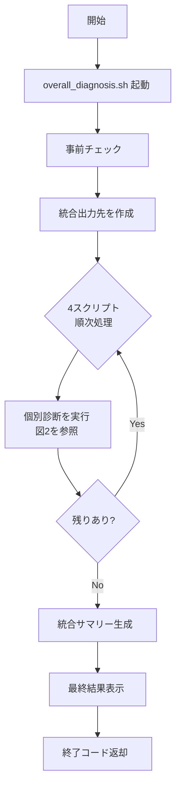
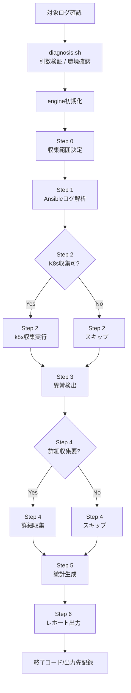

# diagnosis/README.md

## 概要

本ディレクトリは、DHRC (Dynamic Hardware Resource Control) 構築自動化の診断ツールです。4つの自動化スクリプト（`manager_cluster_setup`, `manager_software_deploy`, `tenant_provisioning`, `tenant_deploy`）の実行後に使用し、構築状態を自動診断します。

**主な機能:**
- Ansibleログの自動解析によるデプロイ状況の把握
- Kubernetesクラスタリソース状態の収集と検証
- 異常検出（Pod障害、ノード問題、リソース不足等）
- 問題が検出された場合の詳細情報自動収集（ログ、describe、イベント）
- ユーザ向けMarkdown形式でのレポート生成

**本診断ツールの位置づけ:**

本診断ツールは、以下のように使用されることを想定しています:

```
1. 自動化スクリプト実行（例: manager_cluster_setup.sh）
   ↓
2. 診断ツール実行（diagnosis.sh）
   ↓
   診断結果markdown生成
```

---

## 使用の前提条件

### 必須要件

1. **Python 3.8以上** がインストールされていること
   ```bash
   python3 --version
   ```

2. **Ansible** がインストールされていること
   ```bash
   ansible --version
   ```
   診断ツールは自動化スクリプトのAnsible設定（inventory、vault）を再利用してKubernetesクラスタにアクセスします。

3. **Python依存パッケージ** がインストール可能であること
   - PyYAML
   - Jinja2

4. **自動化スクリプトのログディレクトリへのアクセス権限**
   - `ansible/logs/` ディレクトリの読み取り権限

5. **Ansible inventoryファイルへのアクセス**
   - 自動化スクリプトのAnsible設定（`ansible/inventory/hosts`、`.vault_pass`）

**注意**: kubectl コマンドはリモートホスト（コントロールプレーンノード）上で実行されるため、診断ツール実行環境へのインストールは不要です。

---

## ソース構成

```
support_tools/diagnosis/
├── README.md                     # 本ドキュメント
├── diagnosis.sh                  # メイン実行スクリプト（Bashエントリーポイント）
├── overall_diagnosis.sh          # 一括診断実行スクリプト（4つの自動化スクリプトを順次診断）
├── ansible.cfg                   # 診断ツール専用のAnsible設定
├── common/                       # 共通ライブラリ
│   └── diagnosis_common.sh       # 共通ライブラリ（終了コード定数、ログ関数、デフォルト設定）
├── python/                       # Pythonモジュール
│   ├── diagnosis_engine.py       # 診断エンジン本体（メインロジック）
│   ├── log_parser.py             # Ansibleログ解析モジュール
│   ├── k8s_collector.py          # Kubernetesリソース収集モジュール
│   ├── anomaly_detector.py       # 異常検出ロジック
│   ├── detailed_collector.py     # Podログ/describe詳細収集
│   ├── markdown_reporter.py      # Markdown要約レポート生成
│   ├── error_formatter.py        # エラーメッセージフォーマッタ
│   ├── exceptions.py             # カスタム例外定義
│   ├── requirements.txt          # Python依存関係定義
│   └── config/                   # 設定ファイル
│       ├── config.yaml           # カスタマイズ設定（Pod再起動閾値、異常深刻度、ログレベル等）
│       └── resource_mappings.yaml # スクリプト別リソース定義
├── playbooks/                    # Ansible Playbookテンプレート
│   └── k8s_collector.yaml.j2     # Kubernetes情報収集Playbook（Jinja2テンプレート）
└── diagnosis_reports/            # 診断結果出力ディレクトリ（自動生成）
    └── YYYYMMDD_HHMMSS_<script_name>/
        ├── summary.md            # 要約レポート（Markdown形式）
        └── diagnosis_console.log # 診断実行時のコンソール出力
```

### 各ファイルの説明

| ファイル名 | 説明 |
|-----------|------|
| `diagnosis.sh` | Bashスクリプト。引数検証、Python環境チェック、診断エンジン呼び出しを行う。 |
| `overall_diagnosis.sh` | 4つの自動化スクリプトの診断を一括実行。統合サマリーレポートを生成。 |
| `ansible.cfg` | 診断ツール専用のAnsible設定。 |
| `common/diagnosis_common.sh` | diagnosis.sh / overall_diagnosis.sh から source される共通ライブラリ。終了コード定数、ログ関数、デフォルト設定を提供。 |
| `python/config/config.yaml` | カスタマイズ設定ファイル。Pod再起動閾値、異常深刻度、詳細情報収集の制御、ログレベル等を定義。 |
| `python/config/resource_mappings.yaml` | スクリプトごとにチェックすべきKubernetesリソース（Pod/Deployment等）を定義。 |
| `python/diagnosis_engine.py` | Pythonメインロジック。各モジュールを統合して診断全体を制御。 |
| `python/log_parser.py` | custom_logger.py形式のAnsibleログを解析し、実行タスク・エラー・デプロイリソースを抽出。 |
| `python/k8s_collector.py` | SSH+kubectl経由でKubernetesリソース状態（Node/Pod/Namespace等）を収集。外部Playbookテンプレートを使用して1回の実行で全リソースを取得。 |
| `python/anomaly_detector.py` | 収集したリソース状態から異常（NotReady, CrashLoopBackOff等）を検出。 |
| `python/detailed_collector.py` | 異常が検出されたPodのログ、describe、イベント情報を自動収集。 |
| `python/markdown_reporter.py` | ユーザが読みやすいMarkdown形式の要約レポートを生成。絵文字とMarkdown記法を活用した視覚的なレポート。 |
| `python/error_formatter.py` | 診断ツール内部のエラーメッセージを読みやすくフォーマット。 |
| `python/exceptions.py` | 診断ツール用のカスタム例外クラス定義。 |
| `playbooks/k8s_collector.yaml.j2` | Kubernetes情報収集用のAnsible PlaybookテンプレートファイルであるJinja2形式。Python側からnamespaceリストを受け取り、動的にPlaybookを生成。 |

### スクリプトフロー

診断ツールは2つの実行モードがあります：個別診断（`diagnosis.sh`）と一括診断（`overall_diagnosis.sh`）です。以下のフローは、一括診断の中で個別診断がどのように実行されるかを統合的に示しています。


**図1: 一括診断フロー（全体）**



**図2: 個別診断フロー（Step 0-6）**



**図2の補足（詳細情報）**

- `Step 2 (k8s収集実行)`:
  - `k8s_collector.py` が Jinja2 テンプレートをレンダリングし、Ansible Playbook を実行して Nodes/Namespaces/Pods を収集
  - リモート一時保存先: `/tmp/k8s_diagnosis/`
  - 保存物: `{kind}_{namespace}_{index}.json`, `{kind}_wide.txt`, `errors.log`, `.complete`
  - エラー時: `ansible_error.log`
- `Step 4 (詳細収集)`:
  - `detailed_collector.py` が `resources/` に詳細情報を保存
  - 保存物: `{namespace}_{podname}_logs.txt`（最大100行）, `{namespace}_{podname}_describe.txt`, `{namespace}_{podname}_events.txt`
  - 収集条件（`python/config/config.yaml`）:
    - `pod_restart_threshold: 50`
    - `collect_details_for_critical: true`
    - `collect_details_for_warnings: true`
  - エラー時: `ansible_error.log`
- `Step 6 (レポート出力)`:
  - `summary.md`（Markdownサマリー）
  - `diagnosis_console.log`（診断実行ログ）
- 一括診断側の最終判定:
  - 優先順位 `2 > 3 > 1 > 0`
  - いずれかの診断がエラーでも全診断は続行

**フローの説明:**

**個別実行の場合（`./diagnosis.sh`）:**

単一の自動化スクリプトに対して、上記フロー図の「診断実行ループ」内の個別診断フロー（Step 0〜6）を1回だけ実行します：

1. **diagnosis.sh (エントリーポイント)**: 引数検証、Python環境チェック、ログディレクトリ自動検出
2. **diagnosis_engine.py 起動**: 前提条件バリデーション、python/config/resource_mappings.yaml 読み込み、各モジュール初期化
3. **Step 0 - 収集範囲決定**: 対象スクリプトの収集範囲（Namespace、依存関係、cluster_type）を決定
4. **Step 1 - Ansibleログ解析**: `log_parser.py` がログを解析し、実行タスク・エラー・デプロイリソースを抽出
5. **Step 2 - Kubernetesリソース収集** (条件付き): `k8s_collector.py` が Ansible Playbook を動的生成し、リソース状態を収集
6. **Step 3 - 異常検出**: `anomaly_detector.py` が異常（Pod障害、ノード問題等）を検出
7. **Step 4 - 詳細情報収集** (条件付き): 異常検出時のみ、`detailed_collector.py` が詳細情報を自動収集
8. **Step 5 - 統計情報生成**: severity別、resource_type別の集計を実行
9. **Step 6 - 結果出力**: `markdown_reporter.py` がレポート（`summary.md`）を生成

**一括実行の場合（`./overall_diagnosis.sh`）:**

上記フロー図の通り、以下の順序で実行されます：

1. **overall_diagnosis.sh 起動**: 共通ライブラリ読み込み、引数解析、環境変数設定
2. **事前チェック**: `diagnosis.sh` の存在確認と、4つのスクリプトディレクトリ・ログディレクトリの確認
3. **統合レポートディレクトリ作成**: `diagnosis_reports/YYYYMMDD_HHMMSS_overall/` を作成
4. **診断実行ループ**: 4つのスクリプト（manager_cluster_setup → manager_software_deploy → tenant_provisioning → tenant_deploy）に対して順次、上記の個別診断フロー（Step 0〜6）を実行
   - 各スクリプトごとに `diagnosis.sh` を呼び出し
   - 終了コード・レポートパス・ログディレクトリを記録
   - いずれかの診断がエラーでも全診断を続行
5. **統合サマリーレポート生成**: 全体ステータスを決定し、統合レポート（`overall_summary.md`）を生成
6. **最終結果表示**: 各スクリプトの診断結果サマリーと全体ステータスを表示

**条件分岐について:**

- **Step 2 (Kubernetes収集)**: k8s_collector が有効な場合のみ実行（Ansible設定が利用可能か確認）
- **Step 4 (詳細情報収集)**: 異常検出時（`needs_detailed_collection` フラグが立っている場合）のみ実行

**全体終了コードの決定ロジック:**

- 終了コードの優先順位: **2 (重大な問題) > 3 (警告) > 1 (ツールエラー) > 0 (成功)**
- いずれかのスクリプトで終了コード2が返された場合、全体終了コードは2
- 全てのスクリプトが終了コード0または3の場合で、いずれかが3なら全体終了コードは3
- 全てのスクリプトが終了コード0なら全体終了コードは0

---

### 出力ディレクトリ構造

**個別診断（`./diagnosis.sh`）の出力構造:**

```
diagnosis_reports/YYYYMMDD_HHMMSS_<script_name>/
├── summary.md                                 # Markdown形式のサマリーレポート
├── diagnosis_console.log                      # 診断実行時のコンソール出力ログ
└── resources/                                 # 詳細情報ディレクトリ（異常検出時のみ作成）
    ├── {namespace}_{podname}_logs.txt         # Podコンテナログ（最大100行）
    ├── {namespace}_{podname}_describe.txt     # kubectl describe pod 出力
    └── {namespace}_{podname}_events.txt       # kubectl get events 出力（Pod関連）

# エラー発生時の追加ファイル
# ├── ansible_error.log                        # Ansible実行エラー時のログ
```

**注:**
- `resources/` ディレクトリは、異常検出時（Pod障害、CrashLoopBackOff等）のみ作成されます
- 収集条件は `python/config/config.yaml` で設定可能（`collect_details_for_warnings`, `pod_restart_threshold` 等）
- リモートホスト（コントロールプレーンノード）上には、一時的に `/tmp/k8s_diagnosis/` ディレクトリが作成され、リソースJSON、wide出力、エラーログが保存されます

**一括診断（`./overall_diagnosis.sh`）の出力構造:**

```
diagnosis_reports/
├── YYYYMMDD_HHMMSS_overall/                   # 統合レポートディレクトリ
│   ├── overall_summary.md                     # 統合サマリーレポート（全体ステータス、各診断結果一覧）
│   └── overall_console.log                    # 一括診断実行時のコンソール出力ログ
│
├── YYYYMMDD_HHMMSS_manager_cluster_setup/     # 個別診断レポート 1/4
│   ├── summary.md
│   ├── diagnosis_console.log
│   └── resources/                             # 異常検出時のみ
│       ├── {namespace}_{podname}_logs.txt
│       ├── {namespace}_{podname}_describe.txt
│       └── {namespace}_{podname}_events.txt
│
├── YYYYMMDD_HHMMSS_manager_software_deploy/   # 個別診断レポート 2/4
│   ├── summary.md
│   ├── diagnosis_console.log
│   └── resources/                             # 異常検出時のみ
│       └── ...
│
├── YYYYMMDD_HHMMSS_tenant_provisioning/       # 個別診断レポート 3/4
│   ├── summary.md
│   ├── diagnosis_console.log
│   └── resources/                             # 異常検出時のみ
│       └── ...
│
└── YYYYMMDD_HHMMSS_tenant_deploy/             # 個別診断レポート 4/4
    ├── summary.md
    ├── diagnosis_console.log
    └── resources/                             # 異常検出時のみ
        └── ...
```

**注:**
- `overall_summary.md` には全診断の統合結果（全体ステータス、各スクリプトの診断結果一覧表、推奨アクション）が記載されます
- 各個別診断レポートは独立したディレクトリに格納されます
- いずれかの診断がエラーでも全診断を続行し、すべての結果が出力されます

---

## 使用前準備

### 1. Python依存関係のインストール

初回のみ、必要なPythonパッケージをインストールします:

```bash
cd support_tools/diagnosis
pip install -r python/requirements.txt
```

または、仮想環境を使用する場合:

```bash
python3 -m venv venv
source venv/bin/activate
pip install -r python/requirements.txt
```

---

## 使用方法

### 1a. 単体実行

診断ツールを個別に実行する場合:

```bash
./diagnosis.sh <SCRIPT_NAME> [OPTIONS]
```

**引数:**
- `SCRIPT_NAME`: 自動化スクリプト名（必須）
  - 例: `manager_cluster_setup`, `manager_software_deploy`, `tenant_provisioning`, `tenant_deploy`

**オプション:**
- `--script-root PATH`: 自動化スクリプトの親ディレクトリパス（デフォルト: `../../`）
  - 指定されたパスの下に `<SCRIPT_NAME>/` ディレクトリが存在する必要があります
  - 実際のスクリプトパスは `${SCRIPT_ROOT}/${SCRIPT_NAME}` として構築されます
- `--log-dir-name NAME`: 診断対象のログディレクトリ名（またはタイムスタンプ部分）
  - 完全なディレクトリ名（例: `20260408_120000_manager_cluster_setup`）または一部（例: `20260408_120000`）で指定可能
  - 省略時は最新ログを自動選択（`YYYYMMDD_HHMMSS_${SCRIPT_NAME}` パターンで検索）
- `--output-dir DIR`: 診断結果の出力先ディレクトリ（デフォルト: `./diagnosis_reports`）
- `--help`, `-h`: ヘルプメッセージを表示

**自動推測される項目:**
- スクリプトパス: `${SCRIPT_ROOT}/${SCRIPT_NAME}`
- Inventory: `${SCRIPT_ROOT}/${SCRIPT_NAME}/ansible/inventory/hosts`
- ログディレクトリ: `${SCRIPT_ROOT}/${SCRIPT_NAME}/ansible/logs/` 内の最新ディレクトリ（または`--log-dir-name`で指定されたディレクトリ）
- Vault設定: `${SCRIPT_ROOT}/${SCRIPT_NAME}/ansible/.vault_pass`（存在する場合）

**実行例:**

```bash
# 最新ログを自動選択して診断（最もシンプル）
./diagnosis.sh manager_cluster_setup

# 別のスクリプトの診断
./diagnosis.sh manager_software_deploy

# 特定のログディレクトリを指定して診断（タイムスタンプ部分で指定）
./diagnosis.sh manager_cluster_setup --log-dir-name 20260408_120000

# ログディレクトリ名の一部で指定（部分一致で検索）
./diagnosis.sh manager_software_deploy --log-dir-name 20260319_144956_manager_software_deploy_test

# カスタム出力ディレクトリを指定
./diagnosis.sh tenant_provisioning --output-dir /tmp/diagnosis_output

# 親ディレクトリを明示的に指定
./diagnosis.sh manager_cluster_setup --script-root /path/to/scripts

# デバッグモードで実行
DIAGNOSIS_LOG_LEVEL=DEBUG ./diagnosis.sh manager_cluster_setup

# ヘルプを表示
./diagnosis.sh --help
```

### 1b. 一括実行（4つの自動化スクリプト全体の診断）

4つのDCI自動化スクリプト（`manager_cluster_setup`, `manager_software_deploy`, `tenant_provisioning`, `tenant_deploy`）の実行結果に対して、診断ツールを一括実行する場合:

```bash
./overall_diagnosis.sh [OPTIONS]
```

**オプション:**
- `--script-root PATH`: 自動化スクリプトの親ディレクトリパス（デフォルト: `../../`）
- `--output-dir DIR`: 統合レポートの出力先ディレクトリ（デフォルト: `./diagnosis_reports`）
- `--help`, `-h`: ヘルプメッセージを表示

**環境変数:**
- `DIAGNOSIS_LOG_LEVEL`: 各診断ツールのログレベル（DEBUG|INFO|WARNING|ERROR、デフォルト: INFO）
- `DIAGNOSIS_TIMEOUT`: 各診断ツールの処理タイムアウト（秒、デフォルト: 600）

**実行例:**

```bash
# 基本的な使用方法（最新ログを自動選択、デフォルトパス使用）
./overall_diagnosis.sh

# 親ディレクトリを明示的に指定
./overall_diagnosis.sh --script-root /path/to/scripts

# 出力ディレクトリを指定
./overall_diagnosis.sh --output-dir /tmp/diagnosis_output

# デバッグモードで実行
DIAGNOSIS_LOG_LEVEL=DEBUG ./overall_diagnosis.sh

# ヘルプを表示
./overall_diagnosis.sh --help
```

**統合サマリーレポートの確認:**

```bash
cat diagnosis_reports/*_overall/overall_summary.md
```

統合サマリーレポートには以下の情報が含まれます：
- 全体ステータス（全成功/一部警告/一部エラー）
- 各スクリプトの診断結果一覧（ステータス、終了コード、レポートリンク）
- 推奨アクション
- 関連ドキュメントへのリンク

**使用シーン:**
- 4つの自動化スクリプトを全て実行した後の全体診断
- 定期的なシステムヘルスチェック
- トラブルシューティング時の全体状況把握

### 3. 出力ファイルの確認

診断完了後、以下のファイルが生成されます:

```
diagnosis_reports/20260408_153045_manager_cluster_setup/
├── summary.md              # 要約レポート（Markdown形式、視覚的な絵文字付き）
├── diagnosis_console.log   # 診断実行時のコンソールログ（全出力）
└── resources/              # 詳細情報（異常検出時のみ生成）
    └── ...
```

**注:** 完全な出力ディレクトリ構造（個別診断・一括診断）については、「[出力ディレクトリ構造](#出力ディレクトリ構造)」セクションを参照してください。

**summary.mdの確認:**

```bash
cat diagnosis_reports/*/summary.md
```

**summary.mdに含まれる情報:**
- **♦ サマリー**: 総合ステータス、検出された問題件数（絵文字付き）、参照したログ、合計稼働時間
- **検出された問題**: 深刻度別に分類（ログエラー、ログ警告、リソース重大問題、リソース警告）
  - 0件の場合でもセクションを表示（問題がないことを明確化）
  - エラーは最大20件まで表示（それ以上は「... 他 N件」と省略）
  - Ansibleタスク失敗時はホスト名、エラーメッセージ、STDERR（折りたたみ可能）を含む詳細情報を表示
- **リソース状態**: Kubernetes リソースの状態詳細（収集された場合）
- **参照したログ**: ログディレクトリ、ログファイル一覧、各Playbook稼働時間

**diagnosis_console.logの確認:**

診断ツール実行時のすべてのコンソール出力（Pythonスクリプトの標準出力・標準エラー出力）が記録されています。
トラブルシューティング時や、詳細な診断プロセスの確認に利用できます。

```bash
cat diagnosis_reports/*/diagnosis_console.log
```

---

## 備考

### 診断ツールの動作について

- **終了コードとその意味:**
  
  診断ツールは問題の深刻度に応じて以下の終了コードを返します:
  
  | 終了コード | 状態 | 診断ツールの状態 | リソース状態 | 説明 |
  |-----------|------|----------------|-------------|------|
  | `0` | 正常完了 | 正常 | 問題なし | 診断処理が正常に完了し、リソース状態に問題なし |
  | `1` | ツールエラー | エラー | 不明 | 診断ツール自体のエラー（前提条件不足、接続失敗等） |
  | `2` | 重大な問題検出 | 正常 | Critical問題あり | リソース状態にCritical問題を検出（Pod障害、ノードNotReady等） |
  | `3` | 警告検出 | 正常 | Warning問題あり | リソース状態にWarning問題を検出（高再起動回数、PodNotReady等） |

- **診断ツールの動作方針:**
  
  診断ツールは診断処理が正常に完了すれば、終了コード 0/2/3 のいずれかを返します。これらの終了コードはリソース状態の深刻度を表し、CI/CDパイプラインでの判断材料として利用できます。
  
  - **終了コード 0**: リソース状態に問題なし → デプロイ処理を継続可能
  - **終了コード 2 (Critical)**: 重大な問題を検出 → デプロイ処理の停止を検討
  - **終了コード 3 (Warning)**: 警告を検出 → 注意して継続可能
  
  診断ツール自身のエラー（Ansible接続失敗、テンプレート読み込み失敗等）のみが終了コード 1 を返します。

- **Ansible実行エラー時:** Kubernetes クラスタへのAnsible経由での接続に失敗した場合、Kubernetesリソースチェックはスキップされ、Ansibleログ解析のみが実行されます。

- **効率化実装:** Kubernetesリソース収集は、Ansible Playbookを動的生成して1回の実行で全リソースを取得します。

### 出力形式について

- **Markdown要約（summary.md）:** 人間が読みやすい形式で、問題の概要を素早く把握できます。絵文字とMarkdown記法を活用した視覚的なレポート形式です。GitHub IssueやPull Requestのコメントとして使用できます。

### カスタマイズ方法

#### リソースマッピングの編集

診断対象のKubernetesリソースをカスタマイズするには、`python/config/resource_mappings.yaml`を編集します。このファイルはスクリプトごとにチェックすべきリソース（Pod/Deployment/ConfigMap等）を定義します。

全てのリソース（Pod/Node/Namespace/ConfigMap/Secret/CRD等）は`generic_resources`セクションで統一的に定義します。

**基本フォーマット:**

```yaml
manager_software_deploy:
  description: "説明文"
  
  check_scope:
    cluster_type: "manager" or "tenant"
    namespaces:
      - namespace1
      - namespace2
    include_dependencies: true/false
    collect_all_pods: true/false  # 全Pod自動チェック機能（オプション）
  
  generic_resources:
    - kind: "リソースタイプ"
      namespace: "対象namespace（省略可）"
      namespaced: true/false
      name_pattern: "正規表現パターン"
      expected_status: "期待されるステータス（Podのみ）"
      expected_exists: true/false
      expected_conditions: [...] # Nodeのみ
      api_version: "APIバージョン（CRD等）"
      description: "説明文"
```

**check_scope設定:**

| 項目 | 説明 | デフォルト | 例 |
|------|------|-----------|-----|
| `cluster_type` | 対象クラスタタイプ | `manager` | `manager`, `tenant` |
| `namespaces` | 監視対象namespace | `[]` | `[kube-system, harbor]` |
| `include_dependencies` | 依存スクリプトのリソースも含めるか | `false` | `true`, `false` |
| `collect_all_pods` | namespace内の全Podを自動チェック | `false` | `true`, `false` |

**collect_all_pods 機能:**

`collect_all_pods: true` に設定すると、`check_scope.namespaces` で指定された全namespaceの全Podを自動的に収集し、異常状態（CrashLoopBackOff, Failed, ImagePullBackOff, Pending等）を検出します。

- generic_resources で個別定義されたPodとは独立して動作し、併用可能
- 詳細ログ収集（logs/describe/events）は config.yaml の `collect_details_for_warnings`/`collect_details_for_critical` 設定に従う
- 個別定義されたPod（name_pattern 指定）は expected_status 等の詳細チェックを実施
- collect_all_pods で収集したPodは基本的な異常状態チェックのみ実施

**使用例:**

```yaml
tenant_deploy:
  check_scope:
    namespaces:
      - kube-system
      - harbor
      - argo-events
      - loki
    collect_all_pods: true  # これらのnamespace内の全Podをチェック
  
  generic_resources:
    # 個別定義（詳細チェック）
    - kind: "Pod"
      namespace: "harbor"
      name_pattern: "^harbor-core-"
      expected_status: "Running"
    
    # collect_all_pods により、上記以外のすべてのPodも自動チェックされる
```

**設定可能な項目:**

| 項目 | 説明 | 必須 | 適用対象 | 例 |
|------|------|------|---------|-----|
| `kind` | リソースタイプ | ✅ | 全て | `Pod`, `Node`, `ConfigMap`, `Secret`, `CustomResourceDefinition` |
| `namespaced` | namespace対象か | ✅ | 全て | `true` (Pod, ConfigMap等), `false` (Node, CRD等) |
| `namespace` | 対象namespace | | namespaced=true | `kube-system`, `harbor` |
| `name_pattern` | リソース名の正規表現 | | 全て | `^coredns-`, `^harbor-.*-secret$` |
| `expected_status` | 期待されるステータス | | Pod, PVC | `Running`, `Succeeded`, `Bound` |
| `expected_exists` | 存在を期待するか | | 全て | `true`, `false` |
| `expected_conditions` | 期待される条件 | | Node | `[{condition: "Ready", status: "True"}]` |
| `api_version` | APIバージョン | | CRD/CR | `cluster.x-k8s.io/v1beta1` |
| `description` | 説明文 | | 全て | `CoreDNS pods` |

**使用例:**

```yaml
generic_resources:
  # ノード
  - kind: "Node"
    namespaced: false
    expected_conditions:
      - condition: "Ready"
        status: "True"
    description: "Cluster nodes"
  
  # Pod
  - kind: "Pod"
    namespace: "kube-system"
    namespaced: true
    name_pattern: "^coredns-"
    expected_status: "Running"
    description: "CoreDNS pods"
  
  # ConfigMap
  - kind: "ConfigMap"
    namespace: "kube-system"
    namespaced: true
    name_pattern: "^kube-proxy$"
    expected_exists: true
    description: "kube-proxy configuration"
  
  # Secret
  - kind: "Secret"
    namespace: "harbor"
    namespaced: true
    name_pattern: "^harbor-core$"
    expected_exists: true
    description: "Harbor core secret"
  
  # CRD（クラスタスコープ）
  - kind: "CustomResourceDefinition"
    namespaced: false
    name_pattern: "^certificates\\.cert-manager\\.io$"
    expected_exists: true
    description: "cert-manager Certificate CRD"
  
  # カスタムリソース（CRインスタンス）
  - kind: "Cluster"
    namespace: "tenant-a"
    namespaced: true
    api_version: "cluster.x-k8s.io/v1beta1"
    name_pattern: ".*"
    expected_exists: true
    description: "Tenant cluster instance"
  
  # PVC
  - kind: "PersistentVolumeClaim"
    namespace: "harbor"
    namespaced: true
    name_pattern: ".*"
    expected_exists: true
    description: "Harbor persistent storage"
  
  # Namespace
  - kind: "Namespace"
    namespaced: false
    name_pattern: "^(kube-system|default)$"
    expected_exists: true
    description: "System namespaces"
```

**異常検出ロジック:**

診断ツールは以下のルールで異常を検出します:

1. **期待値との不一致 = critical**
   - `expected_status`と実際のステータスが異なる
   - `expected_exists: true`だがリソースが存在しない
   - `expected_conditions`と実際のNode条件が異なる
   
2. **既知の異常状態 = critical/warning**
   - Pod: `CrashLoopBackOff`, `Failed`, `ImagePullBackOff` → critical
   - Pod: `Pending` → warning
   - Node: `NotReady` → critical
   - Node: `MemoryPressure`, `DiskPressure`, `PIDPressure` → warning

3. **Pod再起動回数チェック = warning**
   - 閾値（デフォルト50回）を超えた再起動 → warning
   - `config.yaml`で制御可能

**注意事項:**

- `name_pattern`は正規表現です。完全一致の場合は`^name$`、前方一致は`^prefix-`とします
- クラスタスコープリソース（Node, CRD等）は`namespace`を省略し、`namespaced: false`を指定
- namespace対象リソース（Pod, ConfigMap等）は`namespaced: true`とし、`namespace`を指定（`--all-namespaces`で収集する場合は省略可）

#### カスタマイズ設定ファイル（config.yaml）

診断ツールの動作設定をカスタマイズするには、`python/config/config.yaml`を編集します。このファイルでPod再起動閾値、異常深刻度、ログレベル、タイムアウト等を制御できます。

**主な設定項目:**

1. **Pod再起動回数の警告閾値** (`pod_restart_threshold`)
   
   Podの再起動回数がこの値を超えると警告として検出されます。
   
   ```yaml
   # 推奨値: Kubernetes control planeコンポーネント（kube-vip等）の再起動が多い環境では50〜100程度に設定することで正常な再起動を許容できます
   # デフォルト: 50
   pod_restart_threshold: 50
   ```

2. **詳細情報収集の制御**
   
   異常検出時に、Podログやdescribe情報を自動収集するかを制御します。
   
   ```yaml
   # warningレベルで詳細情報を収集するか
   # デフォルト: true（収集する）
   collect_details_for_warnings: true
   
   # criticalレベルで詳細情報を収集するか
   # デフォルト: true（収集する）
   collect_details_for_critical: true
   ```

3. **異常の深刻度設定**
   
   特定の異常パターンを warning / critical / info / ignore として扱うかを設定します。
   
   ```yaml
   # 選択肢: warning / critical
   # - warning: Podが起動中だがコンテナがReadyでない状態を警告として扱う
   # - critical: PodNotReadyを重大な問題として扱う
   # デフォルト: warning
   pod_not_ready_severity: warning

   # 選択肢: warning / info / ignore
   # - warning: 閾値を超えた再起動を警告として扱う（推奨）
   # - info: 情報レベルとして記録するが警告としては扱わない
   # - ignore: 再起動回数のチェックを完全に無効化
   # デフォルト: warning
   high_restart_severity: warning
   ```

4. **Ansibleログエラー検出設定** (`ansible_log_error_detection`)
   
   Ansibleログから自動的にエラーや警告を検出するパターンを定義します。
   
   ```yaml
   ansible_log_error_detection:
     # 重大エラーとして検出するパターン（正規表現）
     critical_patterns:
       - "STATUS: FAILED"  # Ansibleタスク失敗
     
     # 警告として検出するパターン（正規表現）
     warning_patterns:
       - "ERROR:"          # 一般的なエラーメッセージ
       - "WARNING:"        # 警告メッセージ
       - "FAILED!"         # Ansible失敗インジケーター
       - "deprecated"      # 非推奨機能の使用
     
     # STDERR内容のエラー検出設定
     stderr_error_detection:
       enabled: false  # STDERR内のパターンを重大エラーとして検出するか
       patterns:
         - "Error:"
         - "ERROR:"
     
     # エラー情報にSTDERR全文を含めるか
     include_stderr_in_errors: true
   ```
   
   この設定により、診断ツールは指定されたパターンに基づいてログ内のエラーや警告を自動的に検出し、summary.mdに含めます。

### 環境変数設定

診断ツールの実行時動作は環境変数でカスタマイズできます。これらの環境変数は `common/diagnosis_common.sh` でデフォルト値が定義されており、実行時に上書き可能です。

**利用可能な環境変数:**

| 環境変数 | 説明 | デフォルト値 |
|---------|------|-------------|
| `DIAGNOSIS_LOG_LEVEL` | ログレベル（DEBUG/INFO/WARNING/ERROR） | `INFO` |
| `DIAGNOSIS_TIMEOUT` | 診断処理全体のタイムアウト時間（秒） | `900` |
| `K8S_COLLECTOR_TIMEOUT` | Kubernetes情報収集Playbookのタイムアウト（秒） | `600` |

**使用例:**

```bash
export DIAGNOSIS_LOG_LEVEL=DEBUG
export DIAGNOSIS_TIMEOUT=1000
export K8S_COLLECTOR_TIMEOUT=800
./diagnosis.sh ../manager_cluster_setup
```

### トラブルシューティング

**Q: Ansible実行に失敗する**  
A: 以下を確認してください：
  - `ansible`コマンドがインストールされているか
  - inventoryファイル（`${SCRIPT_ROOT}/ansible/inventory/hosts`）が存在するか
  - Ansibleで対象ホストに接続できるか（SSH設定、認証情報等）
  - Vaultパスワードファイル（`.vault_pass`）が正しいか

**Q: Podログが取得できない**  
A: 対象Podが存在しない、または既に削除されている可能性があります。summary.mdで確認してください。

**Q: 診断結果が空になる**  
A: ログディレクトリのパスが正しいか確認してください。ログファイルは `.log` 拡張子である必要があります。

### セキュリティ上の注意

- 診断ツールは自動化スクリプトのAnsible設定（SSH鍵、Vaultパスワード等）を再利用するため、これらのファイルのセキュリティ管理に注意してください
- SSH秘密鍵ファイルのパーミッションは `600` に設定してください
- Vaultパスワードファイル（`.vault_pass`）のパーミッションも適切に設定してください
- 診断結果（特にPodログ）には機密情報が含まれる可能性があるため、取り扱いに注意してください

---

## 関連ドキュメント

- [manager_cluster_setup/README.md](../../manager_cluster_setup/README.md) - DCI管理用クラスタの構築
- [manager_software_deploy/README.md](../../manager_software_deploy/README.md) - DCI管理用クラスタへのソフトウェア構成品配備
- [tenant_provisioning/README.md](../../tenant_provisioning/README.md) - DCIテナント論理インフラの構築
- [tenant_deploy/README.md](../../tenant_deploy/README.md) - DCIテナント論理インフラへのソフトウェア構成品配備とアクセス設定

---

## ライセンスと著作権

本診断ツールは、DCI自動化スクリプト群と同じライセンスおよび著作権が適用されます。詳細は各ディレクトリのNOTICEファイルを参照してください。
